在技术美术一般的工作环境中，HDRI贴图作为非常常见的全局光照源，一方面可以提供物理准确的环境光和反射，另一方面预烘焙静态环境的Cubemap有针对性地在材质中使用改变物体的环境光照信息。

同时一张独立的CubeMap也可以直接作为3D场景的天空背景，来营造不同的沉浸式空间。

但是HDRI的获取却在日常工作中比较受限，要么是引擎默认的那些HDRI，要么就要自己制作HDRI，比如通过HDR Light Studio等软件，虽然效果非常好，但总归过程有些繁琐，而且还有些门槛。

那接下来的这个方式可以将任何图片迅速转换为HDRI贴图进而迅速让我们的素材进入到开发的过程。

## 一、图片预处理

首先我们要做的第一件事情就是对图片做预处理，一般用来做HDRI的图片应该是连续的全景图，所以我们的图片就需要左右连续，但是一张图片一般左右都不会一样，所以需要在PS中进行左右连续的处理。

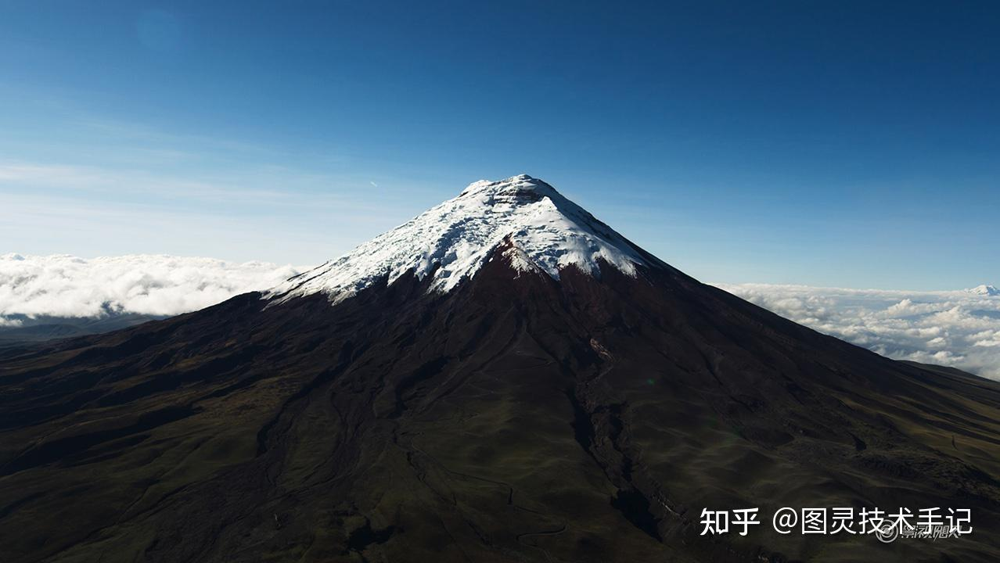

（PS的过程不是教程的重点，制作后的图片如下所示，这个做的比较粗糙，相信有大佬做的更舒服的）

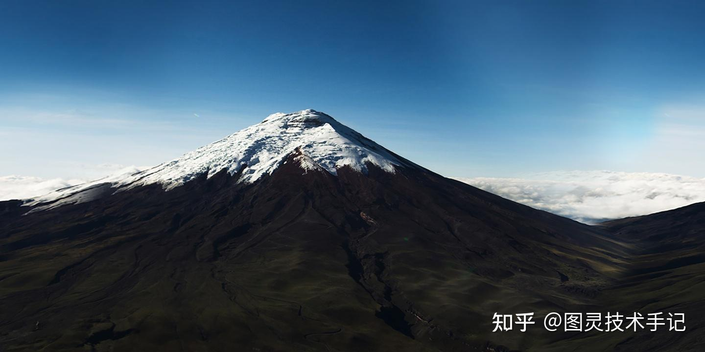

## 二、CubeMap生成方式一

有一个网站比较快捷，没有代码基础的小伙伴可以使用

打开网站直接将我们需要转为HDRI的图片上传，网站就会自动生成我们想要的结果

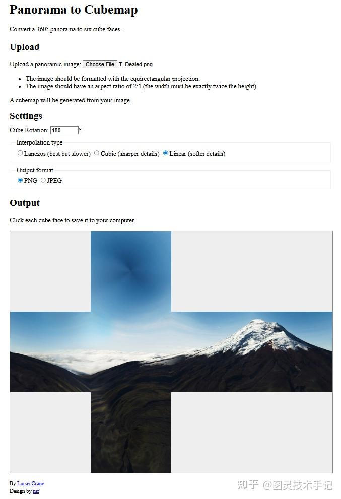

点击每个块面就可以单独将这个块面下载下来，就进一步得到了我们想要的原始素材

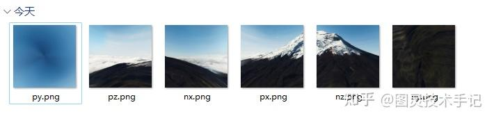

## 三、CubeMap生成方式二

有代码基础的同学可以在本地使用python来运行下面的代码

（中间有几次碰见上面网站下载的图片很奇怪，于是就自己刨了一下代码还原这个功能，毕竟还是自己写的东西每一步都可以掌控）

```cpp
import numpy as np
from PIL import Image, ImageOps
import os

def equirectangular_to_cubemap(image_path, output_dir, face_size=None):
    img = Image.open(image_path).convert("RGB")
    img_np = np.array(img)
    width, height = img.size

    if face_size is None:
        face_size = width // 4

    face_names = ["right", "left", "top", "bottom", "front", "back"]
    face_vectors = {
        "right":  lambda x, y: np.stack([np.ones_like(x), y, -x], axis=-1),
        "left":   lambda x, y: np.stack([-np.ones_like(x), y, x], axis=-1),
        "top":    lambda x, y: np.stack([x, np.ones_like(x), -y], axis=-1),
        "bottom": lambda x, y: np.stack([x, -np.ones_like(x), y], axis=-1),
        "front":  lambda x, y: np.stack([x, y, np.ones_like(x)], axis=-1),
        "back":   lambda x, y: np.stack([-x, y, -np.ones_like(x)], axis=-1),
    }

    def normalize(v):
        norm = np.linalg.norm(v, axis=-1, keepdims=True)
        return v / norm

    def dir_to_equi_uv(v):
        x, y, z = v[...,0], v[...,1], v[...,2]
        theta = np.arctan2(z, x)
        phi = np.arcsin(y)
        u = (theta + np.pi) / (2 * np.pi)
        v = (np.pi/2 - phi) / np.pi
        return u, v

    if not os.path.exists(output_dir):
        os.makedirs(output_dir)

    cubemap_faces = {}
    for face in face_names:
        u = np.linspace(-1, 1, face_size, endpoint=False) + 1 / face_size
        v = np.linspace(-1, 1, face_size, endpoint=False) + 1 / face_size
        xv, yv = np.meshgrid(u, v)
        dirs = face_vectors[face](xv, yv)
        dirs = normalize(dirs)
        uv_u, uv_v = dir_to_equi_uv(dirs)
        px = (uv_u * width).astype(np.int32) % width
        py = (uv_v * height).astype(np.int32) % height
        sampled = img_np[py, px]
        face_img = Image.fromarray(sampled)

        # 面贴图旋转方向调整
        if face == "top":
            face_img = ImageOps.mirror(face_img.rotate(180, expand=True))
        elif face == "bottom":
            face_img = ImageOps.mirror(face_img.rotate(180, expand=True))
        elif face == "left":
            face_img = ImageOps.mirror(face_img.rotate(180, expand=True))
        elif face == "right":
            face_img = ImageOps.mirror(face_img.rotate(180, expand=True))
        elif face == "back":
            face_img = ImageOps.mirror(face_img.rotate(180, expand=True))
        elif face == "front":
            face_img = ImageOps.mirror(face_img.rotate(180, expand=True))
        # front 不变

        face_path = os.path.join(output_dir, f"{face}.png")
        face_img.save(face_path)
        cubemap_faces[face] = face_img

    # 拼接整体图像：标准十字布局（接续连通）
    w, h = face_size, face_size
    layout = Image.new("RGB", (w * 4, h * 3), (127,127,127))
    layout.paste(cubemap_faces["top"],    (w, 0))
    layout.paste(cubemap_faces["left"],   (0, h))
    layout.paste(cubemap_faces["front"],  (w, h))
    layout.paste(cubemap_faces["right"],  (2*w, h))
    layout.paste(cubemap_faces["back"],   (3*w, h))
    layout.paste(cubemap_faces["bottom"], (w, 2*h))
    layout.save(os.path.join(output_dir, "cubemap_combined_fixed.png"))

if __name__ == "__main__":
    equirectangular_to_cubemap("T_Dealed.png", "./cubemap_output")

```

运行代码就得到了我们想要的结果以及我们可以看到也自动帮我们生成了各个块面的拆分图片

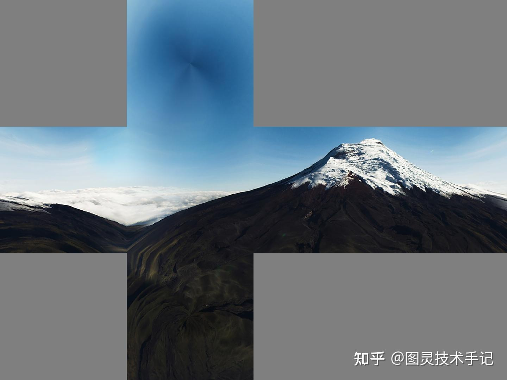

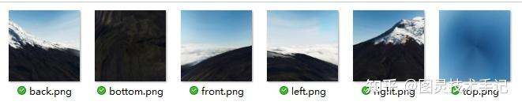

## 四、CubeMap的合成和导出

接下来我们使用Nvidia的Texture Tools Exporter这个软件来对图片进行合成

我们选择PS插件版进行安装（也可以插件版和Standalone的版本都安装）

打开PS新建一个画布，为了平铺我们的图片，务必保证宽高比为6:1

（我这里的格式为6144 * 1024）

在官方的教程中也向我们说明了这六张图片的排列顺序——右、左、上、下、前、后，这个顺序一定不能错

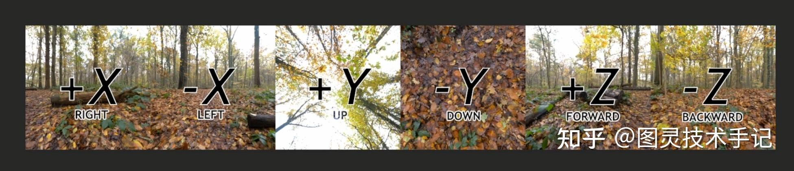

我们也如此排列得到的图片

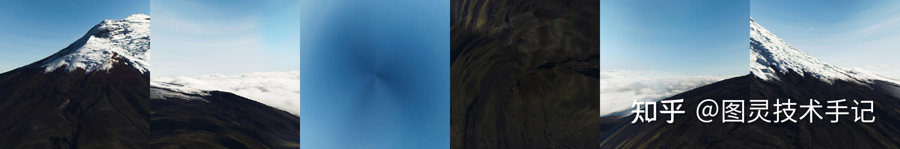

然后在PS中“存储为...”选择格式为.DDS就是Texture Tools Exporter的工程格式，会自动打开我们的界面

打开界面后在Texture Type中选择CubeMap，在Format中选择BC7的压缩格式，尽可能多地保留细节

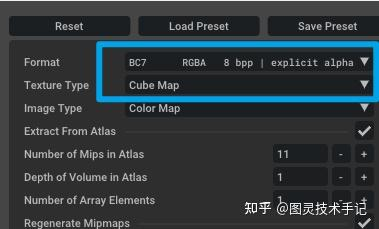

选择后我们可以得到如下图所示的预览界面就大功告成！

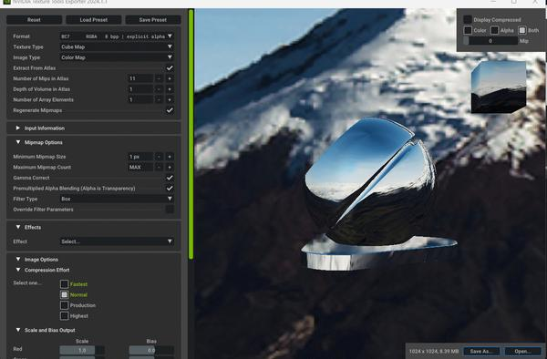

右下角选择"Save As..."，选择.hdr格式即可

## 五、CubeMap的使用

将图片导入UE，打开检查“Details”面板的信息

Max In-Game显示了三维尺寸并标明了CubeMap则说明我们的HDRI制作成功

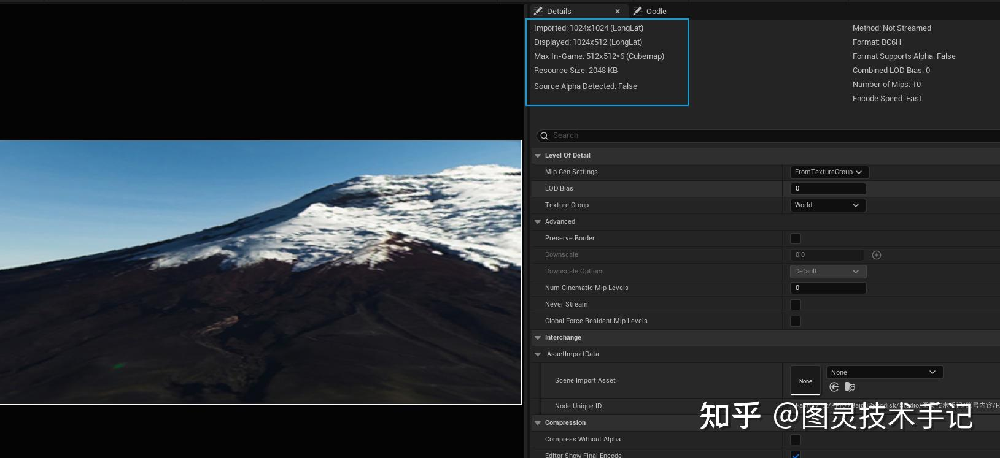

将图片通过反射向量进行采样，并配合Normal就可以得到我们自定义的反射效果了

（反射贴图的采样参考“重启 RestArt ProjectSH”中的相关章节）

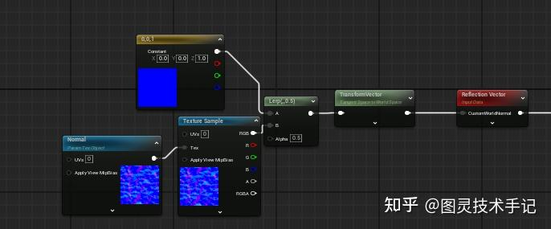

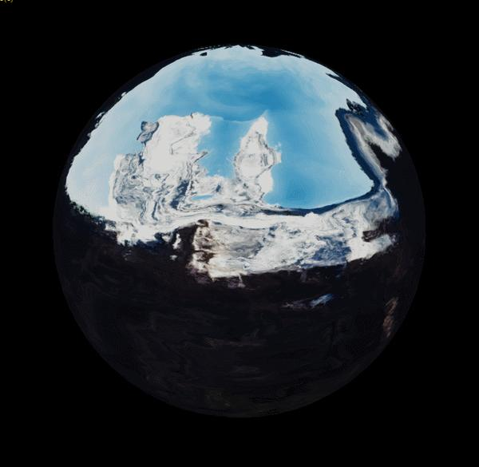


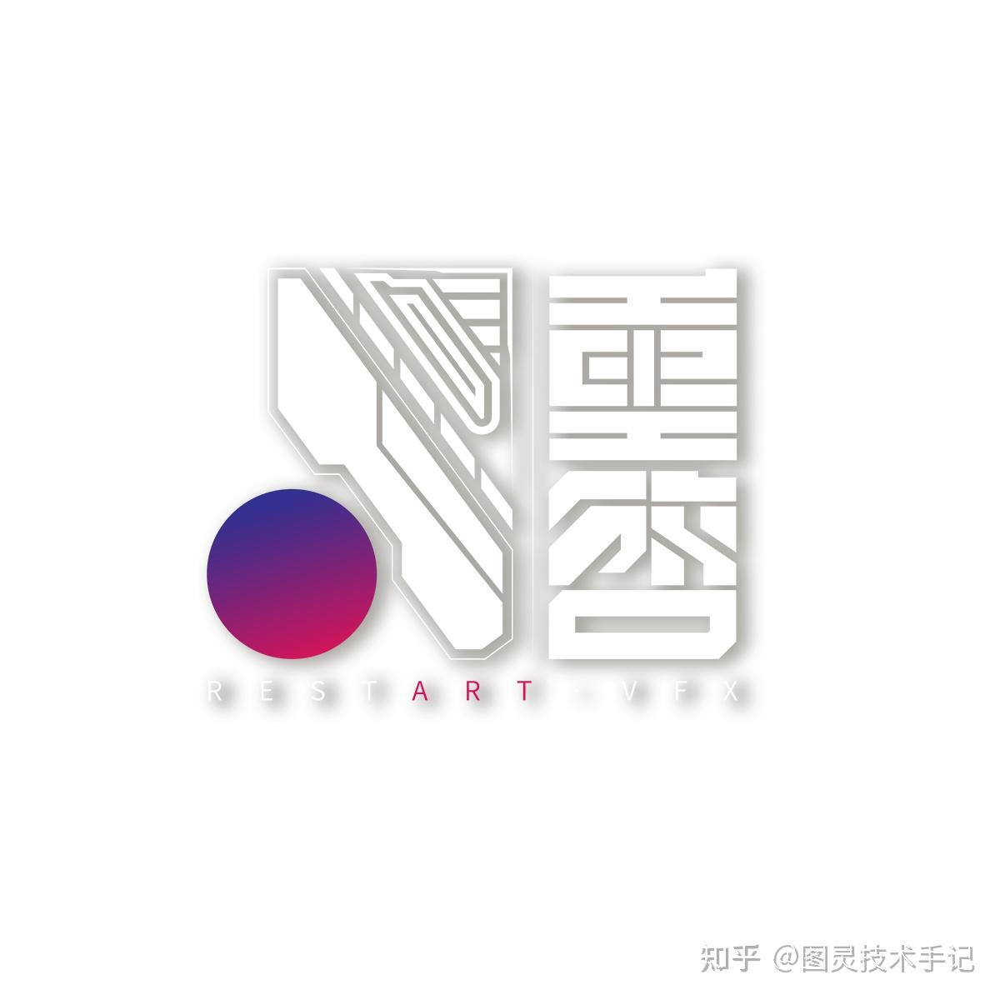
