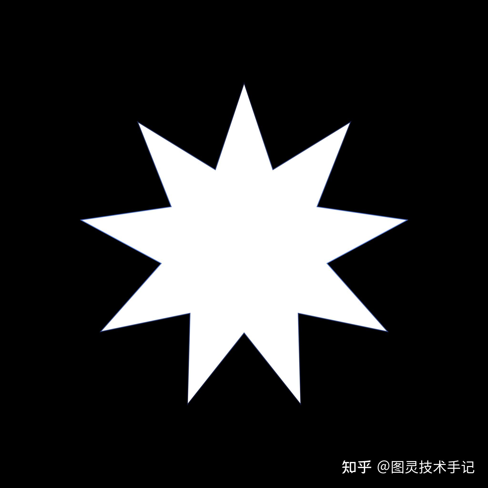
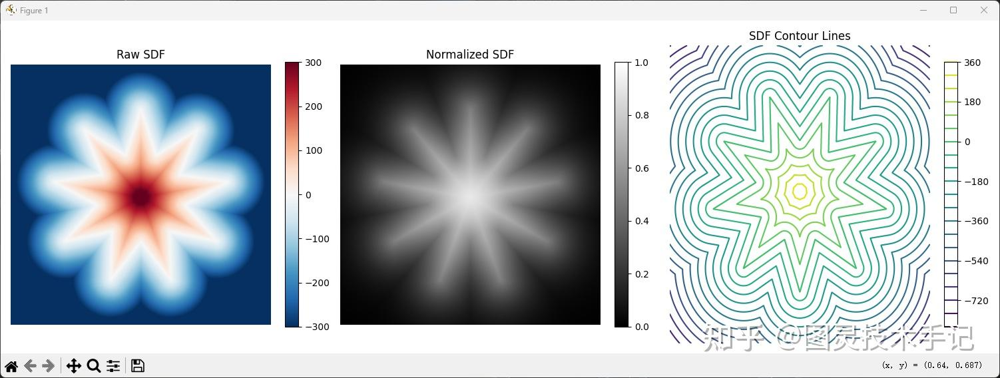
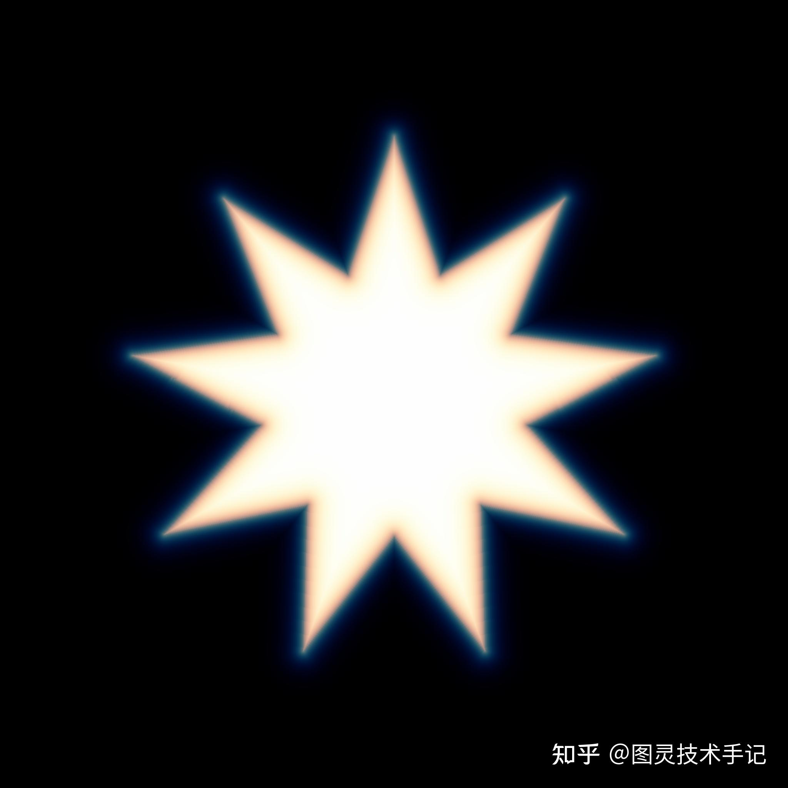
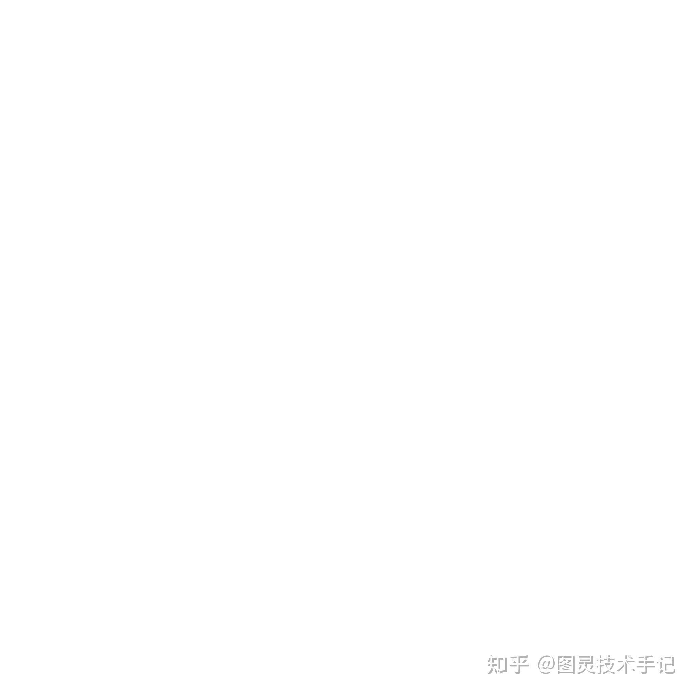

SDF（Signed Distance Field，有向距离场）是一种数据结构，用来表示空间（2D 或 3D）中任意一点到某个特定几何形状表面的距离信息，并且这个距离是带有符号的

在一些日常生产中，尤其是对于需要实时渲染性能的游戏开发来说是实时计算距离场是一件不太现实的事情，所以我们就需要通过预制的方式或者缓存的方式来实现

一般来说SDF的优势还是十分明显的，我们可以通过查询任意点的 SDF 值，可以立即知道到目标表面的距离以及内外关系

同时，SDF 天然地表示了一个连续的、平滑的距离场。这使得它非常适合表示平滑过渡或抗锯齿的边缘

而且，利用 SDF 值还可以进行布尔运算（并集、交集、差集）以及偏移（膨胀/腐蚀）等操作变得相对简单和直观（通常通过比较或组合不同 SDF 值的最小值/最大值来实现）

还有在渲染 SDF 定义的形状时，光线上的当前点查询 SDF 值，就能知道到最近表面的安全距离（这个距离保证光线不会穿透表面），可以安全地向前推进这个距离，极大地优化了光线求交的过程

一般SDF的生产也有很多种方式，比如通过Substance Designer，又或者通过屏幕空间偏移采样，而这一篇文章是通过Python对Mask进行局外卷积采样和导出的方式制作的

```cpp
import numpy as np
import matplotlib.pyplot as plt
from scipy.ndimage import distance_transform_edt
from PIL import Image
import cv2
from typing import Tuple, Optional

def generate_sdf_high_precision(
    mask_image_path: str, 
    output_path: str, 
    decay_distance: float = 20.0,
    output_size: Tuple[int, int] = (0, 0),
    edge_mode: str = 'linear',  # 'linear', 'exponential', 'smooth'
    normalize_range: Tuple[float, float] = (0.0, 1.0),
    bit_depth: int = 16,  # 8 or 16 bit output
    antialiasing: bool = True
) -> np.ndarray:
    """
    生成高精度的SDF（Signed Distance Field）图像。
    
    参数：
    - mask_image_path: 输入的黑白mask图像路径
    - output_path: 输出的SDF图像保存路径
    - decay_distance: SDF衰减距离（像素单位）
    - output_size: 输出图像尺寸 (宽, 高)，(0, 0)表示与输入相同
    - edge_mode: 边缘衰减模式 ('linear', 'exponential', 'smooth')
    - normalize_range: 归一化范围，默认(0, 1)
    - bit_depth: 输出位深度，8或16位
    - antialiasing: 是否使用抗锯齿
    
    返回：
    - sdf_array: 生成的SDF数组（浮点精度）
    """
    
    # 加载mask图像
    mask_image = Image.open(mask_image_path).convert('L')
    
    # 如果需要调整大小，先进行高质量重采样
    if output_size != (0, 0) and output_size != mask_image.size:
        # 使用LANCZOS重采样以保持边缘质量
        mask_image = mask_image.resize(output_size, Image.Resampling.LANCZOS)
    
    # 转换为numpy数组并归一化到0-1
    mask_array = np.array(mask_image, dtype=np.float64) / 255.0
    
    # 应用抗锯齿处理
    if antialiasing:
        # 使用高斯模糊轻微平滑边缘
        mask_array = cv2.GaussianBlur(mask_array, (3, 3), 0.5)
    
    # 创建二值化mask，使用0.5作为阈值
    mask_binary = mask_array > 0.5
    
    # 计算内部和外部的距离场
    # 内部距离（mask内部到边缘的距离）
    dist_internal = distance_transform_edt(mask_binary)
    # 外部距离（mask外部到边缘的距离）
    dist_external = distance_transform_edt(~mask_binary)
    
    # 创建带符号的距离场
    # 内部为正值，外部为负值
    sdf_raw = np.where(mask_binary, dist_internal, -dist_external)
    
    # 应用衰减函数
    if edge_mode == 'linear':
        # 线性衰减
        sdf_normalized = np.clip(sdf_raw / decay_distance, -1.0, 1.0)
    elif edge_mode == 'exponential':
        # 指数衰减
        sdf_normalized = np.sign(sdf_raw) * (1.0 - np.exp(-np.abs(sdf_raw) / decay_distance))
    elif edge_mode == 'smooth':
        # 平滑衰减（使用sigmoid函数）
        sdf_normalized = np.tanh(sdf_raw / decay_distance)
    else:
        raise ValueError(f"Unknown edge_mode: {edge_mode}")
    
    # 将范围从[-1, 1]映射到指定的归一化范围
    min_val, max_val = normalize_range
    sdf_normalized = (sdf_normalized + 1.0) * 0.5  # 映射到[0, 1]
    sdf_normalized = sdf_normalized * (max_val - min_val) + min_val
    
    # 保存图像
    if bit_depth == 16:
        # 16位精度输出
        sdf_uint16 = np.uint16(np.clip(sdf_normalized * 65535, 0, 65535))
        Image.fromarray(sdf_uint16, mode='I;16').save(output_path.replace('.png', '_16bit.png'))
    else:
        # 8位精度输出
        sdf_uint8 = np.uint8(np.clip(sdf_normalized * 255, 0, 255))
        Image.fromarray(sdf_uint8, mode='L').save(output_path)
    
    # 可视化选项
    visualize_sdf(sdf_raw, sdf_normalized, decay_distance)
    
    return sdf_normalized


def visualize_sdf(sdf_raw: np.ndarray, sdf_normalized: np.ndarray, decay_distance: float):
    """可视化SDF结果"""
    fig, axes = plt.subplots(1, 3, figsize=(15, 5))
    
    # 原始SDF
    im1 = axes[0].imshow(sdf_raw, cmap='RdBu_r', vmin=-decay_distance, vmax=decay_distance)
    axes[0].set_title('Raw SDF')
    axes[0].axis('off')
    plt.colorbar(im1, ax=axes[0], fraction=0.046)
    
    # 归一化SDF
    im2 = axes[1].imshow(sdf_normalized, cmap='gray', vmin=0, vmax=1)
    axes[1].set_title('Normalized SDF')
    axes[1].axis('off')
    plt.colorbar(im2, ax=axes[1], fraction=0.046)
    
    # 等高线视图
    x = np.arange(sdf_raw.shape[1])
    y = np.arange(sdf_raw.shape[0])
    X, Y = np.meshgrid(x, y)
    contour = axes[2].contour(X, Y, sdf_raw, levels=20, cmap='viridis')
    axes[2].set_title('SDF Contour Lines')
    axes[2].axis('off')
    plt.colorbar(contour, ax=axes[2], fraction=0.046)
    
    plt.tight_layout()
    plt.show()


def batch_process_sdf(
    input_folder: str,
    output_folder: str,
    **kwargs
):
    """批量处理多个mask图像"""
    import os
    from pathlib import Path
    
    Path(output_folder).mkdir(parents=True, exist_ok=True)
    
    for filename in os.listdir(input_folder):
        if filename.lower().endswith(('.png', '.jpg', '.jpeg', '.bmp')):
            input_path = os.path.join(input_folder, filename)
            output_path = os.path.join(output_folder, f"sdf_{filename}")
            
            print(f"Processing: {filename}")
            generate_sdf_high_precision(input_path, output_path, **kwargs)


# 高级功能：生成带通道的SDF纹理（用于UE材质）
def generate_multichannel_sdf(
    mask_image_path: str,
    output_path: str,
    distances: list = [10, 20, 40],
    edge_mode: str = 'smooth'
) -> np.ndarray:
    """
    生成多通道SDF纹理，每个通道使用不同的衰减距离。
    这在UE中可以用于创建更复杂的效果。
    
    参数：
    - distances: 每个通道的衰减距离列表（最多4个）
    """
    mask_image = Image.open(mask_image_path).convert('L')
    mask_array = np.array(mask_image, dtype=np.float64) / 255.0
    mask_binary = mask_array > 0.5
    
    # 计算基础SDF
    dist_internal = distance_transform_edt(mask_binary)
    dist_external = distance_transform_edt(~mask_binary)
    sdf_raw = np.where(mask_binary, dist_internal, -dist_external)
    
    # 创建多通道图像
    height, width = mask_array.shape
    channels = min(len(distances), 4)  # 最多4个通道（RGBA）
    result = np.zeros((height, width, channels), dtype=np.float64)
    
    # 为每个通道生成不同衰减的SDF
    for i, distance in enumerate(distances[:channels]):
        if edge_mode == 'smooth':
            channel_sdf = np.tanh(sdf_raw / distance)
        else:
            channel_sdf = np.clip(sdf_raw / distance, -1.0, 1.0)
        
        # 映射到[0, 1]
        result[:, :, i] = (channel_sdf + 1.0) * 0.5
    
    # 如果少于4个通道，填充alpha通道
    if channels == 3:
        result = np.dstack([result, np.ones((height, width))])
    
    # 保存为PNG
    result_uint8 = np.uint8(np.clip(result * 255, 0, 255))
    Image.fromarray(result_uint8).save(output_path)
    
    return result


# 使用示例
if __name__ == "__main__":
    # 基础用法
    mask_path = r'D:\PProj\BaiduSyncdisk\Studio\图灵技术手记\EasyTA\SDF快速生成\Mask.png'
    
    output_path = 'T_SDF_Highres.png'
    
    # 生成高精度SDF
    sdf = generate_sdf_high_precision(
        mask_path,
        output_path,
        decay_distance=300.0,
        output_size=(0, 0),  # 可以指定输出尺寸
        edge_mode='smooth',      # 使用平滑边缘模式
        normalize_range=(0.0, 1.0),
        bit_depth=16,           # 使用16位精度
        antialiasing=True       # 启用抗锯齿
    )
    
    # 生成多通道SDF
    generate_multichannel_sdf(
        mask_path,
        'T_SDF_Multichannel.png',
        distances=[10, 25, 50],  # 三个不同的衰减距离
        edge_mode='smooth'
    )
```

使用参考如下

我们获得了一张星形的Mask贴图，直接将贴图地址传入代码即可获得预览





在这张预览图中我们就可以看到它的计算过程和展示的等高线





上方我们的输出图也有两种格式，一种是三通道图，包括从1-0，从0-1以及从0-1-0三种边界模式方便我们进行计算，其深度是8bit

另一张单通道图片是16bit位深，从内到外是1-0，边界为0.5


