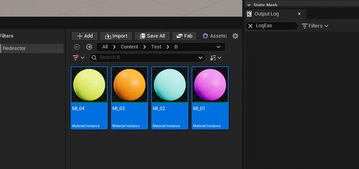
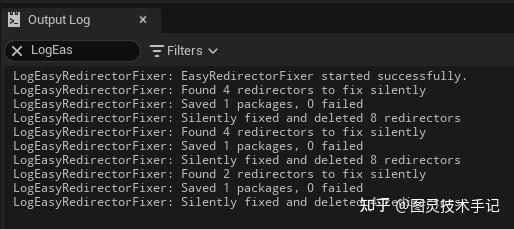
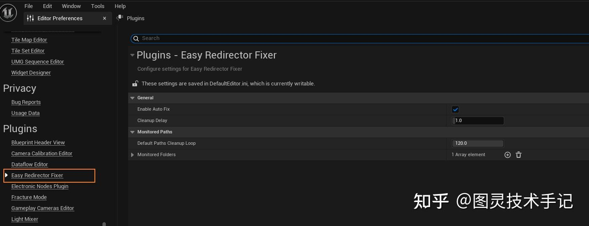

在虚幻引擎中有引用的文件在移动的时候会在原地生成一个看不见但是却实际存在的一个Redirector文件，导致每次删除“空”文件夹或者打包项目的时候发生一些未知的错误

那有没有一种可能性我们可以在文件重命名或者移动的时候自动识别到其生成的Redirector文件并在后台自动处理掉呢？

那有没有一种可能我们可以在后台定时运行一次Redirector自动清理功能呢？

## 一、感受一下Redirector自动消除的爽感



这依赖于我自己写的一个插件——EasyRedirectorFixer（源码下方自取，放入引擎插件中直接编译使用）


插件通过侦听OnAssetRenamed事件的方式对资产的变更进行反应

一旦当资产变更便会扫描其OldPath（旧路径）下是否存在有Redirector资产，如果有则后台清除并输出日志



## 二、为什么要侦听OnAssetRenamed

为什么要侦听OnAssetRenamed，是因为无论资产是在重命名还是在移动位置，都会召唤这个事件

但是在这个事件中我并没有直接处理Redirector，因为这里新资产位置还没有被注册，也就是OnAssetRemoved还没有被调用，所以我做了一个延迟，在OnAssetRenamed调用后只将需要扫描的路径添加到变量中进行管理，一定的时间后召唤处理Redirector的逻辑

```cpp
void FEasyRedirectorFixerModule::OnAssetRenamed(const FAssetData& AssetData, const FString& OldPath)
{
	// ERFLogOnly("Renamed.");
	
	UEasyRedirectorFixerSettings* Settings = UEasyRedirectorFixerSettings::GetSettings();

	if (!Settings->bEnableAutoFix)
	{
		return;
	}

	UncheckedPaths.AddUnique(FPaths::GetPath(OldPath));

	if (GEditor)
	{
		FTimerHandle RenameCleanupTimer;
		GEditor->GetTimerManager()->SetTimer(RenameCleanupTimer, 
			FTimerDelegate::CreateLambda([this, OldPath, AssetData]()
			{
				this->CleanupUncheckedPathRedirector();
			}), 
			Settings->CleanupDelay, false);
	}
}

```

## 三、void FEasyRedirectorFixerTool::FixUpRedirectors(const TArray&lt;FString&gt;& Paths)

处理Redirector是专门的逻辑，在void FEasyRedirectorFixerTool::FixUpRedirectors(const TArray&lt;FString&gt;& Paths)函数中

```cpp
void FEasyRedirectorFixerTool::FixUpRedirectors(const TArray<FString>& Paths)
{
    FAssetRegistryModule& AssetRegistryModule = FModuleManager::Get().LoadModuleChecked<FAssetRegistryModule>(TEXT("AssetRegistry"));

    // 创建过滤器查找redirectors
    FARFilter Filter;
    Filter.bRecursivePaths = true;
    for (const FString& Path : Paths)
    {
        Filter.PackagePaths.Add(FName(*Path));
    }
    Filter.ClassPaths.Add(UObjectRedirector::StaticClass()->GetClassPathName());

    TArray<FAssetData> OutRedirectors;
    AssetRegistryModule.Get().GetAssets(Filter, OutRedirectors);

    if (OutRedirectors.Num() == 0)
    {
        ERFLogOnly(TEXT("No redirector was found."));
        return;
    }

    ERFLogOnly(FString::Printf(TEXT("Found %d redirectors to fix silently"), OutRedirectors.Num()));

    // 收集redirector对象
    TArray<UObjectRedirector*> ValidRedirectors;
    TMap<FSoftObjectPath, FSoftObjectPath> RedirectorMap;
    TSet<UPackage*> PackagesToSave;
    TSet<UPackage*> LoadedPackages;

    // 第一步：收集有效的redirectors并构建映射表
    for (const FAssetData& RedirectorData : OutRedirectors)
    {
        if (UObjectRedirector* Redirector = Cast<UObjectRedirector>(RedirectorData.GetAsset()))
        {
            if (Redirector->DestinationObject && IsValid(Redirector->DestinationObject))
            {
                ValidRedirectors.Add(Redirector);
                
                // 构建重定向映射
                FSoftObjectPath OldPath = FSoftObjectPath(Redirector);
                FSoftObjectPath NewPath = FSoftObjectPath(Redirector->DestinationObject);
                RedirectorMap.Add(OldPath, NewPath);

                // 如果是Blueprint，也添加类引用
                if (UBlueprint* Blueprint = Cast<UBlueprint>(Redirector->DestinationObject))
                {
                    FString OldPathStr = OldPath.ToString();
                    FString NewPathStr = NewPath.ToString();
                    RedirectorMap.Add(FString::Printf(TEXT("%s_C"), *OldPathStr), 
                                    FString::Printf(TEXT("%s_C"), *NewPathStr));
                }

                // 收集引用包
                TArray<FName> ReferencingPackages;
                AssetRegistryModule.Get().GetReferencers(Redirector->GetPackage()->GetFName(), ReferencingPackages);
                
                for (FName PackageName : ReferencingPackages)
                {
                    FString PackageNameStr = PackageName.ToString();
                    UPackage* Package = FindPackage(nullptr, *PackageNameStr);
                    if (!Package)
                    {
                        Package = LoadPackage(nullptr, *PackageNameStr, LOAD_None);
                        if (Package)
                        {
                            LoadedPackages.Add(Package);
                        }
                    }
                    if (Package && !Package->HasAnyPackageFlags(PKG_CompiledIn))
                    {
                        PackagesToSave.Add(Package);
                    }
                }
            }
        }
    }

    // 确保在结束时卸载临时加载的包
    ON_SCOPE_EXIT {
        if (!LoadedPackages.IsEmpty())
        {
            FText ErrorMessage;
            UPackageTools::UnloadPackages(LoadedPackages.Array(), ErrorMessage, true);
        }
    };

    if (ValidRedirectors.Num() == 0)
    {
        ERFLogOnly(TEXT("No valid redirectors to fix"));
        return;
    }

    // 第二步：静默修复引用（使用自动化模式避免弹窗）
    bool bOriginalAutomationMode = GIsRunningUnattendedScript;
    GIsRunningUnattendedScript = true;

    ON_SCOPE_EXIT {
        GIsRunningUnattendedScript = bOriginalAutomationMode;
    };

    // 修复软对象路径引用
    if (RedirectorMap.Num() > 0 && PackagesToSave.Num() > 0)
    {
        // 这里需要手动实现软引用修复，因为AssetRenameManager可能不公开
        for (UPackage* Package : PackagesToSave)
        {
            bool bPackageModified = false;
            ForEachObjectWithPackage(Package, [&](UObject* Object) -> bool
            {
                if (Object)
                {
                    // 这里可以添加更详细的引用修复逻辑
                    // 基本思路是遍历对象的属性，找到软引用并更新
                    bPackageModified = true;
                }
                return true;
            }, false);

            if (bPackageModified)
            {
                Package->MarkPackageDirty();
            }
        }
    }

    // 第三步：保存修改的包
    if (PackagesToSave.Num() > 0)
    {
        TArray<UPackage*> FailedToSave;
        const bool bCheckDirty = false;
        const bool bPromptToSave = false;
        FEditorFileUtils::PromptForCheckoutAndSave(PackagesToSave.Array(), bCheckDirty, bPromptToSave, &FailedToSave);
        
        ERFLogOnly(FString::Printf(TEXT("Saved %d packages, %d failed"), 
            PackagesToSave.Num() - FailedToSave.Num(), FailedToSave.Num()));
    }

    // 第四步：删除redirectors
    TArray<UObject*> ObjectsToDelete;
    for (UObjectRedirector* Redirector : ValidRedirectors)
    {
        UPackage* RedirectorPackage = Redirector->GetOutermost();
        bool bContainsOtherAssets = false;

        ForEachObjectWithOuter(RedirectorPackage, [&](UObject* Obj) -> bool
        {
            if (UObjectRedirector* OtherRedirector = Cast<UObjectRedirector>(Obj))
            {
                OtherRedirector->RemoveFromRoot();
                ObjectsToDelete.Add(OtherRedirector);
            }
            else if (Obj != RedirectorPackage)
            {
                bContainsOtherAssets = true;
            }
            return true;
        });

        if (!bContainsOtherAssets)
        {
            RedirectorPackage->RemoveFromRoot();
            ObjectsToDelete.Add(RedirectorPackage);
        }
    }

    if (ObjectsToDelete.Num() > 0)
    {
        ObjectTools::DeleteObjects(ObjectsToDelete, false);
        ERFLogOnly(FString::Printf(TEXT("Silently fixed and deleted %d redirectors"), ObjectsToDelete.Num()), 1);
    }
}

void FEasyRedirectorFixerTool::FixUpRedirectors(const FString& Path)
{
    TArray<FString> PathArray;
    PathArray.Add(Path);
    FixUpRedirectors(PathArray);
}

```

这个函数是对引擎原生修复Redirector逻辑的复用和改写，因为原生的逻辑中包含了Dialog提示的逻辑，并不适用于这个插件希望在后台运行的逻辑，所以单独将其提取出来进行了改写

## 四、插件是可配置的

插件本身我们也留了一些可配置的内容（存在于“Editor Settings”中）



Enable Auto Fix——可以配置是否需要激活自动修复

Cleanup Delay——即OnAssetRenamed被触发后闲置多久调用自动修复的逻辑（建议1-3s，不要太短或者太长）

Default Paths Cleanup Loop——即多少秒的间隔自动修复我们在Monitored Folders中定义的路径里存在的Redirector资产

Monitored Folders——可以定义在项目中哪些路径需要被我们管理起来进行定时Redirector的扫描


