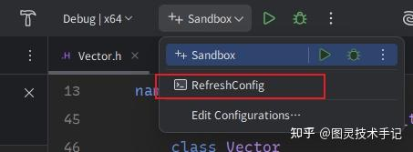
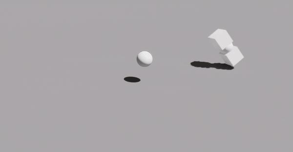

这是一个还在开发中的库，目的就是为了解决图形学或者游戏开发中可扩展的数学计算需求

目前已经有Matrix、Vector、Quaternion、Eular、Color等类可以满足一般情况下的计算，也可以集成到大多数项目中

> 一直很痛苦，很多图形学基础的算法并不是预制好的，尤其矩阵、向量这些基中基的计算，每次开一个新项目都要重新去写基本的算法，所以我就萌生出了预制一个dll的想法，且这个东西要能集成到任何项目中可以避免反复计算，就有了这个库。

当然我这个库并不是大家唯一能找到的类似功能的库，这也只是我的一个尝试，用我自己的方式去组织适用性更强的通用计算库。

这个库也会一直更新，大家遇到任何bug可以随时提起issue

## 文件结构

```cpp
E:.\EasyMath
├─include
│  ├─ByteSize.h
│  ├─Color.h
│  ├─Common.h
│  ├─EasyConversion.h
│  ├─EasyMath.h
│  ├─EasyMathAPI.h
│  ├─EMConst.h
│  ├─Matrix.h
│  ├─Quaternion.h
│  ├─Vector.h
│  └─Version.h
├─src
│  └─ByteSize.cpp
└─sandbox
    └─sandbox.cpp
```

## Install

第一次打开克隆项目后只需要运行 Scripts/GenerateWIN.bat 即可在 Windows 上生成/配置 Visual Studio 工程

项目配置使用premake来同步，如果是rider打开项目，在工具栏会自动配置一个CommandLine，运行RefreshConfig就会自动运行配置脚本



库中的算法大量使用了template方法进行通用性适配，有必要特化的地方已进行了特化处理，比如四元数、颜色等都特化了维度范围但是保留了精度的适配性

## Matrix

EM::Matrix&lt;T, rows, cols&gt;为行主序、定长的矩阵模板，T必须为算术类型（std::is_arithmetic_v&lt;T&gt;）。

通过assert做越界与前置条件检查。

### 模板参数

T：元素类型（float/double/int 等）

rows：行数（&gt;0）

cols：列数（&gt;0）

### 构造

默认构造：零初始化存储

列表构造：Matrix(std::initializer_list&lt;T&gt;)（行主序，长度需等于 rows*cols）

```cpp
EM::Matrix<float, 3, 3> MA{ 1,3,3,-9,7,6,7,8,9 };
EM::Matrix<float, 2, 2> MB{ 1,2,3,4};
EM::Matrix<float, 4, 2> MC{ 1,2,3,4,5,6,7,8};
```

### 元素访问

线性下标（行主序）：operator[]

二维访问：operator()(row, col)

维度：Rows() / Cols()

```cpp
EM::Matrix<float, 3, 3> MA{ 1,3,3,-9,7,6,7,8,9 };
MA[1];
MA(0,1);
MA.Rows();
MA.Cols();
```

### 格式化输出

print(std::ostream&)；operator&lt;&lt; 转发到 print，默认定宽并保留 3 位小数

```cpp
EM::Matrix<float, 3, 3> MA{ 1,3,3,-9,7,6,7,8,9 };
std::cout << MA << std::endl;
```

输出

```cpp
Matrix 3x3
-                     -
| 1.000  3.000  3.000 |
|-9.000  7.000  6.000 |
| 7.000  8.000  9.000 |
-                     -
```

### 子矩阵

submatrix(size_t r, size_t c)：去除第 r 行和第 c 列后的 (rows-1)×(cols-1) 矩阵

```cpp
EM::Matrix<float, 3, 3> MA{ 1,3,3,-9,7,6,7,8,9 };
std::cout << MA.submatrix(1,2) << std::endl;
```

输出

```cpp
Matrix 2x2
-            -
|1.000 3.000 |
|7.000 8.000 |
-            -
```

### 代数运算

原地：+=、-=、*=（标量）

友元：标量乘、矩阵加减、一元负号、矩阵×矩阵

### 矩阵运算

determinant()（仅方阵）：1×1 直接返回元素；2×2 使用闭式；更高阶按首行拉普拉斯展开（determinant() 的拉普拉斯展开在最坏情况下为阶乘复杂度，适合小规模（≤4）；更大规模可考虑 LU 分解（未来计划））

cofactor(r, c)：代数余子式

cofactorMatrix()：余子式矩阵

adjugate()：伴随矩阵（余子式矩阵的转置）

inverse()：需 det != 0；实现为 adjugate() / det

transpose()：返回 cols×rows

### 全局辅助函数

单位矩阵：MTXIdentity&lt;T, N&gt;()

3D 旋转（弧度）：MTXRotationX/Y/Z&lt;T, N&gt;(T radians)

3D 平移：MTXTranslation&lt;T, N&gt;(x, y, z, bool usedWithOrient=false)（若 usedWithOrient=true，将 (3,3) 置 0 以便与包含齐次项的朝向矩阵组合）

3D 缩放：MTXScale&lt;T, N&gt;(sx, sy, sz)

```cpp
std::cout << EM::MTXScale<float>(1,2,4) << std::endl;
std::cout << EM::MTXRotationX<float>(PI/4) << std::endl;
std::cout << EM::MTXRotationY<float>(PI/3) << std::endl;
std::cout << EM::MTXTranslation<float>(1,2,4) << std::endl;
std::cout << EM::MTXTranslation<float>(1,2,4) *  EM::MTXScale<float>(1,2,4) * EM::MTXRotationX<float>(PI/4) * EM::MTXRotationY<float>(PI/3)<< std::endl;
```

输出

```cpp
Matrix 4x4
-                        -
|1.000 0.000 0.000 0.000 |
|0.000 2.000 0.000 0.000 |
|0.000 0.000 4.000 0.000 |
|0.000 0.000 0.000 1.000 |
-                        -

Matrix 4x4
-                            -
| 1.000  0.000  0.000  0.000 |
| 0.000  0.707 -0.707  0.000 |
| 0.000  0.707  0.707  0.000 |
| 0.000  0.000  0.000  1.000 |
-                            -

Matrix 4x4
-                            -
| 0.500  0.000  0.866  0.000 |
| 0.000  1.000  0.000  0.000 |
|-0.866  0.000  0.500  0.000 |
| 0.000  0.000  0.000  1.000 |
-                            -

Matrix 4x4
-                        -
|1.000 0.000 0.000 1.000 |
|0.000 1.000 0.000 2.000 |
|0.000 0.000 1.000 4.000 |
|0.000 0.000 0.000 1.000 |
-                        -

Matrix 4x4
-                            -
| 0.500  0.000  0.866  1.000 |
| 1.225  1.414 -0.707  2.000 |
|-2.449  2.828  1.414  4.000 |
| 0.000  0.000  0.000  1.000 |
-                            -
```

## Vector

EM::Vector&lt;T, N&gt;是维度泛化、定长的向量模板，T必须为算术类型。支持元素访问、swizzle、算术运算、范数与归一化、投影与反射、插值、齐次坐标转换等；

通过assert做边界与前置条件检查。

### 模板参数

T：元素类型（float/double/int 等）

N：维度（N &gt; 0）

### 构造

默认零初始化：Vector()

标量填充：explicit Vector(const T& value)

列表构造：Vector(std::initializer_list&lt;T&gt;)（长度必须等于 N）

```cpp
EM::Vector<float, 3> VA{};
EM::Vector<float, 3> VB(1);
EM::Vector<float, 3> VC{1,2,3};
```

### 元素访问

operator[](size_t) 读写 / 常量访问

边界检查：at(size_t) 读写 / 常量访问

迭代器：begin()/end()（含常量版本）

原始数据：T* Data() / const T* Data() const

尺寸与维度：static constexpr size_t size()、getDimension()、Dimension()

### Swizzle

Swizzle的实现这里参考了GLM库的实现，我个人觉得这个实现蛮有意思的

通过定义Swizzle结构体的方式，在Vector中用Union将原始数据和Swizzle类结合起来，虽然声明的排列写起来有点麻烦，但使用的时候性能几乎没有损耗，而且十分方便

```cpp
int main(int argc, char * argv[])
{
	EM::Vector<float,4> vector{ 1, 2, 3, 6};
	
	PRINT(vector.xz)
	PRINT(vector.xyw)
	
	return 0;
}

```

输出

```cpp
(1, 3) (V mode: xy)
(1, 2, 6) (V mode: xyz)
```

### 矩阵转换

列向量：Matrix&lt;T, N, 1&gt; toColMatrix()

行向量：Matrix&lt;T, 1, N&gt; toRowMatrix()

```cpp
EM::Vector<float, 3> VB{1,2,3};
std::cout << VB.toColMatrix() << std::endl;
std::cout << VB.toRowMatrix() << std::endl;
```

输出

```cpp
Matrix 3x1
-      -
|1.000 |
|2.000 |
|3.000 |
-      -

Matrix 1x3
-                  -
|1.000 2.000 3.000 |
-
```

### 算术运算

原地：+=、-=、*=、/=（向量或标量）

友元：+、一元 -、-、*、/（向量或标量）

比较：==、!=（浮点类型使用 NEARZERO_THRESHOLD 作为 epsilon）

### 范数与归一化

length(bool dimensionalityReduction = false) const

constexpr lengthSquared(bool dimensionalityReduction = false) const

normalized(bool dimensionalityReduction = false) const

normalize(bool dimensionalityReduction = false)

isZero(T epsilon = T{NEARZERO_THRESHOLD}) const

isNormalized(T epsilon = T{NEARZERO_THRESHOLD}, bool dimensionalityReduction = true) const

当 dimensionalityReduction = true 时，范数仅计算前三个分量；normalized() 会保持其余维度不变

### 向量间运算

点积：dot(a, b)

叉积（3D）：cross(a, b)，返回 Vector&lt;T,3&gt;

2D 叉积（标量）：cross2D(a, b)

距离：distance(a, b, bool dimensionalityReduction = true)

距离平方：distanceSquared(a, b, bool dimensionalityReduction = true)

夹角：angle(a, b, bool dimensionalityReduction = true)（弧度）

### 插值

线性插值：成员 lerp(other, t) 与自由函数 lerp(a, b, t)

球面插值（单位向量）：slerp(a, b, t)

### 投影与反射

project(const Vector& onto) / project(const Vector& onto, bool dimensionalityReduction)

reflect(const Vector& normal)（要求单位法向，N ≥ 2）

### 齐次坐标

转齐次：template&lt;size_t newDim = N+1&gt; toHomogeneous(T w = T{1}) const

还原齐次：template&lt;size_t newDim = N-1&gt; fromHomogeneous() const（w==0 视为方向向量，不做透视除法）

### 图形学辅助

平移矩阵（N==3）：toTranslationMatrix(bool usedWithOrient=false) -&gt; Matrix&lt;T,4,4&gt;

反对称矩阵：skewSymmetric()（N=2/3 有专门构造，N&gt;3 提供通用构造）

二维专用反对称矩阵：skewSymmetric_2D() -&gt; Matrix&lt;T,3,3&gt;（仅 N==2）

### 格式化输出

print(std::ostream&)；operator&lt;&lt; 转发到 print，默认定宽并保留 3 位小数

### 常用类型别名

Vector2/3/4

Vector2f/3f/4f

Vector2d/3d/4d

Vector2i/3i/4i

## 验证

日常开发作为插件加入游戏也是可以的（算法性能优化中）

比如简单做一个算法使得Actor可以做公转

```cpp
UFUNCTION(BlueprintCallable, meta = (DisplayName = "Easy Math Rotate", Keywords = "EasyMath Translate"), Category = "EasyMath|Rotate")
static FVector EasyMathRotateFunction(AActor* actor , FVector VecIn, FVector Source = FVector::ZeroVector);

```

（自转可以直接做Rotation的累加即可实现）

```cpp
FVector UEasyMathBPLibrary::EasyMathRotateFunction(AActor* actor, FVector VecIn, FVector Source)
{
	if (!actor)
	{
		return FVector::ZeroVector; // 安全检查
	}

	auto mx = EM::MTXRotationX(VecIn[0] * PI / 180);
	auto my = EM::MTXRotationY(VecIn[1] * PI / 180);
	auto mz = EM::MTXRotationZ(VecIn[2] * PI / 180);

	auto mt = EM::MTXTranslation(Source[0],Source[1],Source[2]);
	auto mt_inv = EM::MTXTranslation(-Source[0],-Source[1],-Source[2]);

	auto m = mt * mx * my * mz * mt_inv;

	FVector CurrentLocation = actor->GetActorLocation();
	EM::Vector<double,4> pos = EM::Vector<double,4>{CurrentLocation[0], CurrentLocation[1], CurrentLocation[2], 1};
	
	EM::Matrix<double,4, 1> location = m * pos;
	
	FVector NewLocation(location[0], location[1], location[2]);
	
	actor->SetActorLocation(NewLocation);
	
	return NewLocation;
}

```



但是当然这不是最佳的实践，最佳实践应该是放在图形库的应用中，配合OpenGL或者HLSL的底层进行运算（更新中）


