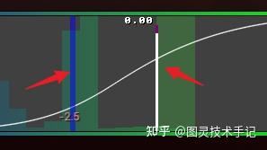
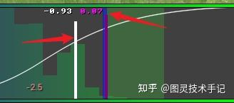
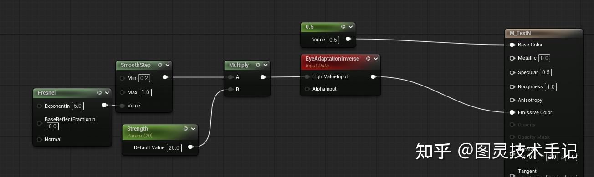
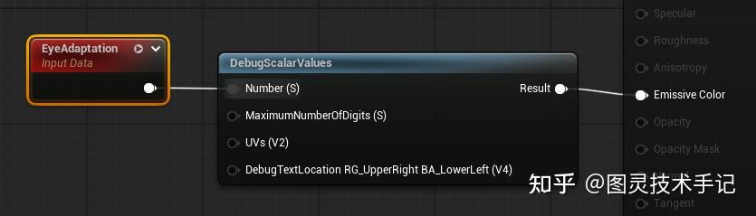
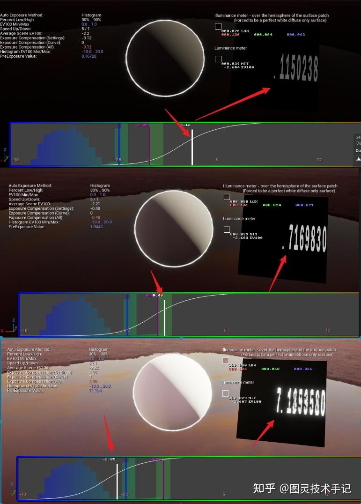
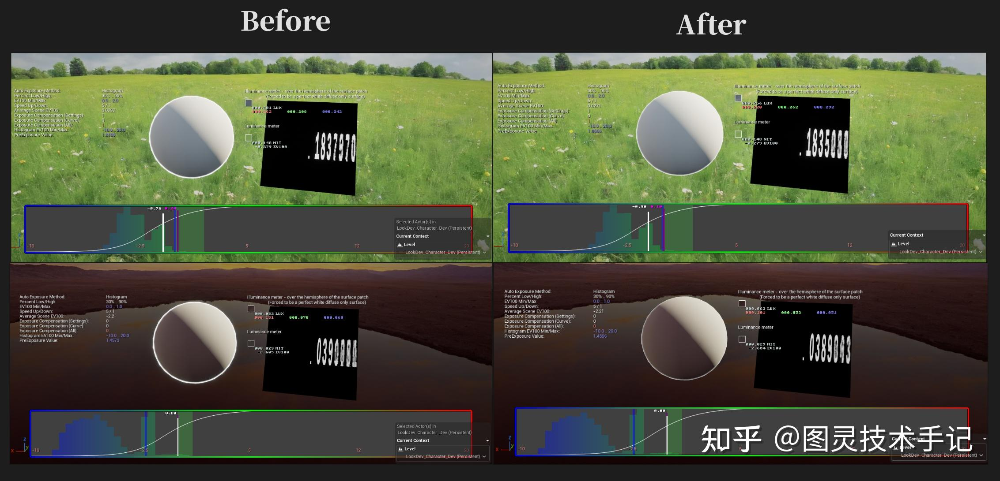
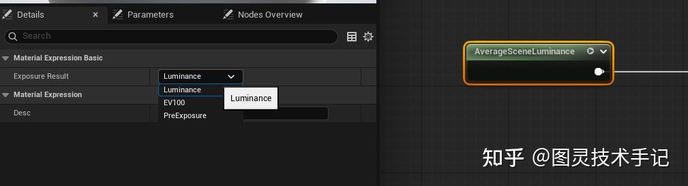
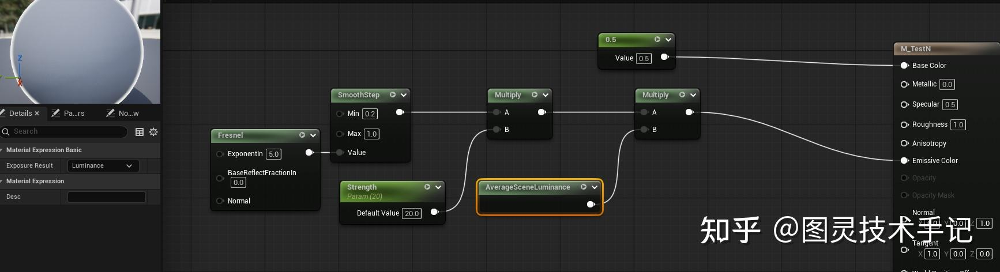
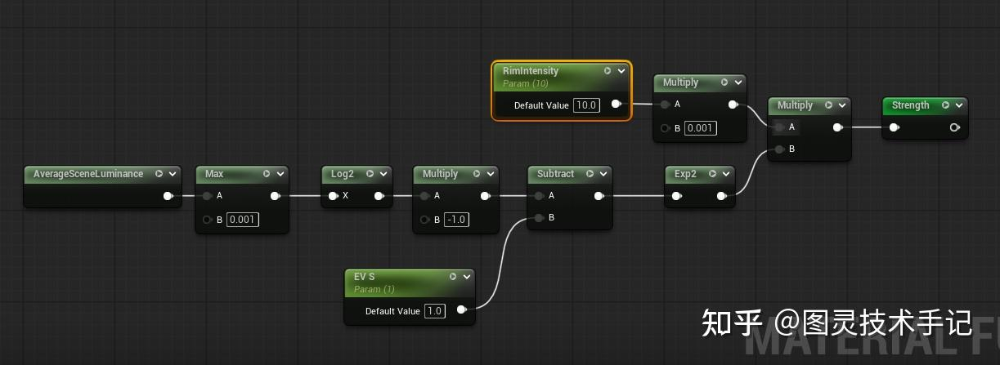
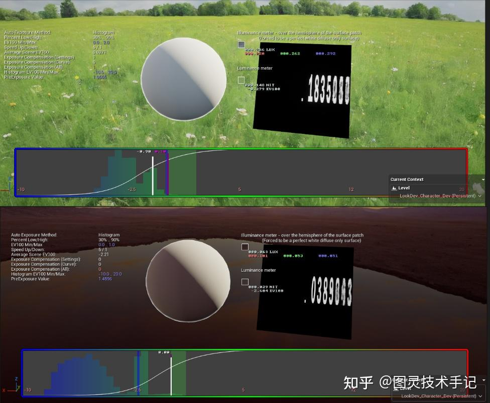

自发光平衡一直是UE中一个比较难搞清楚的问题，当然UE有一些自己在ViewUniformBuffer中写入的数据，比如EyeAdaptation，也有用来计算自发光平衡的节点EyeAdaptationInverse，但是连接后我们依然会发现在PostProcess中的曝光设置过后，依然会出现一些奇怪的自发光光比错误的问题

在解决这些问题之前我们要搞清楚一些关于曝光的测量问题，参考一下大佬的文章，就会知道自动曝光在整个曝光曲线上会将我们的最终曝光压缩到可见范围内，也就是HDR的处理（具体看下面的文章），我们打开HDR测量器也会发现很多时候我们的场景平均EV100（Average Scene EV100）和我们的最终曝光值是错位的（白线是最终补偿曝光值，紫线是未补偿的最终曝光值，受到Min EV100和Max EV100的影响，蓝线是Average Scene EV100）





看到这就会发现有意思的事情出现了，白线和蓝线我们在补偿曝光的时候到底应该以哪个为准呢？

一般我们的做法是将颜色除以EyeAdaptation或者是直接将颜色连入EyeAdaptationInverse来解决，一般情况下这种连接方式没有问题



但是我们依然要理解EyeAdaptation到底和什么是线性关系

这里虽然可以看代码但是没太大必要，理解就好了，我们给到一个测试材质如下方式



不动场景曝光，仅仅去动曝光补偿，EyeAdaptation就会和补偿的结果呈现反比的关系，其实恰好应证了是EyeAdaptationInverse中的方法是基于曝光补偿后的值所产生变化（可以看到下方三个场景中发光边缘相对于曝光补偿后亮度基本是不变的）



所以这个时候有没有发现一个问题，我们所想的是这个曝光可以基于我们场景的平均亮度发生变化，但是实际是根据曝光修正后的结果发生的变化，自然而然是不可能满足我们的需求的

再次观察发现其实我们想拿到的是蓝线（AverageSceneEV100）的值，因为无论曝光补偿如何改变，这里都没有发生改变，因为它记录的是补偿之前场景的平均EV100，这才是我们的实际需求

当我们可以获取到相应的值就可以做到如下的效果，让轮廓发光的亮度根据场景而不是曝光后的补偿值进行变化



## ViewUniformBuffer写入

第一步想要获取这个值我们需要知道它在什么位置使用过

在SceneRendering.h中其实已经给我们声明了一个可以使用的AverageSceneLuminance的方法

```cpp
float GetLastAverageSceneLuminance() const;

```

下面是它引擎中的实现

```cpp
float FViewInfo::GetLastAverageSceneLuminance() const
{
	if (const FSceneViewState* EffectiveViewState = GetEyeAdaptationViewState())
	{
		return EffectiveViewState->GetLastAverageSceneLuminance();
	}
	return 0.0f; // Invalid scene luminance
}

```

这是可以直接使用的，但是我们有没有办法获取到EV100的值呢？

这时候我们直接去查HDR这个模块中是如何做的，在PostProcessVisualizeHDR.cpp中有这样一段代码，LuminanceToEV100是一个直接可以使用和访问的方法

```cpp
// ......

float AverageSceneLuminance = View.GetLastAverageSceneLuminance();

float CurveExposureBias = 0.0f;
float AverageSceneLuminanceEV100 = 0.0f;
if (AverageSceneLuminance > 0)
{
	// We need the Log2(0.18) to convert from average luminance to saturation luminance
	AverageSceneLuminanceEV100 = LuminanceToEV100(LuminanceMax, AverageSceneLuminance) + FMath::Log2(1.0f / 0.18f);
	if (View.FinalPostProcessSettings.AutoExposureBiasCurve)
	{
		CurveExposureBias = View.FinalPostProcessSettings.AutoExposureBiasCurve->GetFloatValue(AverageSceneLuminanceEV100);
	}
}

Line = FString::Printf(TEXT("%.3g"), AverageSceneLuminanceEV100);
Canvas.DrawShadowedString(X, Y += YStep, TEXT("Average Scene EV100:"), GetStatsFont(), FLinearColor(1, 1, 1));
Canvas.DrawShadowedString(X + ColumnWidth, Y, *Line, GetStatsFont(), FLinearColor(1, 1, 1));

// ......

```

提取必要的点我们就可以构建一个GetLastAverageSceneEV100()函数声明在文件SceneRendering.h中

```cpp
float GetLastAverageSceneEV100() const;

```

它的实现直接提取必要部分

```cpp
float FViewInfo::GetLastAverageSceneEV100() const
{
	if (const FSceneViewState* EffectiveViewState = GetEyeAdaptationViewState())
	{
		const float LuminanceMax = LuminanceMaxFromLensAttenuation();
		float luminance = EffectiveViewState->GetLastAverageSceneLuminance();
		float AverageSceneLuminanceEV100 = LuminanceToEV100(LuminanceMax, luminance) + FMath::Log2(1.0f / 0.18f);

		return AverageSceneLuminanceEV100;
	}
	return 0.0f; // Invalid scene luminance
	
}

```

第二步就是在SceneView.h中声明并写入我们的ViewUniformBuffer值

```cpp
VIEW_UNIFORM_BUFFER_MEMBER(float, AverageSceneLuminance) \
VIEW_UNIFORM_BUFFER_MEMBER(float, AverageSceneEV100) \

```

然后在SceneRendering.cpp中的void FViewInfo::SetupUniformBufferParameters函数内写下其取值方法就完成了ViewUniformBuffer的写入

```cpp
ViewUniformShaderParameters.AverageSceneLuminance = GetLastAverageSceneLuminance();
ViewUniformShaderParameters.AverageSceneEV100 = GetLastAverageSceneEV100();

```

## 使用ViewUniformBuffer成员

这里在任意的Custom节点中我们都可以直接使用声明的这个值

```cpp
return ResolvedView.AverageSceneEV100;

```

又或者是访问Luminance也是一样的

```cpp
return ResolvedView.AverageSceneLuminance;

```

## 声明节点

既然我们在Custom中可以使用了，就可以将其整合成一个节点方便后期开发进行访问

这里直接放上头文件和实现

MaterialExpressionAverageSceneLuminance.h

```cpp
#pragma once

#include "CoreMinimal.h"
#include "UObject/ObjectMacros.h"
#include "Materials/MaterialExpressionExternalCodeBase.h"

#include "MaterialExpressionAverageSceneLuminance.generated.h"


UENUM()
enum class ExposureResult  : uint8
{
    ER_Luminance = 0 UMETA(DisplayName="Luminance"),
    ER_EV100 UMETA(DisplayName="EV100"),
    ER_PreExposure UMETA(DisplayName="PreExposure")
};

UCLASS(collapsecategories, hidecategories=Object)
class UMaterialExpressionAverageSceneLuminance : public UMaterialExpressionExternalCodeBase
{
    GENERATED_BODY()

public:
    UPROPERTY(EditAnywhere, BlueprintReadWrite, Category = MaterialExpressionBasic, meta = (ShowAsInputPin = "Advanced"))
    ExposureResult Exposure_Result;

    //~ Begin UMaterialExpression Interface
#if WITH_EDITOR
    virtual int32 Compile(class FMaterialCompiler* Compiler, int32 OutputIndex) override;
    virtual void GetCaption(TArray<FString>& OutCaptions) const override;
#endif
    //~ End UMaterialExpression Interface
};

```

MaterialExpressionAverageSceneLuminance.cpp

```cpp
#include "MaterialExpression/MaterialExpressionAverageSceneLuminance.h"
#include "MaterialCompiler.h"
#include "Materials/MaterialExpressionCustom.h"

#if WITH_EDITOR
int32 UMaterialExpressionAverageSceneLuminance::Compile(class FMaterialCompiler* Compiler, int32 OutputIndex)
{
	
    UMaterialExpressionCustom* MaterialExpressionCustom = NewObject<UMaterialExpressionCustom>();
    
    switch (Exposure_Result)
    {
    case (ExposureResult::ER_EV100):
        MaterialExpressionCustom->Code = TEXT(R"(return ResolvedView.AverageSceneEV100;)");
        break;
    case (ExposureResult::ER_PreExposure):
        MaterialExpressionCustom->Code = TEXT(R"(return ResolvedView.PreExposure;)");
        break;
    default:
        MaterialExpressionCustom->Code = TEXT(R"(return ResolvedView.AverageSceneLuminance;)");
        break;
    }
	
    MaterialExpressionCustom->OutputType = ECustomMaterialOutputType::CMOT_Float1;
    MaterialExpressionCustom->Inputs.Empty();
    TArray<int32> CompiledInputs;
    return Compiler->CustomExpression(MaterialExpressionCustom, OutputIndex, CompiledInputs);
}

void UMaterialExpressionAverageSceneLuminance::GetCaption(TArray<FString>& OutCaptions) const
{
    OutCaptions.Add(FString(TEXT("AverageSceneLuminance")));
}
#endif

```

这里比较特殊的使用Enum组织了几种不同的情况，后期也可以根据实际情况进行扩展（节点如下）



## 使用节点

接下来就可以直接使用我们的节点了，这里直接使用线性的Luminance更容易控制



当然也有一些其他算法的尝试我们之后再讨论，这里有一份自己写的算法作为参考（方案还有很多优化空间）



我们也可以加入对Luminance实际值的量化检测




