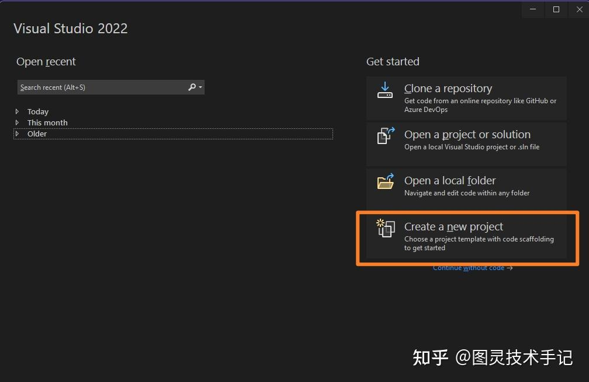
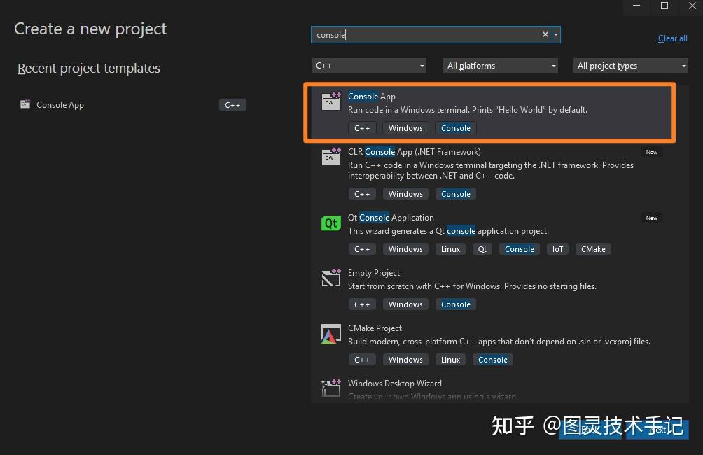
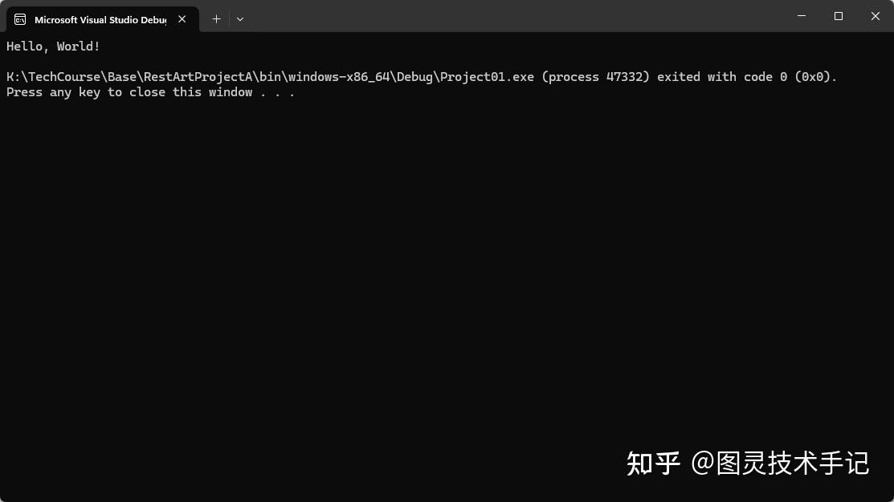
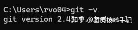

终于我们要开始一个全新的项目了

虽然“Hello World”终将成为一个烂梗，但是每一个程序员都是从“Hello World”开始的。

## 一、打开一个项目

打开Visual Studio，选择Create a new project --&gt; 选择Console App





## 二、简单的源码

通过上面的操作我们就打开了一个已经预制好的工程，其中已经帮我们放好了一段代码就是"Hello World"。

```cpp
#include <iostream>

int main(int argc, const char * argv[])
{
	std::cout << "Hello, World!" << std::endl;
	return 0;
}

```

运行就得到了一个控制台的结果。



这段代码虽然简单，但是其中还是包含了很多很重要的知识点，我们逐一拆解，打好基础。

## 三、源码拆解

### Part1.#include &lt;iostream&gt;

在项目中，我们的文件不可能只有一个源文件，通常来说成千上万的文件和资产对于一个尤其是游戏类的项目来说，都是十分常见的（虽然有的时候文件过多是由于项目规划导致的，这就体现了技术美术的重要性）。

所以我们就要想一个办法将其他的文件和现在的文件联系起来，在C++中就出现了#include ，其作用就是将其他的头文件引用到现在的文件中来

（头文件和源文件是C++中非常重要的两个概念，后面我们会详细解释）

这里#include的是一个C++原生内置的用来做输入和输出的一个头文件模块iostream，没有这个文件，我们就不能使用下文中的std::cout和std::endl。

### Part2.std::cout &lt;&lt;"Hello, World!"&lt;&lt; std::endl;

这一段代码就是我们将"Hello, World!" 输出到控制台的方法

std是一个namespace（命名空间）

cout就是我们的输出流

endl很简单，就是一个结束符号，帮助我们的输出流换行

### http://Part3.int main(int argc,const char* argv[])

这一段放在了最后说，因为非常重要，main是一个函数，且被特殊定义为了程序的入口（Entry），如果没有这个入口，那程序将不知道该如何执行，或者说从哪执行

但是大家如果看过其他教程应该会见过int main()的写法，这种写法是可行的，但是会面临一个问题，即不支持外部控制台输入和输出

大家是不是都见过程序员在命令行中敲一个一个的命令的场景，比如我们去查git的版本



在其中git是程序-v就是外部的输入内容，通过输入内容的不同，我们使用命令行就可以控制我们编译好的程序了

我们在函数的输入中所看到的int argc和const char * argv[]就是我们从外部获取输入信息的方式，int main()由于没有定义这种输入，虽然可以运行，但是是不可以从外部获取控制命令的，这就是int main()和int main(int argc,const char* argv[])最本质的区别。

int argc传入的是程序后传入的参数数量

const char * argv[]是一个数组，记录的是后面传入的参数的具体内容

今天的知识点你都有Get到吗~

有没有什么疑问，我们在评论区见哦~


