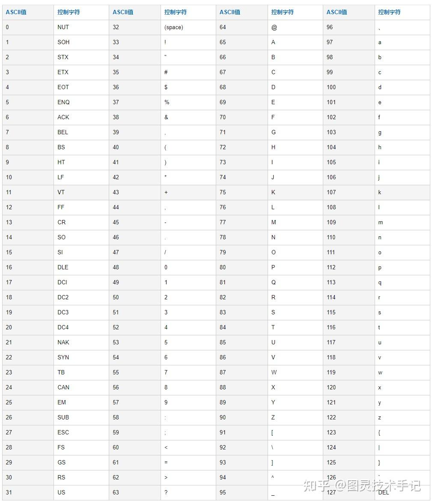
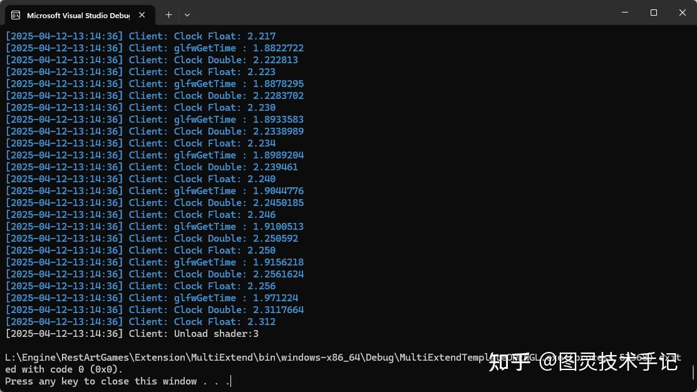

## 一、什么是变量

想象你在玩《原神》时，每次捡到摩拉时，右上角的数字会自动增加；受到攻击时，生命值条会逐渐减少；切换角色时，队伍列表会记住你的选择。这些不断变化的数字背后，都是变量在记录我们的状态，没有变量，很多信息就会转瞬即逝。

变量 = 计算机内存中的命名存储空间

变量包含三个关键要素

1. 类型：整数/文字/真假值（int/string/bool）

1. 名字（标识符），比如hpgoldplayerName

1. 值：当前存储的具体数据（100/"旅行者"/true）

## 二、为什么需要变量？

1. 动态控制：实现状态的动态读取和变化

1. 重复使用：比如通过damage变量统一管理伤害值

1. 实时交互：比如根据玩家输入改变角色位置

## 三、源码

```cpp
#include <iostream>

int main(int argc, const char * argv[])
{
	
	int i = 1; // 4Byte 2**31
	unsigned int ui = 1; // 4Byte 2*32

	short s = 1; // 2Byte 2**15
	unsigned short us = 1; // 2Byte 2**16

	long l = 1; // 4Byte 2**31
	unsigned long ul = 1; // 4Byte 2**32

	char c = 75; //K 1Byte 

	float f = 1.0f;
	double d = 1.0;
	long double ld = 1.0;

	bool b = true; // 1Byte wasted!!!

	return 0;
}

```

## 四、源码解读

### Part1.int short long 整数

整数就是用来存储间离且不可分割数据的最好选择，比如说索引值、计数器等

### Part2.unsigned int unsigned short unsigned long 无符号整数

整数也分为了有符号整数（也就是上面提到的）和无符号整数

- 有符号整数：早期计算机科学家发现需要表示债务/温度等正负值，发明了用最高位表示符号（0正1负）的方案

- 无符号整数：当只需要处理物品数量/血量等非负值时，让所有bit都参与计数能获得更大数值范围

|  | int（带符号） | usigned int（无符号） |
| --- | --- | --- |
| 表示范围（x32 or x64） | -2³¹ ~ 2³¹-1 | 0 ~ 2³²-1 |
| 典型应用场景 | 角色坐标/温度系统 | 金币数量/背包物品计数 |
| 内存 | 最高位是符号位 | 所有位都是数值位 |
| 危险操作 | 减到负数会溢出 | 强行赋值负数会变极大值 |

错误示例：玩家金币被洗劫一空时...

```cpp
uint32_t playerGold = 0;
playerGold -= 1; // 结果变成4,294,967,295！

```

正确做法：对关键数值进行安全判断。

有关if判断语句可以查阅 图灵技术手记：图灵重启RestArt ProjectA｜04.条件判断

```cpp
if(playerGold >= consumption)
{
    playerGold -= consumption;
}

```

当然这里还有需要注意的，虽然现在16位机不常见了，但避免不了有时候会需要硬件编程碰到x16的配置，又或者是在使用long等配置的时候，格外注意使用的是win系统还是linux系统，整数精度就要格外注意了

| 单位（Byte） | short | int | long | long long |
| --- | --- | --- | --- | --- |
| x16 | 2 | 2 | 4 | 不支持 |
| x32（x86） | 2 | 4 | 4 | 8 |
| x64 win | 2 | 4 | 4 | 8 |
| x64 linux | 2 | 4 | 8 | 8 |

> C++标准规定long long必须≥64位（实际统一为8字节），现代编译器（MSVC/GCC/Clang）均严格遵循此标准，long long与int64_t等价，但推荐使用标准库的&lt;cstdint&gt;类型

如果想要计算这个其最大值和最小值，设定其内存占用为n字节

如果是有符号整数，那么其最大值就是 2^{n-1}-1 ,最小值就是 -2^{n-1}

如果是无符号整数，那么其最大值就是 2^{n}-1 ,最小值就是0

### Part3.char 字符

尤其是在游戏中，char可以说是一个开发中的微型万能容器，char在内存中固定1字节（8bit），而它又拥有双重身份——作为字符类型，依据ASCII/扩展字符存储（如下图） ；作为微型整数，又可以存储数据，同时也可以声明unsigned char(0~255)



以下两种声明方式是等价的

```cpp
char a = 75;
char b = 'k';
```

| 编码类型 | 范围 | 游戏开发应用场景 |
| --- | --- | --- |
| ASCII | 0~127 | 配置文件/存储文档 |
| 扩展ASCII | 128~255 | 多语言字符/自定义符号 |
| Unicode | 多char组合 | 国际化文本系统（比如常见utf-8） |

> 恰好8位的unsigned char 可以用来存储8位深度的整数颜色信息；不过在游戏中我们一般将颜色信息换算为浮点数存储在内存中，方便我们进行换算和归一化

```cpp
// OpenGL纹理数据示例
unsigned char pixelData[] = 
{
    255, 0, 0, 255,  // 红色像素
    0, 255, 0, 255   // 绿色像素
};

```

一些要关注的点

1. char具有内存对齐优势：1字节对齐特性适合打包数据结构

1. char存在跨平台陷阱：char的符号性由编译器决定，需明确声明

1. char可以利用二进制操作：与位掩码配合实现紧凑状态存储（后面的章节详细讨论）

### Part4.float double long double 浮点三兄弟：精度掌控者

|  | 内存 | 名称 | 有效位数 | 应用（以游戏为例） |
| --- | --- | --- | --- | --- |
| float | 4Byte (32位) | 单精度 | 6~7 | 角色坐标
材质参数 |
| double | 8Byte (64位) | 双精度 | 15~16 | 物理引擎
大世界坐标 |
| long double | 16Byte(通常) | 扩展双精度 | 18~19 | 科学计算
特殊模拟 |

> 注意：在Linux系统下long double通常为12字节（实际80bit），Windows下保持8字节

> float 精度组成：1bit(符号位)+8bits(指数位)+23bits(尾数位)
double 精度组成：1bit(符号位)+11bits(指数位)+52bits(尾数位)

比如在一些游戏中的常量设定

```cpp
// 3D角色移动（使用float足够）
float playerX = 123.456f; 

// 银河系尺度模拟（需要double）
double galaxyPosition = 9.4607e15; // 1光年距离

// 核爆特效物理模拟（特殊需求使用long double）
long double energyRelease = 1.616255e-35L; // 普朗克能量

```

一些要关注的点

1. 性能消耗阶梯：float : 1x | double : 2x | long double : 4x

1. 精度陷阱：累计误差导致角色抖动（解决方法：定期归零原点）

1. GPU偏爱：现代显卡对float运算有硬件优化加速

1. 引擎潜规则

|  | 默认精度 |
| --- | --- |
| Unity | float |
| UE | double |
| Shader | half(16bit) |

关于大地形的错误示例

```cpp
// 错误：用float存储全局坐标导致"世界颤抖"
float worldX = 123456789.0f; // 实际存储为123456792.0

// 正确解决方案：使用相对坐标系统
struct WorldPosition 
{
    double sectorX; // 大区块坐标
    float localX;   // 局部精确坐标
};

```

OpenGL中计算时间的错误示例

我在写DrawVertices管线的时候，错误的将全局时间计算值提前转换成了float导致了精度丢失，结果就是运行起来十分卡顿（关于OpenGL和游戏编程的基础内容会在ProjectB和大家说明）

```cpp
template<typename T, size_t colorDepth>
void DrawVertices(VertexBuffer<T,colorDepth> * buffer, ShaderGL * shader, GLenum mode, const float & ratio)
{
  // ......
  float glfwTime = (float)glfwGetTime();

  std::chrono::steady_clock::duration startTime = GlobalClock::GetProcessStartTime()->m_time_highres.time_since_epoch();
  std::chrono::steady_clock::duration now = MULTIEXTEND_CLOCK_HIGHRES::now().time_since_epoch();

  // 错误发生在这里，精度丢失了
  float startTimeDurationFloat = std::chrono::duration<float>(startTime).count();
  float nowTimeDurationFloat = std::chrono::duration<float>(now).count();
  float timeSpanFromStart_Float = nowTimeDurationFloat - startTimeDurationFloat;

  // ......
}

```

在部分CPU上这里由于精度丢失导致看起来定点更新十分卡顿，对每一帧Debug这里的内容后发现，float计算出来的精度要远远低于double转换后的float值



所以将代码做如下改动后便正常了

```cpp
template<typename T, size_t colorDepth>
void DrawVertices(VertexBuffer<T,colorDepth> * buffer, ShaderGL * shader, GLenum mode, const float & ratio)
{
  // ......
  float glfwTime = (float)glfwGetTime();

  std::chrono::steady_clock::duration startTime = GlobalClock::GetProcessStartTime()->m_time_highres.time_since_epoch();
  std::chrono::steady_clock::duration now = MULTIEXTEND_CLOCK_HIGHRES::now().time_since_epoch();

  // 改动位置
  double startTimeDurationDouble = std::chrono::duration<double>(startTime).count();
  double nowTimeDurationDouble = std::chrono::duration<double>(now).count();
  float timeSpanFromStart_Double = (float)(nowTimeDurationDouble - startTimeDurationDouble);

  // ......
}

```

跨平台开发备忘录

1. Switch慎用double：部分移动芯片不支持硬件双精度

1. DirectX规则：常量缓冲区必须16字节对齐

1. 网络同步原则：同步数据统一使用float避免精度不一致

> 黄金法则：能用float绝不用double，必须用double时设计补偿机制！

### Part5.bool布尔值：本质就是二进制

布尔值只有真和假的区分

对于bool本身来讲，一切非0的数值，都为真，只有0为假

于是我们就能推理得到如下表达式的结果

```cpp
// 均为真
bool a = true;
bool b = 1;
bool c = 2;
bool d = -1;

//均为假
bool e = false;
bool f = 0;
bool g = NULL;

void * ptr = nullptr;
bool h = ptr;

```

bool谜题

理论只需1bit，实际占用1字节（内存对齐需求）,所以浪费了大量的内存

那我们可以设想一下1个字节能不能存储8个bool值呢？

当然是可以的

```cpp
// 8个布尔状态打包成1字节
union StatusFlags {
    uint8_t byteValue;
    struct {
        bool isVisible : 1;
        bool isDamaged : 1;
        bool hasBuff : 1;
        // ...剩余5个标记位
    };
};

```

这里使用的union的基本概念，即多个成员共享同一块内存空间。其中xx:1 为结构体位域的语法，表示该成员占用的位数。

那么我们就可以解释为StatusFlags的整体大小为unint8_t，struct结构体声明了其另一种解读方式，即其中不同的bool值仅占用1bit，最终可以有8个bool值共同解释这个变量，这样我们就将8个状态压缩到了1Byte。

除了使用union，我们在enum中使用二进制声明也是可以达到相同效果的，具体可以查看enum章节

今天的知识点你都有Get到吗~

有没有什么疑问，我们在评论区见哦~

你们也可以告诉我有什么是你们想知道的


