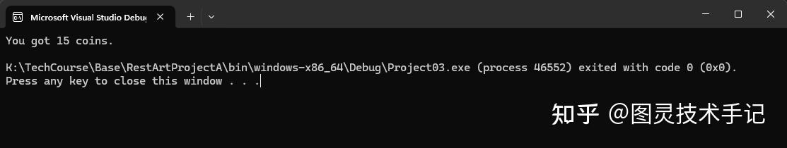
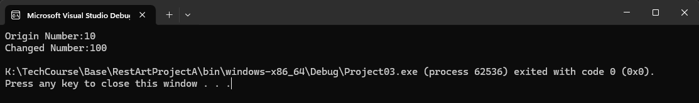
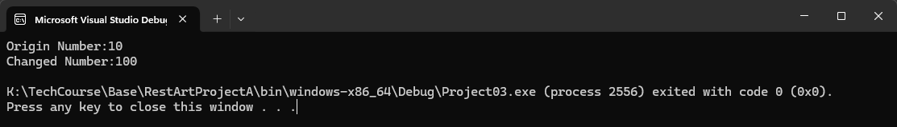

## 一、什么是函数

想象你想喝一杯苹果汁，如果要完全手动操作的话，你需要“清洗→去皮→切块→放入容器→捣碎→榨汁→过滤”等等步骤。但这时候你有一台自动榨汁机，那么我们的流程就会简化“放入苹果 →自动削皮榨汁 →得到苹果汁”这样是不是方便了很多？

函数就是这样的"代码机器"

接收原料（参数）--&gt;执行操作--&gt;返回结果

## 二、源码案例

我们再设想一个游戏机的案例

（输入）投入硬币 → （处理）验证币值 → （输出）吐出游戏币

```cpp
// 制作一个"吐币机器"
#include <iostream>

// 函数定义 (兑换汇率的说明)
int GetCoins(int cash)		// 输入两个int参数
{ 
	
	int coins = cash * 5;		// 处理过程,一个单位的现金可以换5个游戏币

	return coins;				// 返回int结果
}

int main(int argc, const char * argv[])
{
	// 使用机器
	int coins = GetCoins(3);	// 放入3个单位的货币
	std::cout << "You got " << coins << " coins." << std::endl;   // 输出15
	return 0;
}

```



我们在main函数之前声明了一个函数int GetCoins(int cash){...} 我们在main中使用的时候只需要调用这个函数就可以完成得到函数内逻辑运行的结果了，如果这个时候不断有玩家向机器索要货币，我们就不需要给他们一次又一次计算汇率了对吗，而是直接调用这个函数就足够了。

所以你发现了吗，函数可以使我们的代码变得更加干净，也更加容易被其他人理解，维护性更高了。

那我们接下来就来拆解一下函数的构成。

## 三、函数的五大关键部件

### Part1.返回类型（输出类型）

这里的类型和我们的变量类型是一样的，变量可以声明的，这里就可以返回。

（变量具体参考这一篇）

```cpp
double GetPI() // 返回double类型
{  
    return 3.1415926536; 
}

```

当然有一个特殊的返回值就是void，意味着什么都不返回，里面只对变量进行相应的操作即可，比如

```cpp
void CharacterUpgrade()    //函数不需要return来返回
{
    m_CharacterLevel += 1; //角色等级+1
}

```

### Part2.函数名（自定义的函数识别符号）

函数名是我们调用函数时候的标识符，函数名必须要保证唯一且含义清晰。

```cpp
// 好的命名案例
void spawnEnemy() { ... }    // 生成敌人
bool checkCollision() { ... }// 碰撞检测

// 不可接受的命名案例
void A() { ... } 
void B123() { ... } 

```

虽然你命名的好坏不会影响程序的编译，因为程序知道它调用了什么，但是对于开发者来说，使用名称含义不明的函数无异于用买彩票的方式写程序，是否能编译成功最后只能全看运气，对于一个大型项目来讲，其结果是灾难性的。

### Part3.参数列表（输入接口）

```cpp
void showDialog(const char * text, int fontSize) { ... }

int main(int argc, const char * argv[])
{
    const char * text = "text";
    int size = 14;
    showDialog(text,size);

    return 0;
}

```

其中text fontSize都叫做参数，也叫做形参（形式参数，Attribute），

而在实际使用中showDialog(text,size);填入的参数叫做实参（实际参数，Parameter）。

其实对于函数传入的参数来讲，还有引用传入和复制传入的区别，具体可以看类（class）这一板块相关的内容来了解。

应用传入往往其形式是加上了& 符号，用来绕过构建新的参数传入函数。

比如在void showDialog(const char* text, int fontSize){...} 中，这个fontSize就是将实参的值复制到fontSize然后传入，如果我们在函数中对fontSize进行了重新赋值，这并不会影响到原始传入的实参。

那如果我们想要在函数中更改实参怎么办？在声明中我们需要为形参添加& 符号

```cpp
void showDialog(const char * text, int & fontSize) { ... }

```

这样当我们传入fontSize这个参数并希望对参数做改变时，就可以直接改动其值了。

下面我用一个void changeNumber(int & originNumber)函数来给大家示例

```cpp
#include <iostream>

void changeNumber(int & originNumber)
{
	originNumber = 100;
}

int main(int argc, const char * argv[])
{
	int num = 10;
	std::cout << "Origin Number:" << num << std::endl;
	
	changeNumber(num);
	std::cout << "Changed Number:" << num << std::endl;

	return 0;
}

```



那还有没有别的方式可以改变值的呢？当然有，那就是使用指针传入。

具体内容大家可以查阅指针（pointer）相关板块的内容，这里仅仅给大家做一个示例，其中用到了引用和解引用的相关知识点，都是和指针的使用直接相关的。

```cpp
#include <iostream>

void changeNumber(int * originNumber)
{
	*originNumber = 100;
}

int main(int argc, const char * argv[])
{
	int num = 10;
	std::cout << "Origin Number:" << num << std::endl;
	
	changeNumber(&num);
	std::cout << "Changed Number:" << num << std::endl;

	return 0;
}

```



### Part4.函数体（自定义处理方式）

函数体就是我们刚刚在函数中写的可以多次复用的逻辑。

```cpp
void playSound() 
{
    // 这里是函数体 ↓
    cout << "播放音效！" << endl;
    system("play effect.wav");
}

```

### Part5.返回语句（结果输出——必须匹配返回类型的定义）

返回语句就是我们在函数体最后写到的return

一般来说return后面必须跟上和返回类型一样的值，除了void，返回类型为void的函数return后面可以不跟任何值，甚至可以没有return。

```cpp
int getPlayerLevel() 
{
    int currentLevel = 1;
    return currentLevel;  // 必须返回int
}

```

那有意识的小伙伴已经会发问了，既然void函数中，return不需要返回任何值，甚至可以不用return，那为什么return在void函数中还有存在的意义呢？

这就要说到我们函数中我们的逻辑了

在很多时候为了代码的安全，我们会在函数执行真正的任务之前做逻辑判断（条件判断（if else）参考 图灵技术手记：图灵重启RestArt ProjectA｜04.条件判断）

这样当判断不合格时，我们是不是可以直接返回而不执行接下来的内容，那是不是既保证了运行的安全，又简化了逻辑。

```cpp
int getPlayerLevel(int LevelIdx) 
{
    if (!LevelIndexExist(LevelIdx))
    {
        return 0;  // 如果不存在索引为传入值的关卡，那么我们直接返回0
     }

    return ChangeCurrentLevel(LevelIdx);  // 如果存在索引为传入值的关卡，那么我们直接切换关卡
}

```

## 四、函数的三种使用方式

### Part1.声明（产品预告）

函数声明可以在出现在不同的地方，等于告诉程序“嘿，我的程序中有这个函数，你放心使用，我在其他地方做了定义了”。

一般声明我们放在头文件中（头文件和CPP文件参考相关章节），也可以在任何需要使用的地方预先声明。

这里不需要函数体，也就是不需要函数的具体定义，只要告诉程序，我有这个函数就够了，这样就方便我们在不同文件之间共享某个函数的实现。

```cpp
// 头文件中声明（.h文件）
void attackEnemy(int damage);  // 分号结尾，没有函数体

```

### Part2. 定义（实际制造）

函数定义必须且仅仅可被定义一遍，即只能出现在一个地方，否则当程序识别到两个定义的时候，就不知道该怎么做了，就会直接给你报错“xxx函数被重复定义”。

当编译的时候，cpp文件都会被编译为.obj中间文件，这个文件就是告诉程序，“嘿，这里是它的定义，哪里声明过这个函数，就把这个函数的定义拿过去用吧。”

```cpp
// 源文件中定义（.cpp文件）
void attackEnemy(int damage) 
{
    enemyHP -= damage;
    cout << "造成" << damage << "点伤害！";
}

```

### Part3. 调用（使用机器）

调用函数就是我们正常使用函数的地方啦，只要有声明，且有定义，函数就会正常运行我们自定义的过程。

```cpp
int main() 
{
    attackEnemy(50);  // 调用函数
    return 0;
}

```

## 五、新手必知四大特性

### Part1. 变量作用域

作用域是C++以及大部分编程中非常重要的概念，它涉及到变量的生命周期，什么时候可以使用，什么时候会被销毁，如果超过作用域访问的话就会报错。

```cpp
void testScope() 
{
    int a = 10;  // 局部变量
    cout << a;   // ✓
}

int main() 
{
    cout << a;   // ❌ 无法访问局部变量
}

```

> 一个比较容易分辨的标识就是{} ，大括号中声明的变量，在大括号结束时就会销毁，超出大括号的范围就访问不到了。

### Part2. 参数传递

参数传递我们在参数列表这一个小节中我们也已经大致明确了三种传递方式，我们在这里再总结一下

| 类型 | 示例 | 特点 |
| --- | --- | --- |
| 值传递 | void func(int a) | 创建副本，原值不变 |
| 引用传递 | void func(int & a) | 直接操作原变量 |
| 指针传递 | void func(int * a) | 通过内存地址操作 |

### Part3. 函数重载

这是一个非常重要的概念，同一个函数的名称可以实现不同类型的传递吗？

当然可以，回到最开始的例子，一个榨汁机可以放入苹果，也可以放入西瓜或者香蕉对吧，那我们的函数也应该针对不同的传入有不同的实现。

比如我们可以给一个名字叫attack的函数传入攻击技能的索引参数，也可以给它传入技能的具体名字。

```cpp
// 同名不同参的函数
void attack(int skillIndex) { ... }       // 普通攻击
void attack(std::string skillName) { ... }     // 技能攻击

```

这样我们就可以在使用的时候用两种方式来调用

```cpp
int main(int argc, const char * argv[])
{
    attack(1); // 用技能索引值来调用
    attack("normal"); // 用技能名字来调用
}

```

### Part4. 默认参数

默认参数即函数在调用时，如果不传入参数就默认执行的值。

注意：这里默认值必须在列表参数的后面，不可以在默认值后，又声明没有默认值的参数。

```cpp
void showMessage(string text, int times = 1) 
{
    for(int i=0; i<times; i++) 
        cout << text;
}

showMessage("Hello");    // 默认显示1次
showMessage("Hi", 3);    // 显示3次

```

## 六、新手常见错误

### 错误1：忘记返回

```cpp
int add(int a, int b) 
{
    int sum = a + b; 
    // 忘记写return → 导致未定义行为！
}

// 正确写法：
int add(int a, int b) { return a + b; }

```

### 错误2：参数类型不匹配

```cpp
void setSpeed(float speed) { ... }
setSpeed(5);  // ✓ int隐式转float
setSpeed("fast"); // ❌ 字符串无法转换

```

### 错误3：作用域混淆

```cpp
int a = 10;  // 全局变量

void test() 
{
    int a = 20;  // 局部变量
    cout << a;   // 输出20（局部优先）
}

```

## 七、游戏开发实战案例

### 案例1：角色属性计算

```cpp
float calculateDamage(float attack, float defense) 
{
    float base = attack * 2.5f;
    float reduction = defense / (defense + 100);
    return base * (1 - reduction);
}

int main()
{
    // 使用示例
    float dmg = calculateDamage(80, 50);
}


```

### 案例2：游戏物体生成

```cpp
void spawnEnemy(string type, int count = 1) 
{
    for(int i=0; i<count; i++) {
        cout << "生成" << type << "敌人！" << endl;
        // 实际游戏中的对象实例化代码...
    }
}

int main()
{
    // 调用
    spawnEnemy("僵尸");
    spawnEnemy("骷髅战士", 3);
}

```

### 案例3：碰撞检测

```cpp
bool checkCollision(int x1, int y1, int w1, int h1,
                   int x2, int y2, int w2, int h2) 
{
    return (x1 < x2 + w2) &&
           (x1 + w1 > x2) &&
           (y1 < y2 + h2) &&
           (y1 + h1 > y2);
}

int main()
{
    // 使用
    if(checkCollision(playerX, playerY, 32, 32,
                 enemyX, enemyY, 32, 32)) 
    {
        // 处理碰撞...
    }
}

```

## 八、最佳实践指南

### 原则一：单一职责，一个函数只做一件事

```cpp
// 不好 ❌
void handlePlayer() 
{
    move();
    attack();
    draw();
}

// 好 ✅ 
void updatePlayer() { move(); attack(); }
void renderPlayer() { draw(); }

```

### 原则二：输入参数在前，输出参数在后

```cpp
void transformObject(float x, float y，// 输入参数
                     Object& obj)      // 输出参数 
{ ... } 

```

### 原则三：多使用const来保证参数的安全性

const的相关资料参考const篇

```cpp
// 不会修改的参数加const
void printMessage(const string& msg) 
{
    cout << msg;  // 保证不修改msg
}

```

### 原则四：先写函数声明，再写实现！就像先画蓝图再盖房子 ️

```cpp
// 在头文件中声明
namespace GameUtils 
{
    float calculateExperience(int level);
}

// 在源文件中实现
float GameUtils::calculateExperience(int level) 
{
    return level * 100 * 1.5f;
}

```

今天的知识点你都有Get到吗~

有没有什么疑问，我们在评论区见哦~

你们也可以告诉我有什么是你们想知道的


