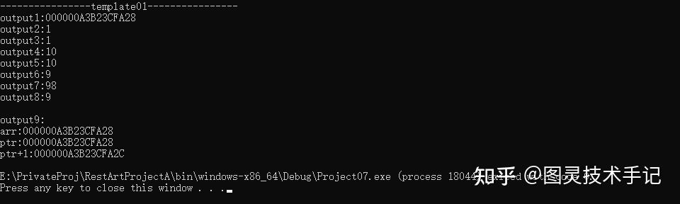
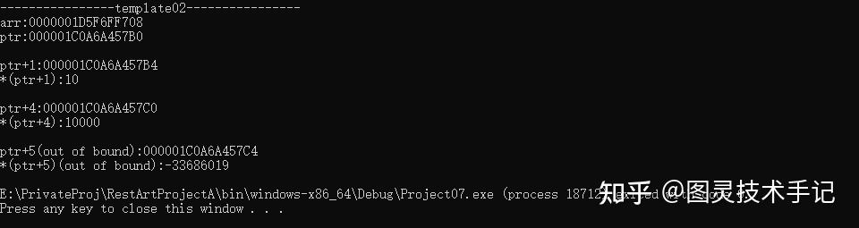
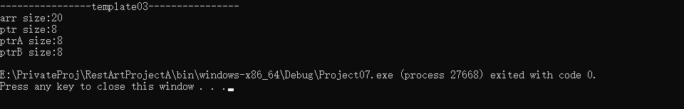

## 一、什么是数组？

数组一句话解释就是同类型变量的「储物柜」

想象你是一个游戏背包系统的设计师，需要存储玩家的10把武器。如果用int weapon1, weapon2...weapon10;定义变量，代码会臃肿不堪！

所以我们为什么不将这些武器放到一起呢？就像这样

```cpp
int weapons[10]; // 10个连续的武器槽位
```

这样我们就简简单单声明了一个数组，允许我们在其中存放10把武器

如果向从中取用某一把，只需要weapons[1] 就可以取出第二把武器啦

> 这里要记住，程序的计数是从0开始的，而我们正常计数是从1开始的，一定要牢记

数组的本质：一组连续内存空间的储物柜，用同一个名字+编号管理多个同类型数据。

## 二、源码案例

### Template01.数组声明和调用

```cpp
int main(int argc, const char * argv[])
{
	// initialized by each member
    int arr[5]{ 1,10,100,1000,10000 };
    int* ptr = arr;

    std::cout << "output1:" << arr << std::endl;

    std::cout << "output2:" << arr[0] << std::endl;
    std::cout << "output3:" << *arr << std::endl;

    std::cout << "output4:" << arr[1] << std::endl;
    std::cout << "output5:" << *(arr + 1) << std::endl;

    arr[0] = 9;
    std::cout << "output6:" << *arr << std::endl;

    *(arr + 1) = 98;
    std::cout << "output7:" << arr[1] << std::endl;

    int a = *arr;
    a = 7;
    std::cout << "output8:" << *arr << std::endl;

    std::cout << std::endl;
    std::cout << "output9:" << std::endl;

    std::cout << "arr:" << arr << std::endl;
    std::cout << "ptr:" << ptr << std::endl;
    std::cout << "ptr+1:" << ptr + 1 << std::endl;
}
```



在这一组例子中，主要说明了如何声明和使用数组。

从int arr[5]{1,10,100,1000,10000}; 中知道了数组一般的声明方式。

这里的这个数组是存储了5个整数值的数组，在后续的调用中，也必须是5个值，换句话说，这样的数组是静态的，不能根据程序需求动态变化长度，但是这样的数组十分安全，不会有超出内存或者其他的一些问题。

接着这句话int* ptr = arr; 说明了一个特别有意思的问题，arr虽然是一个数组的变量名，但其本质确是一个指针。（关于指针可以具体查看指针一篇）

所以在Output1中，直接输出arr时，输出的是指针的地址，并不是这个数组。

再看Output2，我们在arr后面加上了[]操作符对其数值进行访问，这时候就可以访问到其第一个元素了。

同理我们看一下Output4，操作符中传入的是1，也就是第二个元素，所以打印出来的结果也就是数组的第二个元素啦。

但还有不太一样的，我们观察一下Output3和Output5，有没有发现，我们并没有使用[]操作符，直接使用了加法；这里比较特殊，我们已经知道这个arr实际上是一个指向第一个元素的指针（但是跟纯指针稍微有些区别，看下文Template03），这样我们的程序就已经知道它一个单位存放的是什么类型的数据，而+1就是访问下一个元素的位置。（再次强调：是访问下个元素的位置，因为程序已经知道arr中的每一个数值占用了多少内存，所以就可以直接跳到下一个元素）

接着我们再看一下Output6和Output7，用指针的形式访问到元素后，我们可以直接更改元素的值，这又说明了什么问题？我们通过[] 的访问是引用访问，不是复制访问，等效于我们直接访问到了内存中的这个地址的元素，而不是将这个地址存储的值复制出来。

进一步明确这个问题，我们观察Output8的实现逻辑，int a =*arr; 将第一个值获取出来，但是这里有一个陷阱，就是复制的陷阱，int 后面没有跟上引用符号& 所以这里的a是第一个值的复制，后面进行了赋值操作，但是这只影响到了a，这个a并不是数组中的元素，所以当我们Debug的时候，输出的值依然为前面更改后的值，也就是9而不是7。

### Template02.堆栈两种数组声明方式

```cpp
int main(int argc, const char * argv[])
{
	// assigned in stack
	// stack assignment will be destroyed at the end of current bracket;
	int arr[5]{ 1,10,100,1000,10000 };

	// assigned in heap
	// heap assignment will be destroyed only when the program get to end except use delete;
	int* ptr = new int[5] {1, 10, 100, 1000, 10000};


	std::cout << "arr:" << arr << std::endl;
	std::cout << "ptr:" << ptr << std::endl;
	std::cout << std::endl;
	std::cout << "ptr+1:" << ptr + 1 << std::endl;
	std::cout << "*(ptr+1):" << *(ptr + 1) << std::endl;
	std::cout << std::endl;
	std::cout << "ptr+4:" << ptr + 4 << std::endl;
	std::cout << "*(ptr+4):" << *(ptr + 4) << std::endl;
	std::cout << std::endl;
	std::cout << "ptr+5(out of bound):" << ptr + 5 << std::endl;
	std::cout << "*(ptr+5)(out of bound):" << *(ptr + 5) << std::endl;

	delete[] ptr;
	
}
```



在这个案例中，我们不仅用了第一种声明数组的方式（栈数组）int arr[5]{1,10,100,1000,10000}; ，另外还用到了另一种声明方式（堆数组）int* ptr =newint[5]{1,10,100,1000,10000}; 这两种有区别吗？当让，而且区别很大。

这里大家首先回想一下我们在变量中所说到的作用域，如果忘记了可以在巩固一遍 图灵技术手记：图灵重启RestArt ProjectA｜02.认识C++基础变量

他俩第一重区别就是生命周期完全不同。

栈声明的数组，可以随着程序跨出作用域而主动结束生命周期。

但是！！！堆数组不会，如果没有手动调用delete[] ptr 在整个程序生命周期中，其数组会一直占用内存而不被销毁，这时候如果指向这个数组的指针被销毁了，而数组还遗留在程序中，就是C++最普遍的一个bug——内存泄漏，我们因为指针丢失没办法再访问这个数组，也没办法再删除这个数组，这对程序来会产生很多积少成多的垃圾。

他们的第二重区别就是访问其大小时，arr虽然是栈数组，但是其可以读到所有元素的大小之和，而不是指针的大小，但是ptr属于堆数组，访问ptr的大小，并不是访问ptr数组，所以其大小永远是一个指针的大小，也就是8Byte的大小。（具体看Template03）

### Template03.数组指针和数组的大小

```cpp
void template03()
{
	// assigned in stack
	// stack assignment will be destroyed at the end of current bracket;
	int arr[5]{ 1,10,100,1000,10000 };
	int* ptr = arr;

	// assigned in heap
	// heap assignment will be destroyed only when the program get to end except use delete;
	int* ptrA = new int[5] {1, 10, 100, 1000, 10000};
	int* ptrB = new int[9] {1, 10, 100, 1000, 10000, 10, 100, 1000, 10000};

	std::cout << "arr size:" << sizeof(arr) << std::endl;
	std::cout << "ptr size:" << sizeof(ptr) << std::endl;
	std::cout << "ptrA size:" << sizeof(ptrA) << std::endl;
	std::cout << "ptrB size:" << sizeof(ptrB) << std::endl;

}
```



这里我们做了三组对比测试

第一组是arr和ptr的比较，arr是栈数组，当我们获取其size的时候，它可以明确获得其元素大小之和（5个int之和为20Byte），但一旦将arr赋予给ptr作为指针的时候，其大小就变成了一个指针的大小，因为ptr明确被声明为int *

第二组是arr和ptrA的比较，arr是栈数组，ptrA是堆数组，很明显，堆数组的声明也只能识别为一个指针的大小，而不是元素之和的大小

第三组是ptrA和ptrB的比较，两者都是堆数组，ptrA有5个元素，ptrB有9个元素，但是当我们获取其size的时候，最终都返回了一个指针的大小，这就是堆数组的特性，也是所有指针的特性

## 三、实用案例

### 游戏场景：动态生成随机数量的野外敌人

```cpp
int enemyCount = rand() % 20 + 10; // 随机10~30个敌人
int* enemies = new int[enemyCount]; 
// ...初始化敌人数据
delete[] enemies; // 战斗结束后清理内存


```

### 游戏案例：快速遍历敌人施加减速效果

数组可以在循环中直接使用，关于数组如果有遗忘可以查看数组一篇

尤其是当我们声明index（i）时，index的顺序刚好就是我们访问的元素的顺序，不会有任何遗漏

```cpp
for (int i=0; i<5; ++i) 
{
    ApplySlowEffect(enemyHP + i); // 指针传递敌人地址
}


```

### 游戏案例：Boss弹夹中的子弹数量

当设计一个BOSS类时，可能需要动态管理其可以发射的子弹，并在类销毁时，主动销毁这个数组

```cpp
class Boss 
{

public:
    explicit Boss(int patternCount) {
        bulletPatterns = new int[patternCount]; // 按需创建
        // 初始化模式代码...
    }

    virtual ~Boss() {
        delete[] bulletPatterns; // 死亡时自动清理弹药库
    }

private:
    int* bulletPatterns; // 存储子弹发射模式
};


```

## 四、数组常见错误

### 01.越界访问

```cpp
int arr[5];
arr[5] = 10; // 越界！可能覆盖其他内存数据
```

### 02.忘记释放堆数组

```cpp
void LoadMap() 
{
    int* mapData = new int[1000];
    // 忘记写delete[] mapData;
} // 每次调用泄漏1KB内存，最终游戏卡死


```

### 03.返回局部栈数组

```cpp
int* CreateBuff() 
{
    int buff[3]{10,20,30};
    return buff; // 函数结束buff被销毁，返回野指针！
}


```

今天的知识点你都有Get到吗~

有没有什么疑问，我们在评论区见哦~

你们也可以告诉我有什么是你们想知道的


