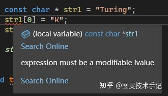
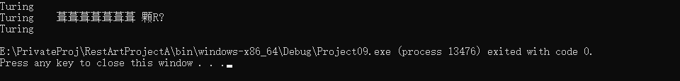
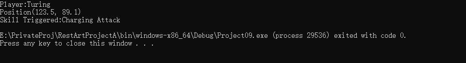

游戏中角色是不是得有自己的名字？技能是不是在介绍中也得有名字？甚至在FPS游戏中敌人标、队友标是不是都得有名字？在程序的本质上，这些名字就是字符串。

我们在声明一串字符串的时候，一般来说会用到这样的方式

```cpp
const char * name = "Turing";

```

这样当我们在打印name的时候，就会在控制台上显示Turing。

字符串可以有很多用处，显示名字，给对象打标签，输出log信息等等，都是我们日常在程序中常用的地方。但即使是接触编程很久的小伙伴也依然会问我一个问题，为什么不建议长期使用const char *而是推荐使用std::string，在UE开发中推荐大家使用FString呢？

这就不得不让我们重新理解什么是字符串，它的工作原理又是什么样的。

## 一、内存分布

内存分布对于很多小伙伴来说熟悉又陌生，.data .rodata BSS这些名词可能听过但也可能忘了具体什么意思

接下来我们举个例子把这些内容列举出来

以前面的声明为例，我们会发现，name看起来是一个存储char且不可更改其内容的指针，然后我们将一个值赋予给了这个指针，没有通过堆或者栈进行声明就赋予了一个值。

可是我们都知道一个变量必须要在内存中“安家”才能被访问，那这个变量去哪了？

其实"Turing"这个变量的名字叫做字面量，是存储在C++中固定内存地址的量，不在堆上，也不在栈上，而是在只读数据段中。

要理解这个数据段，我们就要将内存分布展开如下

```cpp
+---------------------+
|  代码段（.text）     | ← 可执行指令
+---------------------+
|  只读数据段（.rodata）| ← 只读常量存储在此处
+---------------------+
|  数据段（.data）     | ← 已初始化的全局变量
+---------------------+
|  BSS段（.bss）       | ← 未初始化的全局变量
+---------------------+
|  堆（heap）          | ← 动态分配的内存
+---------------------+
|  栈（stack）         | ← 局部变量
+---------------------+
```

一般来说内存总共分为这么几个部分，我们比较熟悉的堆栈，还有代码段、只读数据段、数据段和bss段

.bss是指那些没有初始化的和初始化为0的全局变量，BSS段不存放在程序文件中。

.data段（数据段）的名字就暗示着里面存放着数据，是那些已经被初始化之后的数据。如果数据全是零，为了优化考虑，编译器把它当作.bss处理。通俗的说，.data存储那些初始化过（非零）的非const的全局变量。

.rodata段，ro代表read only，即只读数据(const)，但是！！！常量不一定就放在rodata里，有的立即数直接编码在指令里，存放在代码段(.text)中。对于字符串常量，编译器会自动去掉重复的字符串，保证一个字符串在一个可执行文件(EXE/SO)中只存在一份拷贝，所以我们的字面量就存储在了这里。

.rodata是在多个进程间是共享的，这可以提高空间利用率。在有的嵌入式系统中，.rodata放在ROM(如norflash)里，运行时直接读取ROM内存，无需要加载到RAM内存中。

## 一、const char *字符串

到这里我们就知道了字面量一旦生成就存储在.rodata中，而const char * name只是一个指向这个内存的地址，那其实字符串的本质就是包含char的数组

当我们打印name的时候，就会发现，它和数组的特性一样，会打印整个字符串，而不是仅仅第一个字符。

```cpp
int main()
{
	const char * str1 = "Turing";
	
	std::cout << str1 << std::endl;  // 打印Turing
}

```

但是！！！我们不能像数组一样去操作name[0]="K" ，因为它是只读的，不可更改。



不过，如果想要更改我们可以将这个指针指向另一个字面量

```cpp
void template01()
{
	const char * str1 = "Turing";
	str1 = "TuringRestArt";

	std::cout << str1 << std::endl;
}

```

但是这样会在内存中发生的过程可以理解为，.rodata新声明了一个块用来存储"TuringRestArt" ，而
"Turing" 虽然没有被使用了，但是却会一直存储在程序中，直到整个程序结束。

## 二、char[]字符串

使用char数组来声明字符串与数组声明完全相同

既可以使用堆数组来声明，也可以使用栈数组

```cpp
char str[7] = "Turing"; // 栈数组声明
char * str = new char[]("Turing"); // 堆数组声明

```

这里有一个值得注意的地方，为什么Turing是6个字符，但是却需要声明长度为7的字符串呢？

这就是字符串的特性，在输出字符串时，程序本身也不知道什么时候该停止，每一个字符都在内存上紧密排列着，所以C++标准中就提出了一个终止符即0，不过这可不是数字0，而是转义字符中的'\0'，我们可以进行验证

```cpp
void template02()
{
	char* str1 = new char[]("Turing");
	char* str2 = new char[]{'T','u','r','i','n','g'};
	char* str3 = new char[]{'T','u','r','i','n','g','\0'};

	std::cout << str1 << std::endl;
	std::cout << str2 << std::endl;
	std::cout << str3 << std::endl;
}

```



这里声明了三个字符串，第一个和第三个都正常，这是因为str1默认使用了.rodata中的字符串进行了初始化，已经包含进去了'\0'，str3是手动声明了'\0' ，这都可以让程序打印到这就结束，但是str2由于没有声明结束符号，所以程序就会一直打印，直到在内存中碰到'\0' 为止，而在打印的过程中碰到的一切内容都会被强制解读为字符，也就导致了未定义的读取结果。

使用char[]一定要注意缓冲区溢出的问题

```cpp
char dangerStr[7] = "Turing";
strcpy(dangerStr, "TuringRestArt"); // 内存越界！

```

安全解决方案

```cpp
char dangerStr[7] = "Turing";
// C风格安全函数
strncpy(dangerStr, "Furing", sizeof(dangerStr)-1);

```

常见误区——取值错误

```cpp
#include <iostream>

#define LOG(X) std::cout << X <<std::endl


int main() 
{
    char * name = "Turing";
    name[2] = 'a'; // 无效更改
    LOG(name);
}

```

这里误以为name是栈数组，正确做法应该是用指针的offset去获取

```cpp
#include <iostream>

#define LOG(X) std::cout << X <<std::endl


int main() 
{
    char * name = "Turing";
    *(name+2) = 'a'; // 正确更改
    LOG(name);
}

```

## 三、std::string字符串

std::string被封装在&lt;string&gt;这个模块中，使用前要#include &lt;string&gt;

std::string是c++原生的一个类，可以当成一般的变量来使用，且内置了许多非常方便的字符串操作办法

### Part01.std::string内存管理

```cpp
// 动态内存分配示意图
+-------------------+      +------------------+
| std::string对象   | ---> | 堆内存动态分配   |
| (栈/其他内存区)   |      | [字符数据+元数据]|
+-------------------+      +------------------+

```

- RAII原则：自动管理内存生命周期（构造分配，析构释放）

- Small String Optimization (SSO)：短字符串（通常≤15字符）直接存储在对象内部，避免堆分配

- 动态扩容：容量不足时按几何级数增长（如 1.5x 或 2x 扩容）

### Part02.关键成员函数

| 类别 | 典型函数 | 游戏开发应用场景 |
| --- | --- | --- |
| 构造 | string(const char*) | 从C字符串转换资源路径 |
| 容量 | reserve(size_t) | 预分配内存优化网络数据包处理 |
| 修改 | append/insert/erase | 动态构建游戏日志 |
| 访问 | operator[]/at/c_str | 与OpenGL/DX API交互时传递数据 |
| 查找 | find/rfind | 解析配置文件键值对 |
| 迭代 | begin/end | 与STL算法结合处理字符串 |

### Part03.基础操作

案例1：资源路径拼接（避免缓冲区溢出）

```cpp
std::string BuildAssetPath(const std::string& baseDir, 
                          const std::string& modelName) 
{
    std::string path = baseDir;
    if (path.back() != '/') path += '/';  // 自动处理路径分隔符
    path += modelName + ".fbx";           // 安全拼接
    return path;                          // 返回值优化（RVO）生效
}

// 调用示例
std::string modelPath = BuildAssetPath("Assets/Characters", "Turing");

```

案例2：玩家输入过滤（安全替换）

```cpp
void SanitizePlayerName(std::string& name) 
{
    // 替换非法字符
    size_t pos = 0;
    while ((pos = name.find_first_of("!@#$%", pos)) != std::string::npos) 
    {
        name.replace(pos, 1, "_");
    }
    
    // 限制最大长度
    if (name.length() > 16) {
        name.resize(16);  // 自动截断
    }
}

```

> 注意：使用std::string的时候，为了避免过多拷贝，使用的都是引用传入

这里的引用传入比如我们传入函数时，也可以使用移动语义，避免过多拷贝

```cpp
std::string CreateWeaponName() 
{
    std::str name = "SwordOf";
    name += GetRandomSuffix();
    return name; // 触发移动构造（非复制）
}

// 接收时使用移动语义
void DisplayWeapon(std::string&& name) 
{
    mWeaponName = std::move(name); // 零拷贝
}

```

同时有一点非常值得注意，从性能角度考虑，如果我们想要拼接std::string，就可以利用其封装的功能来预先分配内存而避免多次重分配，以此来提升性能。

```cpp
// 低效方式（多次内存分配）
std::string result = "";
for(auto& item : lootList) 
{
    result += item.name + ","; 
}

// 高效方式（预分配内存）
std::string result;
result.reserve(1024); // 根据预估长度预分配
for(auto& item : lootList) 
{
    result.append(item.name).append(",");
}

```

## 四、std::format

这里简单提一下C++20的新特性，就是这个std::format ，封装在&lt;format&gt;模块中 ，使用前需要#include &lt;format&gt;

```cpp
#include <format>
#include <string>

void template04()
{

	std::string log = std::format("Player:{0}\nPosition({1:.1f}, {2:.1f})\nSkill Triggered:{3}",
		"Turing", 123.456f, 89.123f, "Charging Attack");

	std::cout << log << std::endl;


}

```



这里看起来复杂，但是我们拆解一下

std::format至少要传入两个参数，第一个参数则是format的格式，其中用{} 括起来的区域则是待填入的模板量，这个模板量可以是C++内置的任意参数（强调是内置的，否则要额外定义）

后面的参数根据我们定义的模板数量来决定，同时也可以看到括号中有0，1，2，3之类的标注，对应的是后面参数的顺序，也就是说我们可以定义后面第几个传入的参数可以放到目前这个模板中来。

这里特殊注意的是float以及double这类小数变量的传入，使用了{1:.2f}之类的表达，其是用来决定保留几位小数的，这里2就是保留两位小数，原代码中是1，结果也就只保留了一位小数。

游戏简单日志案例

```cpp
class GameLogger {
public:
    template<typename... Args>
    void Log(LogLevel level, std::format_string<Args...> fmt, Args&&... args) 
    {
        std::string msg = std::format("[{}] {}", GetLevelStr(level), 
                                     std::format(fmt, std::forward<Args>(args)...));
        WriteToFile(msg);
    }
};

// 使用示例
logger.Log(LogLevel::Warning, "角色{}的生命值过低: {}/{}", 
          player.GetName(), player.GetHP(), player.GetMaxHP());

```

## 五、Restrict模式

字符串的严格模式就是在双引号左边加上R 标识即可，也就意味着双引号中，字符串的格式是什么，打印出来的字符串就是什么。

```cpp
#include <iostream>

#define LOG(X) std::cout << X <<std::endl

int main() 
{
    const char* text = R"(Line1
Line2
Line3)";

    LOG(text);
}

```

今天的知识点你都有Get到吗~

有没有什么疑问，我们在评论区见哦~

你们也可以告诉我有什么是你们想知道的


