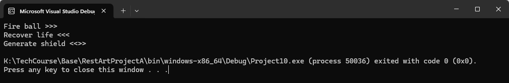
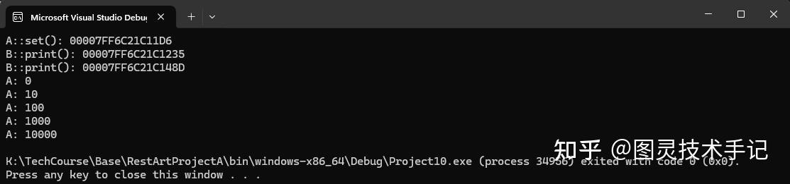

> 不知道大家有没有发现，编程这个东西越学越"抽象"，我们在编程的过程中，思维逐渐开始以结构化的方式思考日常的问题，然后我们会发现开发中或者生活中的问题都可以用程序的方式进行抽象和提炼再进一步解决。
是的，我们的思维和解决问题的方式又多了一种选择啦~我们的编程能力就是在一点一滴的积累中成长的。

游戏中，释放一个技能需要一套流程，也就是说我们的技能可以抽象成一个函数，那技能A、技能B、技能C都是一个函数，现在我有一个角色需要释放技能，为了代码足够容易理解，角色只有一个函数叫做释放技能，至于释放哪一个，不知道。

又或者我们只有一个抽象的角色类，我想让用户定义应该释放哪个技能或者怎么释放，这个时候我们如何处理呢？

```cpp
// 传统写法：一堆if-else判断技能类型
void castSkill(int skillType) 
{
    if(skillType == 1) fireball();
    else if(skillType == 2) heal();
    else if(skillType == 3) shield();
    // ...每新增一个技能都要修改这里
}

```

这样做是不是不太“美观”，让人读起来难以理解，如果是一百种可能呢？一百句话？那能不能让这种方式通用起来，只要是类似的，传入就能运行？

我们大胆猜想能不能把函数也当作一个参数传入另一个函数呢？配合其他的固定逻辑一起运行？

是的这就是函数指针的来历，当然函数指针有着特别多的用处，在未来我们还会多次提起，不管是回调、还是事件还是UE中Delegate代理系统，其本质都是函数指针。

## 一、 什么是函数指针

普通指针：存储变量地址

函数指针：存储函数地址（指向一段可执行的代码，也就是在.text段的内容）

具体可以查阅字符串这一篇

我们可以对比一下不同场景下函数指针的使用

1.一般游戏技能的快捷按键根据不同玩家的习惯会有不同，这个时候我们不能将程序写死，而是用函数指针来绑定不同的技能函数

2.我们使用手柄按键的时候，也会又映射，比如跳跃映射等等，我们需要动态切换函数的操作逻辑，这里也需要函数指针

3.再比如在AI状态切换时，为了使不同的状态映射不同的行为，也需要将行为封装为函数，然后再传入进行判断

## 二、 使用函数指针

### 第1步：定义函数指针类型

```cpp
// 定义函数指针类型（返回值与参数要匹配）
typedef void (*SkillFunc)(); // 无参数无返回值的函数指针
typedef float (*OnHit)(float); // float参数，返回float的函数指针

```

一个函数基本的创建格式如下

```cpp
data_types (*func_pointer)( data_types arg1, data_types arg2, ...,data_types argn);

```

### 第2步：创建函数指针变量

```cpp
SkillFunc currentSkill = nullptr; // 初始化为空指针

```

### 第3步：绑定与调用

```cpp
// 定义三个技能函数
void fireball() { cout << "发射火球！ "; }
void heal() { cout << "恢复生命！ "; }
void shield() { cout << "生成护盾！ ️"; }

// 绑定技能到按键
currentSkill = &fireball; // 绑定火球技能
currentSkill(); // 执行 → 发射火球！

currentSkill = &heal;    // 切换到治疗
currentSkill(); // 执行 → 恢复生命！

```

## 三、 实战案例：灵活的技能系统

### Part1.技能配置表

```cpp
#include <iostream>
#include <map>

typedef void (*SkillFunc)();

void fireball() { std::cout << "Fire ball >>>" << std::endl; }
void heal() { std::cout << "Recover life <<<" << std::endl; }
void shield() { std::cout << "Generate shield <<>>" << std::endl; }

void castSkill(int key, std::map<int, SkillFunc> skillMap)
{
	if (skillMap.find(key) != skillMap.end())
	{
		skillMap[key](); // 调用对应的技能函数
	}
}


int main(int argc, const char* argv[])
{

	std::map<int, SkillFunc> skillMap;
	
	skillMap[1] = &fireball;
	skillMap[2] = &heal;
	skillMap[3] = &shield;

	castSkill(1, skillMap);
	castSkill(2, skillMap);
	castSkill(3, skillMap);

	return 0;
}

```



用这样的方式调用是不是更方便？每次我们只用处理值得传入，然后调用其键值对具体的技能函数就可以实现相应功能了，而同时我们又而已自行设定每个键位所绑定的具体函数，对于游戏配置而言更自由了。

> 第一个小的知识点就是typedef，这里使用typedef相当于是一个宏，可以让我们定义的函数指针有具体的名字SkillFunc，方便像变量一样声明，进一步复用
第二个小的知识点就是map，map就是一个存储键值对的数组，可以通过访问key来找到相应的value（具体参考map一篇）

### Part2.动态切换AI行为

```cpp
// 定义不同AI行为函数
void patrolBehavior() { /* 巡逻逻辑 */ }
void chaseBehavior() { /* 追击逻辑 */ }
void attackBehavior() { /* 攻击逻辑 */ }

// AI状态枚举
enum class AIState { Patrol, Chase, Attack };

// 使用函数指针管理当前行为
void (*currentAIBehavior)() = nullptr;

void updateAI(AIState state) {
    switch(state) {
        case AIState::Patrol: 
            currentAIBehavior = &patrolBehavior;
            break;
        case AIState::Chase:
            currentAIBehavior = &chaseBehavior;
            break;
        case AIState::Attack:
            currentAIBehavior = &attackBehavior;
            break;
    }
    currentAIBehavior(); // 执行当前行为
}

```

这里的处理不单单是利用了一个key值，更是通过我们讲过的enum来使代码更具有可读性

### Part3.C++11升级版：使用std::function

```cpp
#include <functional>

// 定义函数包装器
std::function<void()> currentSkill;

// 支持lambda表达式,具体查看lambda一篇
currentSkill = [](){
    std::cout << "释放闪电链！⚡" << std::endl; 
};

currentSkill(); // 输出：释放闪电链！⚡

```

## 三、 ️函数指针的三大优势

解耦合：调用方不需要知道具体实现，只用满足其传入值和返回值就可以了

动态切换：运行时随时改变函数行为

可扩展性：新增功能无需修改调用框架，使得程序更具有可拓展性

## 四、 新手常见错误

### 错误1：函数签名不匹配

```cpp
int getDamage() { return 100; }

SkillFunc skill = &getDamage; // ❌ 返回值类型不匹配！

```

### 错误2：空指针调用

```cpp
SkillFunc skill = nullptr;
skill(); //   运行时崩溃！

```

正确做法：增加空指针检查

```cpp
SkillFunc skill = nullptr;

if(skill != nullptr) 
{
    skill();
}

```

## 五、拓展和提示——指向类成员函数的函数指针

关于类可以具体查看class（类）一篇，这里留下一个钩子随时可以返回来看

类成员函数指针（member function pointer）用于存储一个指定类具有给定的形参列表与返回值类型的成员函数的访问信息

基本上要注意的有两点：

1、函数指针赋值要使用 &

2、使用 .* (实例对象)或者 -&gt;*（实例对象指针）调用类成员函数指针所指向的函数

### 情况1.类成员函数指针指向类中的非静态成员函数

对于 nonstatic member function （非静态成员函数）取地址，获得该函数在内存中的实际地址

对于 virtual function（虚函数）, 其地址在编译时期是未知的，所以对于 virtual member function（虚成员函数）取其地址，所能获得的只是一个索引值

```cpp
//指向类成员函数的函数指针
#include <iostream>
#include <cstdio>
using namespace std;
 
class A
{
    public:
        A(int aa = 0):a(aa){}
 
        ~A(){}
 
        void setA(int aa = 1)
        {
            a = aa;
        }
        
        virtual void print()
        {
            cout << "A: " << a << endl;
        }
 
        virtual void printa()
        {
            cout << "A1: " << a << endl;
        }
    private:
        int a;
};
 
class B:public A
{
    public:
        B():A(), b(0){}
        
        B(int aa, int bb):A(aa), b(bb){}
 
        ~B(){}
 
        virtual void print()
        {
            A::print();
            cout << "B: " << b << endl;
        }
 
        virtual void printa()
        {
            A::printa();
            cout << "B: " << b << endl;
        }
    private:
        int b;
};
 
int main(void)
{
    A a;
    B b;
    void (A::*ptr)(int) = &A::setA;
    A* pa = &a;
    
    //对于非虚函数，返回其在内存的真实地址
    printf("A::set(): %p\n", &A::setA);
    //对于虚函数， 返回其在虚函数表的偏移位置
    printf("B::print(): %p\n", &A::print);
    printf("B::print(): %p\n", &A::printa);
 
    a.print();
 
    a.setA(10);
 
    a.print();
 
    a.setA(100);
 
    a.print();
    //对于指向类成员函数的函数指针，引用时必须传入一个类对象的this指针，所以必须由类实体调用
    (pa->*ptr)(1000);
 
    a.print();
 
    (a.*ptr)(10000);
 
    a.print();
    return 0;
}

```



### 情况2.类成员函数指针指向类中的静态成员函数

```cpp
#include <iostream>
using namespace std;
 
class A{
public:
    
    //p1是一个指向非static成员函数的函数指针
    void (A::*p1)(void);
    
    //p2是一个指向static成员函数的函数指针
    void (*p2)(void);
    
    A(){
        p1 =&A::funa; //函数指针赋值一定要使用 &
        p2 =&A::funb;
        
        //p1 =&A::funb;//error
        //p2 =&A::funa;//error
        
        //p1=&funa;//error,编译器错误 C2276
        //p2=&funb;//error,编译器错误 C2276
    }
    
    void funa(void){
        puts("A");
    }
    
    static void funb(void){
        puts("B");
    }
};
 
int main()
{
    A a;
    //p是指向A中非static成员函数的函数指针
    void (A::*p)(void);
    
    (a.*a.p1)(); //打印 A
    
    //使用.*(实例对象)或者->*（实例对象指针）调用类成员函数指针所指向的函数
    p = a.p1;
    (a.*p)();//打印 A
    
    A *b = &a;
    (b->*p)(); //打印 A
    
    /*尽管a.p2本身是个非static变量,但是a.p2是指向static函数的函数指针，
     **所以下面这就话是错的!
     */
//    p = a.p2;//error
    
    void (*pp)(void);
    pp = &A::funb;
    pp(); //打印 B
    
    return 0;
}

```

对指向非static成员函数的指针和指向static成员函数的指针的变量的赋值方式是一样的，都是&ClassName::memberVariable形式

区别在于：

对p1只能用非static成员函数赋值

对p2只能用static成员函数赋值

再有，赋值时如果直接&memberVariable，则在VS中报"编译器错误 C2276"

今天的知识点你都有Get到吗~

有没有什么疑问，我们在评论区见哦~

你们也可以告诉我有什么是你们想知道的


