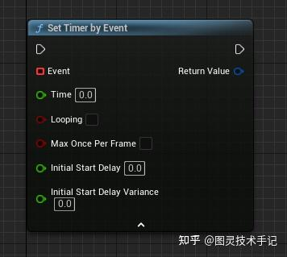
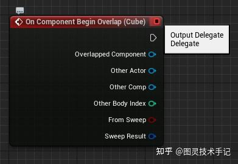
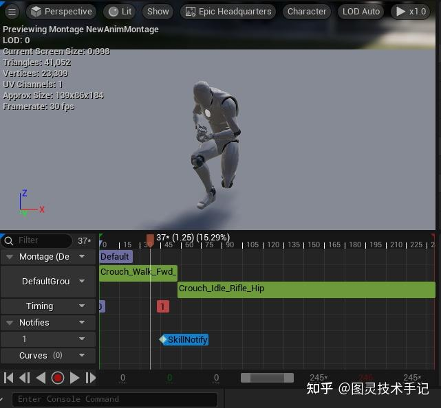
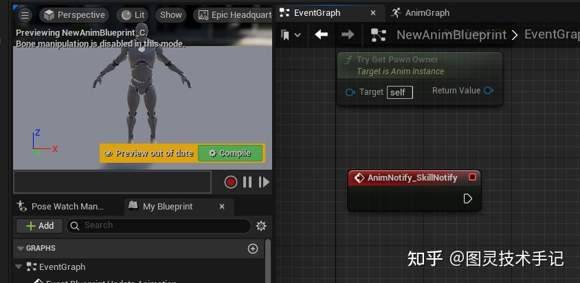
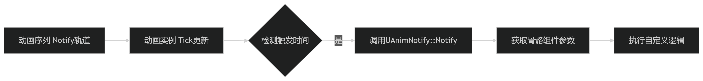

又是一章新的名词，lambda？可以用来做什么？是用来解决什么问题的？

我们思考一下上一章Function Pointer的内容，我们外部声明一个函数，然后通过指针将指向这个函数的地址传入一个函数或者一个类的成员变量之后进行调用。

所以就会存在这样的一个情况，比如我想临时创建一个函数比较一下两个数的大小，或者进行排序呢？是不是为这种复用率不高的操作单独声明一个函数会比较复杂。

这种情况下我们就可以临时声明一个没有名字的函数，一个不会在其他地方调用的函数——lambda

## 一、 Lambda表达式是什么？

总的来说lambda函数有以下三个主要特征

匿名函数：没有名字的临时函数对象

捕获能力：可以访问外部变量

即用即弃：适合一次性使用场景

一个完整的lambda表达式的样子是这样

```cpp
// 完整语法（不常用）
[capture](parameters) -> return_type { body }

// 常见形式
[](int x, int y) { return x + y; } // 隐式返回类型
[=]() { /* 值捕获所有外部变量 */ }
[&]() { /* 引用捕获所有外部变量 */ }

```

这里有一个比较有意思的点，就是capture，什么意思？意味着如果不填入任何内容，外部的变量就不可以在函数内部使用，翻译成“捕获”会更加贴近一些。

如果想要在函数内使用外部的函数，就要通过capture来传入使用，传入也有好几种方式

| 捕获方式 | 特点 | 适用场景 |
| --- | --- | --- |
| [=] | 值捕获（副本） | 需要保留当前状态 |
| [&] | 引用捕获 | 需要修改外部变量 |
| [this] | 捕获当前类指针 | 访问类成员 |
| [var] | 指定捕获特定变量 | 精确控制捕获范围 |

一个错误示例

```cpp
void DangerousLambda() 
{
    int counter = 0;
    auto l = [&counter]() { counter++; };
    // 当函数执行完counter被销毁后调用l → 崩溃！
}

```

这里用一个l变量赋值了一个函数，这样会造成一个问题，就是重复使用lambda，导致函数本身被销毁之后，再调用lambda就会报错，因为lambda已经被销毁。

## 二、 lambda游戏开发6大典型应用场景

### 场景1：虚幻引擎中的定时器

定时器是一个特别典型的需要回调的场景，它允许开发者以灵活的方式控制函数调用的时机和频率。理解其机制对实现动态视觉效果（如周期性特效、动画状态切换、工具自动化等）至关重要。



通过 FTimerManager 时间管理系统，实现以下功能：

- 延迟单次执行（如3秒后播放音效）

- 周期性重复执行（如每0.5秒生成一个粒子）

- 动态控制时间流速（结合TimeDilation实现子弹时间效果）

### 关键参数解析

```cpp
GetWorld()->GetTimerManager().SetTimer
(
    TimerHandle,           // 定时器句柄（用于后续控制）
    Object,                // 调用对象（通常是this）
    &AClass::FunctionName, // 目标函数（需UFUNCTION标记）
    InRate,                // 触发间隔（秒）
    InbLoop,               // 是否循环
    InFirstDelay,          // 首次延迟（可选）
    InTimeDilation         // 时间膨胀系数（可选）
);

```

| 参数 | 典型应用场景 | 关注点 |
| --- | --- | --- |
| InRate
（Time） | 粒子发射频率、材质参数刷新 | 需匹配美术资源的自然节奏（如：水流速度0.2s/次） |
| InbLoop
（Looping） | UI动态元素、环境循环动画 | 结合ClearTimer防止内存泄漏 |
| InFirstDelay
（InitialStartDelay） | 过场动画分阶段触发、BOSS战阶段延迟 | 时序控制的关键参数 |
| InTimeDilation
（InitialStartDelayVariance） | 慢动作特效、全局时间缩放 | 可与UGameplayStatics::SetGlobalTimeDilation配合 |

比如我们可以实现首帧延迟2秒后，每0.3秒喷射一次粒子（火山爆发效果）

```cpp
// 首帧延迟2秒后，每0.3秒喷射一次粒子（火山爆发效果）
GetWorldTimerManager().SetTimer
(
    LavaParticlesHandle,
    this,
    &AVolcano::EruptParticles,
    0.3f,
    true,
    2.0f
);

```

也可以实现固定事件更新材质

```cpp
// 每5秒随机切换角色材质（适合动态伪装效果）
GetWorldTimerManager().SetTimer(
    MaterialTimerHandle, 
    this, 
   [this](float Time) // 通过外部变量控制透明度
        { 
            return FMath::Sin(GetWorld()->GetTimeSeconds() * Speed) * 0.5 + 0.5;
        }(0) // 立即执行
    5.0f, 
    true
);

```

### 场景2：虚幻引擎物理碰撞回调

在虚幻引擎中，CollisionComponent-&gt;OnComponentBeginOverlap.AddDynamic 是用于绑定碰撞事件回调函数的核心方法，它通过委托（Delegate）机制实现动态交互逻辑的触发。

理解这一机制对实现物理交互驱动的特效、动画、游戏逻辑至关重要。

核心作用

- 实时检测碰撞事件：当两个带有碰撞体的对象（Actor/Component）开始重叠时，触发绑定的函数。

- 灵活的事件驱动设计：基于委托模式，允许动态绑定任意符合签名的函数。

- 跨系统协作：连接物理系统与游戏逻辑、特效、动画等模块。



```cpp
// 通常在BeginPlay中绑定
CollisionComponent->OnComponentBeginOverlap.AddDynamic
(
    this,                    // 拥有回调函数的对象（通常是当前Actor）
    &AClass::OnOverlapBegin  // 回调函数（需UFUNCTION标记）
);

// 回调函数签名示例
UFUNCTION()
void OnOverlapBegin
(
    UPrimitiveComponent* OverlappedComponent,  // 当前组件（如触发碰撞的Box）
    AActor* OtherActor,                        // 碰撞的对方Actor
    UPrimitiveComponent* OtherComp,           // 碰撞的对方组件
    int32 OtherBodyIndex,                     
    bool bFromSweep,                          // 是否由Sweep检测触发
    const FHitResult& SweepResult              // 碰撞检测详细信息
);

```

这个功能可以帮我们实现诸多触发事件和任务，比如当玩家触碰"火焰区域"时触发燃烧特效

```cpp
// 当玩家触碰"火焰区域"时触发燃烧特效
void AFlameArea::OnOverlapBegin(...) 
{
    if (OtherActor->IsA(ACharacter::StaticClass())) 
    {
        SpawnFireVFX(OtherActor->GetActorLocation());
        ApplyBurnDamage(OtherActor);
    }
}

```

### 场景3：异步资源加载

因为游戏的高效率需求，UE中我们并不是在单一线程工作，而是需要等待其他线程的工作完成或者同步进行。

有时候我们不会主动监听另一个线程发生了什么，或者某一个任务是否做完，相反我们会等待另一个线程做完某个任务之后主动给主线程一个通知，主线程根据这个通知再判定执行预定的一个系列操作。

```cpp
// 异步加载完成后回调
StreamableManager.RequestAsyncLoad(
    AssetPaths,
    [this]() { // 捕获this指针
        UObject* LoadedAsset = AssetPtr.Get();
        if(LoadedAsset) 
        {
            InitWeaponSystem(LoadedAsset);
        }
    }
);

```

### 场景4：动画通知





```cpp
// 源码路径：Engine\Source\Runtime\Engine\Classes\Animation\AnimNotify.h
UCLASS(Abstract, Blueprintable)
class ENGINE_API UAnimNotify : public UObject {
    GENERATED_BODY()
public:
    // 核心回调接口
    virtual void Notify(
        USkeletalMeshComponent* MeshComp,
        UAnimSequenceBase* Animation
    ) const;
};

```

通知触发入口（动画更新时检测）

```cpp
// 源码路径：Engine\Source\Runtime\Engine\Private\Animation\AnimInstance.cpp
void UAnimInstance::HandleNotifies(
    float DeltaSeconds, 
    const FAnimNotifyQueue& NotifyQueue
) {
    for (const FAnimNotifyEvent* NotifyEvent : NotifyQueue.ActiveNotifies) 
    {
        if (NotifyEvent->Notify) {
            // 触发标准AnimNotify
            NotifyEvent->Notify->Notify(
                this, 
                Cast<USkeletalMeshComponent>(GetOwningComponent())
            );
        }
        if (NotifyEvent->NotifyStateClass) {
            // 处理持续型AnimNotifyState
            NotifyEvent->NotifyStateClass->NotifyBegin(...);
        }
    }
}

```

蓝图可覆盖的虚函数

```cpp
// 在派生类中实现自定义逻辑（如特效触发）
UCLASS()
class UMyCustomAnimNotify : public UAnimNotify 
{
    GENERATED_BODY()
    
    virtual void Notify(
        USkeletalMeshComponent* MeshComp,
        UAnimSequenceBase* Animation
    ) const override {
        // 示例：触发粒子特效
        if (MeshComp && VFXTemplate) {
            UNiagaraFunctionLibrary::SpawnSystemAttached(
                VFXTemplate,
                MeshComp,
                SocketName,
                FVector::ZeroVector,
                FRotator::ZeroRotator,
                EAttachLocation::SnapToTarget,
                true
            );
        }
    }
};

```

比如刀光拖尾特效

```cpp
// 自定义通知类 UAnimNotify_SwordTrail
void UAnimNotify_SwordTrail::Notify(...) const 
{
    if (ACharacter* Character = Cast<ACharacter>(MeshComp->GetOwner())) 
    {
        // 通过Socket获取刀锋位置
        const FVector BladeTip = MeshComp->GetSocketLocation("BladeTip_Socket");
        
        // 激活Niagara拖尾系统
        UNiagaraComponent* Trail = UNiagaraFunctionLibrary::SpawnSystemAtLocation(
            Character->GetWorld(),
            SwordTrailVFX,
            BladeTip
        );
        
        // 绑定材质参数动态控制
        Trail->SetNiagaraVariableLinearColor("User.Color", TrailColor);
    }
}

```



- 动画系统在每帧更新时通过 FAnimTickRecord 计算当前动画进度

- 使用 FAnimNotifyEvent::TriggerTime 判断是否到达通知触发点

- 精度误差处理：通过 NotifyFilter 避免同一通知在同一动画循环中被重复触发

## 三、⚠️ lambda必须注意的3大问题

### 1. 生命周期管理

- 虚幻引擎的UObject：避免在Lambda中持有UObject引用

- 使用WeakObjectPtr：

```cpp
TWeakObjectPtr<ACharacter> WeakChar = MyCharacter;
GetWorld()->GetTimerManager().SetTimer(
    Handle,
    [WeakChar]() {
        if(ACharacter* Char = WeakChar.Get()) 
{
            Char->Jump();
        }
    },
    2.0f
);

```

### 2. 性能优化

- 避免大型对象捕获：优先使用引用捕获大对象

- 高频调用场景：慎用Lambda，考虑预定义函数

### 3. 多线程安全

```cpp
AsyncTask(ENamedThreads::GameThread, [this]() { 
    // 确保在游戏线程执行UI操作
    UpdateHUD(); 
});

```

## 四、 使用lambda 黄金法则

把Lambda想象成即用即弃的游戏道具！

1.适合一次性逻辑处理

2.需要谨慎管理生命周期

3.能大幅减少代码跳转

4.但过度使用会变成代码地雷

今天的知识点你都有Get到吗~

有没有什么疑问，我们在评论区见哦~

你们也可以告诉我有什么是你们想知道的


