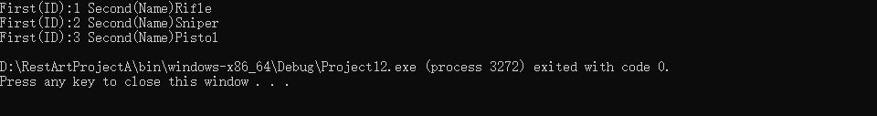
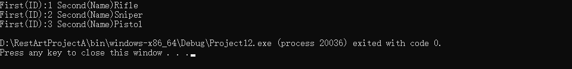
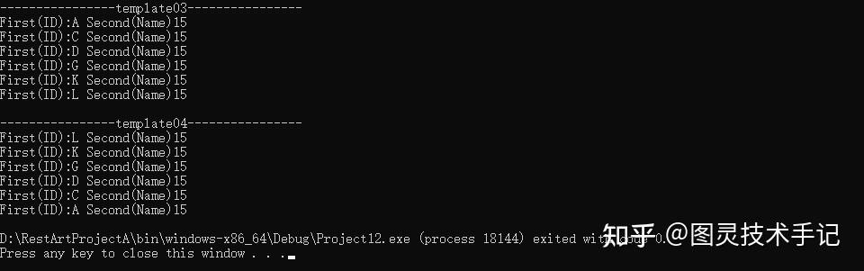

现在我们在开发游戏中又碰到了一个新的任务，我们要对游戏道具仓库进行编号和排序

每个储物格都有唯一编号（Key）

格子里存放具体道具（Value）

储物格自动按编号（Key）排序

这里出现了新的概念，就是这个Key和Value，分别叫键和值，值是具体的物品，而键就是我们给物品打上的标签，一对一对匹配的键值对存储在一个容器中这个容器就是map

在 C++ 中，&lt;map&gt; 是标准模板库（STL）的一部分，它提供了一种关联容器，用于存储键值对（key-value pairs）。map 容器中的元素是按照键的顺序自动排序的，这使得它非常适合需要快速查找和有序数据的场景。

使用map必须要在头文件中包含&lt;map&gt;

```cpp
#include <map>

```

## 一、std::map的定义和特性

键值对：map 存储的是键值对，其中每个键都是唯一的。

排序：map 中的元素按照键的顺序自动排序，通常是升序。

唯一性：每个键在 map 中只能出现一次。

双向迭代器：map 提供了双向迭代器，可以向前和向后遍历元素。

想要声明一个map就需要首先提供键值对的类型

```cpp
std::map<key_type, value_type> myMap;

```

key_type 是键的类型。

value_type 是值的类型。

比如我们想声明一个武器库，其中有武器ID和武器名称

```cpp
#include <map>
#include <string>
// 创建示例：<键类型, 值类型>
std::map<int, std::string> WeaponMap; // 键：武器ID，值：武器名称

```

## 二、基本语法和成员函数

### Part01.插入元素和访问元素

```cpp
myMap[key] = value;// 向键值对中插入元素，或者更改已有键所对应的值

type_ value = myMap[key];// 访问键值对中键所对应的值

```

这种操作类似于我们对数组的操作，只不过数组只能使用整数值来取值，但是map可以使用任意类型的键值来访问和更改数据。

除了这种方法，map还内置有一些成员函数insert / emplace

```cpp
// 传统插入方式
WeaponMap.insert(std::make_pair(101, "激光剑"));

// C++11推荐方式（更高效）
WeaponMap.emplace(102, "等离子步枪"); 

```

insert通常接受一个已经构造好的键值对

```cpp
std::map<int, std::string> m;
m.insert(std::make_pair(42, "Hello"));  // 需要构造临时 pair 对象
m.insert({42, "Hello"});               // C++11 统一初始化语法（仍是构造临时对象）

```

而emplace则是直接在map内部构造元素，避免不必要的拷贝或移动操作，这在处理复杂对象时能提高效率

emplace 内部调用 std::allocator_traits::construct，通过完美转发（forward）参数构造对象。

```cpp
m.emplace(42, "Hello");  // 直接传递参数，内部构造 pair(42, "Hello")

```

当然这两者的返回值也值得关注一下

两者返回值类型相同，均为 std::pair&lt;iterator, bool&gt;：

- first：指向插入元素的迭代器。

- second：是否插入成功（键已存在时返回 false）。

这里使用到了多返回值的情况，是我们自己在构建一些通用类的时候会经常面临的问题。

### Part02.遍历元素

map作为一个有序容器，其中的内容是可以使用for循环来遍历的，而遍历容器也有两种方式

第一种使用C++11的特性，用foreach loop来按顺序循环

```cpp
#include <iostream>
#include <map>
#include <string>

int main()
{
	// 创建示例：<键类型, 值类型>
	std::map<int, std::string> WeaponMap; // 键：武器ID，值：武器名称

	WeaponMap[1] = "Rifle";
	WeaponMap[2] = "Sniper";
	WeaponMap[3] = "Pistol";

	// 范围for循环（C++11）
	for (const auto& Pair : WeaponMap)
	{
		std::cout << "First(ID):" << Pair.first << " Second(Name)" << Pair.second << std::endl;
	}
}

```



这种for循环我们已经很熟悉了，目前在已经学到的内容中可以用在数组、map等地方，未来还能用在其他STL标准库的容器中。

另外一种方式则是STL容器比较传统的做法，使用iterator来遍历。iterator是STL传统容器都会拥有的迭代器。

```cpp
#include <iostream>
#include <map>
#include <string>

int main()
{
	// 创建示例：<键类型, 值类型>
	std::map<int, std::string> WeaponMap; // 键：武器ID，值：武器名称

	WeaponMap[1] = "Rifle";
	WeaponMap[2] = "Sniper";
	WeaponMap[3] = "Pistol";

	// 范围for循环（C++11）
	for (auto it = WeaponMap.begin(); it != WeaponMap.end(); it++)
	{
		std::cout << "First(ID):" << it->first << " Second(Name)" << it->second << std::endl;
	}
}

```



这里我们看它的循环方式有点接近我们的常规循环，只是我们在声明的时候，没有声明索引值整数，而是用auto声明了一个iterator指向WeaponMap的开始位置。

这个iterator的完整声明其实是std::map&lt;key_type, value_type&gt;::iterator

而WeaponMap的begin()方法则返回了第一个元素的迭代器位置。

接下来注意，我们循环的判断条件是it != WeaponMap.end() 这一点的理解非常重要，end()返回的是map的结尾，不是最后一个元素，它要比最后一个元素还多一位。

另外一点要注意的是我们依然可以对it使用累加的方式来逐次数递增。

最后在使用it的时候，可以把it当成这个元素的指针去使用。

### Part03.查找元素

查找元素也是我们常用的一种方法，尤其是在处理元素是否存在的时候，如果不先判断值是否存在就去使用这个值，很容易导致报错。

```cpp
if (map.find(key) != map.end()) 
{
    // 键存在
}

```

这里值得注意的是map.find(key) 返回的并不是布尔值哦，返回的是iterator，这也是所有STL容器的特性。

Part04.删除元素

```cpp
// 按键删除
WeaponMap.erase(101); 

// 按迭代器删除
auto Iter = WeaponMap.find(102);
if (Iter != WeaponMap.end()) 
{
    WeaponMap.erase(Iter);
}

```

这里erase方法也提供了两种传入，一种是键值传入，直接在其中搜索相应键值对来删除

另一种则是按照迭代器的方式，先判断其中是否存在这样这个某个键值的键值对，然后才执行删除，这种方式更加安全。

### Part04.其他方法

```cpp
int Size = map.size();    // 获取元素数量

bool isEmpty = map.empty(); // 判断是否为空

map.clear();             // 清空所有元素

```

### Part05.排序

```cpp
#include <map>
#include <string>
#include <functional>

bool myCompare(const std::string& a, const std::string& b) {
    return a < b;
}

int main() {
    std::map<std::string, int, std::function<bool(const std::string&, const std::string&)>> myMap(myCompare);

    // 其他操作...

    return 0;
}

```

我们在前文已经提及过了，std::map是一个有序容器，当然对应也有无序容器std::unordered_map，我们后面遇到再聊

这里有序容器会有一个特点就是它会以一定的比较方式去根据key来排序键值对

这里就是利用了它可以排序的特性来组织其中键值对的顺序，如果不声明则采用默认的比较升序方式

但是注意！！！非常重要的一点，则是如何触发这个排序~使用map[key]=value 的方式是不会触发排序的，要是用insert或者emplace则会触发排序。

std::map在这里不仅声明了键为string，值为int，还多声明了一个内容就是std::function&lt;bool(const std::string&,const std::string&)&gt;，这里用到的是函数类型，在使用的时候要传入一个函数指针

这里声明的myCompare就是定义对比string键排列顺序的函数

这样当我们每次向其中增添新的键值对（使用insert或者emplace）时候，就会按照key的排列方式来组织键值对

我们做一个尝试

```cpp
void template03()
{
	std::map<std::string, int> myMap;

	myMap.emplace("A", 15);
	myMap.emplace("D", 15);
	myMap.emplace("G", 15);
	myMap.emplace("L", 15);
	myMap.emplace("K", 15);
	myMap.emplace("C", 15);

	for (auto it = myMap.begin(); it != myMap.end(); it++)
	{
		std::cout << "First(ID):" << it->first << " Second(Name)" << it->second << std::endl;
	}

}

bool myCompare(const std::string& a, const std::string& b) 
{
	return a > b;
}


void template04()
{
	std::map<std::string, int, std::function<bool(const std::string&, const std::string&)>> myMap(myCompare);

	myMap.emplace("A",15);
	myMap.emplace("D",15);
	myMap.emplace("G",15);
	myMap.emplace("L",15);
	myMap.emplace("K",15);
	myMap.emplace("C",15);

	for (auto it = myMap.begin(); it != myMap.end(); it++)
	{
		std::cout << "First(ID):" << it->first << " Second(Name)" << it->second << std::endl;
	}
}

```

同样类型的键值对，template03中没有使用任何排序方法，默认升序，而template04中自定义了降序



## 三、常见的崩溃问题

### 问题1：键不存在导致崩溃

```cpp
// 错误写法
FString WeaponName = WeaponMap[999]; // ❌ 可能会插入空值！

// 正确做法
auto Iter = WeaponMap.find(999);
if (Iter != WeaponMap.end()) 
{
    // 安全访问
}

```

### 问题2：误用错误查找方式

```cpp
// 错误：用[]判断存在性
if (WeaponMap[101] == TEXT("XXX")) { ... } // ❌ 会插入新元素！

// 正确：始终先用find检查

```

### 问题3：遍历时修改容器

```cpp
for (auto& Pair : WeaponMap) 
{
    if (Pair.first == 102) 
    {
        WeaponMap.erase(102); // ❌ 导致迭代器失效！
    }
}

// 正确做法：先记录要删除的键，遍历后删除

```

今天的知识点你都有Get到吗~

有没有什么疑问，我们在评论区见哦~

你们也可以告诉我有什么是你们想知道的


