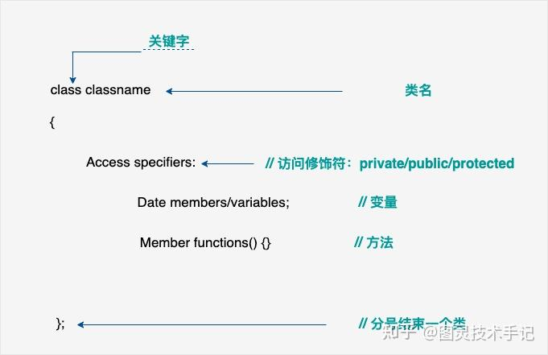
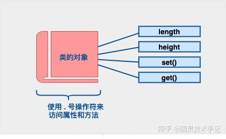
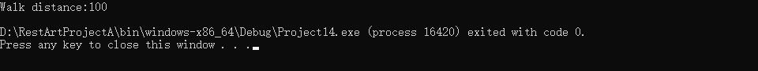

游戏中的武器、车、角色都有其基本的一个形态，人不能像车一样有四个轮子，车也不能像武器一样本来就拥有攻击属性，但是人可以使用车并装备武器来完成任务。

从本质上讲人、车、武器都是一种类型，这种类型决定了他们可以做什么不可以做什么，而这些类型之间又可以相互绑定、相互通信来实现更多的任务。

人、车、武器等在游戏开发中我们就叫一个class（类），一句话来定义的话就是类 = 造物主的蓝图，游戏设计师创造角色时用这个蓝图决定了对象能做什么和有什么

类是 C++ 的核心特性，通常被称为用户定义的类型

类用于指定对象的形式，它是一种封装了数据和函数的组合。

类中的数据称为成员变量，函数称为成员函数。

类可以被看作是一种模板，可以用来创建具有相同属性和行为的多个对象

类的三大核心要素

| 要素 | 作用 | 现实比喻 |
| --- | --- | --- |
| 属性 | 对象的状态数据 | 武器的攻击力、耐久度 |
| 方法 | 对象的行为能力 | 武器的攻击、修理方法 |
| 访问控制 | 控制外部对成员的访问权限 | 武器密码锁（private） |

## 一、声明一个类

定义一个类需要使用关键字 class，然后指定类的名称，并类的主体是包含在{}中，主体包含类的成员变量和成员函数。

定义一个类，本质上是定义一个数据类型的蓝图，它定义了类的对象包括了什么，以及可以在这个对象上执行哪些操作。



比如我们要定义一个武器类，对于武器来说有name damage等属性，也有upgrade showinfo等方法

```cpp
// 定义一个「武器」类
class Weapon 
{
private: // 私有属性（只有自己能碰）
    std::string name = "gun";
    int damage = 50;

public: // 公共方法（所有人都能调用）
    void Upgrade() 
    { 
        damage += 10; 
        std::cout << name << "升级！伤害：" << damage << std::endl;
    }

    void ShowInfo() 
    {
        std::cout << "武器名：" << name << "，伤害值：" << damage << std::endl;
    }
};

// 使用类创建实际武器
Weapon mySword;
mySword.Upgrade(); // ✅ 合法操作
mySword.damage = 100; // ❌ 错误！私有属性不能直接修改

```

这里出现了关键字public，private等，这些关键字确定了类成员的访问属性。

在类对象作用域内，public公共成员在类的外部是可访问的。

private私有成员在外部是不可访问的。

protected保护成员只能在子类中共享访问。

```cpp
class Box
{
public:
    int idx; // 盒子的索引值

protected:
    double length;   // 盒子的长度
    double breadth;  // 盒子的宽度
    double height;   // 盒子的高度

private:
    bool bOpened; // 盒子的状态机
};

class CodeBox : public Box
{

public:
    void functionTemplate()
    {
        if(bOpened)  // 报错！！！ bOpened是Box的私有变量，不可访问
        {
            // ....   
        }

        double volume = length * breadth * height;  // 可行，这里访问的是protect成员
    }
private:
    std::string code;
}

```

## 二、访问数据成员

类的对象的公共数据成员可以使用直接成员访问运算符.来访问



这里我们使用游戏中角色的构建来说明问题

```cpp
#include <iostream>

// .h

class Character
{
public:
	double mSpeed = 10;

	void Walk(double delta);
	double GetDistance();

private:
	double mDistance = 0;

};

// .cpp

void Character::Walk(double delta)
{
	this->mDistance += delta * this->mSpeed;
}

double Character::GetDistance()
{
	return this->mDistance;
}

//main.cpp
int main()
{
	Character c;
	c.Walk(10);
	std::cout << "Walk distance:" << c.GetDistance() << std::endl;
}

```



这里有很多知识点，我们首先对Character类在头文件中进行了申明，包含角色移动的速度（mSpeed）和角色已经移动的距离（mDistance）作为成员变量，而另外有角色移动（Walk()）和获取角色已移动距离（GetDistance()）的成员方法。

接下来在CPP文件中对两个成员方法分别进行了定义

Walk会要求传入一个时间差，然后通过时间差*速度我们就可以改变已经移动的距离

GetDistance则是直接返回mDistance来读取角色已经移动的距离

这里出现了一个核心关键字this ， 开头我们说到了访问运算符.来访问，这是针对于对象来说，但如果是对象的指针要访问呢？你会抢答——解引用，没错，这个方式非常好，(*ptr).member ，而且在部分情况下是实用的方法，但如果处处都这样是不是就变得有些难读了呢？

所以在C++标准中有一个箭头运算符(ArrowOperator -&gt;) ，用来让指针调用成员对象，所以我们就可以写成ptr-&gt;member 是不是清除很多，甚至我们可以分清是指针调用还是对象调用了。

这里的形态是不是也和return this-&gt;mDistance; 十分接近了？没错的，this 就是这个类的抽象指针，指向的就是自己，但因为我们说类只是一个“说明书”，并不是真实的对象，所以我们无法判定对象是如何命名的，所以只能用抽象的关键字this来代替，防止混淆。

> 在 C++ 中，this 指针是一个特殊的指针，它指向当前对象的实例。
在 C++ 中，每一个对象都能通过 this 指针来访问自己的地址。
this是一个隐藏的指针，可以在类的成员函数中使用，它可以用来指向调用对象。
当一个对象的成员函数被调用时，编译器会隐式地传递该对象的地址作为 this 指针。
友元函数没有 this 指针，因为友元不是类的成员，只有成员函数才有 this 指针。

## 三、在堆栈上声明类的方式

我们之前在说到数组时，也说到了堆栈声明两种不同的方式，在栈上声明的，声明周期自动管理，随着作用域结束而销毁，在堆上声明的，必须要手动析构(delete)

class也是同样的道理，我们还是使用刚刚的Character类，我们来看一下在使用上的区别

```cpp
int main()
{
        // 栈声明
	Character c;
	c.Walk(10);
	std::cout << "Walk distance(c):" << c.GetDistance() << std::endl;

        // 堆声明
	Character * d = new Character();
	d->Walk(10);
	std::cout << "Walk distance(d):" << d->GetDistance() << std::endl;

        delete d; 
}

```

我们案例中两种声明的方式已经说名了类调用和类指针调用的不同，不仅是销毁是主动和被动的不同，更是在访问成员方法时使用. 和-&gt;的不同。

## 四、什么是结构体

结构体 = 轻量级数据集装箱

C++中与类几乎相同，但默认所有成员public（公开），适合存放纯数据

```cpp
// 定义一个「角色位置」结构体
struct Position {
    // 默认都是public
    float x = 0.0f;
    float y = 0.0f;
    float z = 0.0f;

    void Teleport(float newX, float newY, float newZ) {
        x = newX;
        y = newY;
        z = newZ;
    }
};

// 使用结构体
Position playerPos;
playerPos.x = 100.0f; // ✅ 直接修改public成员
playerPos.Teleport(200, 50, 300); // ✅ 调用方法

```

## 五、类 vs 结构体 核心区别

| 特性 | 类（Class） | 结构体（Struct） |
| --- | --- | --- |
| 默认访问权限 | private | public |
| 设计哲学 | 强调封装与安全 | 强调数据集合 |
| 典型使用场景 | 复杂对象（玩家/NPC/技能系统） | 简单数据（坐标/颜色/配置项） |
| 继承默认 | private继承 | public继承 |
| 内存占用 | 可能包含虚表指针 | 通常更紧凑 |

## 六、常见问题

### 误区1：滥用结构体写业务逻辑

```cpp
struct Player { // ❌ 结构体不应包含复杂逻辑
private: // 结构体默认public，突然加private会很奇怪
    int health;
public:
    void Attack() { /*...*/ } // 不符合结构体设计初衷
};

// 应改用类
class Player { /*...*/ };

```

### 误区2：混淆C与C++的结构体

```cpp
// C语言结构体（纯数据）
struct Vec2 { 
    float x, y; 
};

// C++结构体（可以有方法）
struct Vec2 {
    float x, y;
    float Length() { return sqrt(x*x + y*y); } // ✅ 合法
};

```

## 七、游戏开发简单示例

### A.技能系统

```cpp
class Skill 
{
protected:
    float cooldown;
    virtual void Cast() = 0; // 纯虚函数（多态基础）
};

class Fireball : public Skill 
{
public:
    void Cast() override {
        std::cout << "火球发射！" << std::endl;
    }
};

```

### B.顶点数据

```cpp
struct Vertex 
{
    glm::vec3 position;
    glm::vec3 normal;
    glm::vec2 uv;
};

// 用于渲染管线的顶点缓冲区
std::vector<Vertex> vertices;

```

## 八、类 vs 结构体如何选择

1.需要隐藏内部细节 → 类

2.需要继承和多态 → 类

3.只是数据集合 → 结构体

4.需要与C语言兼容 → 结构体（POD类型）

今天的知识点你都有Get到吗~

有没有什么疑问，我们在评论区见哦~

你们也可以告诉我有什么是你们想知道的


