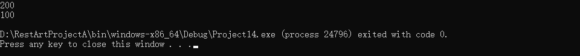
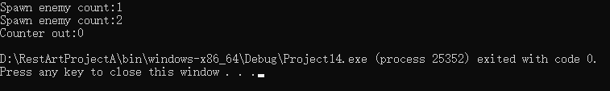

const static mutable是我们常用的三大修饰关键字，决定了具体变量的访问权限，以及类成员函数的行为权限。

## 一、const

const是一个标志不可改变的修饰词，"const在谁左边，谁就不可变！"

在程序中我们经常会碰见取值后不想被错误修改的情况，我们也不想仅仅是用来获取变量的函数，取出来值后被其他语句修改这个值，导致最终标准不一，所以这就是const的用处，保证不被恶意篡改。

### 1.const修饰普通变量

```cpp
// 角色基础属性
const int MAX_HP = 1000;  // 常量血条上限
const float GRAVITY = 9.8f; // 固定重力值

MAX_HP = 2000; // ❌ 编译错误！常量不可修改

```

这种方式可以用来修饰常量，且保证不被更改，比如重力值、普朗克常量等

### 2.const指针双形态（指针不可改变 & 不可改变的指针）

指针形态相对来说特殊一些，当const写在*符号之前时，意味着值不可以改变，当const写在 *符号之后时，意味着指针不可以改变

举一反三，要想让一个指针变成不可改变的东西，那就得有两个const

```cpp
 // 技能系统示例
Skill * const pFireSkill = &fireBall; // 指针本身不可变
const Skill * pHealSkill = &heal;     // 指向内容不可变
const Skill * const pWaterSkill = &water //指针本身和内容都不可变

pFireSkill = &meteor; // ❌ 不能换绑技能
pHealSkill->damage = 100; // ❌ 不能修改技能属性

```

### 3.const 修饰类成员方法

const如果修饰了类的成员函数，可以将其理解为成员函数的一种“承诺”——此函数在使用中不会修改成员变量的值

```cpp
class Entity
{
private:
    int m_x, m_y;
public:
    int GetX() const
    {
        m_x = 100; // not allowed !!!
        return m_x;
    }
};

```

在GetX()函数中因为声明了const，如果其执行过程中更改了任何成员变量， 就会导致编译报错

```cpp
class Entity
{
private:
    int * m_x, * m_y;
public:
    int GetX() const
    {
        int a = 200;
        m_x = &a; // not allowed !!!
        * m_x = 200;
        return *m_x;
    }
};

```

这里又有一个有意思的情况了，如果我声明的不是int，而是int *呢？那就意味着我不能对指针重新赋值，但是我却可以对指针指向的内存地址重新赋值，因为我的成员变量是指针，并不是指针所指向的成员地址

> 图灵笔记：const can be use with method only in class. It means in method, there will be no operation to change the value of variables assigned in class.

### 4.const 修饰函数参数和返回值

如果函数参数和返回值都以const传入和传出，那就意味着传入函数后，不能进行任何更改原始类成员变量的操作，const传出函数的值也不能进行任何成员变量赋值的操作

```cpp
#include <iostream>

#define LOG(X) std::cout << X <<std::endl

class Entity
{
private:
    int m_x, m_y;
public:
    int GetX() const
    {
        return m_x;
    }

    int SetX(int i)
    {
        m_x = i;
    }
};

void getX(const Entity& e){
    e.SetX(5); // not allowed !!!
    LOG(e.GetX());
}

int main() {

}

```

这里非常值得关注，void getX(const Entity& e)以const引用的方式传入了e，首先按照const的理解，对e重新赋值是绝对不可以的，其次，按照const对于类的锁定，e也不可以调用任何会改变类中成员变量属性的操作

SetX(int i)修改了成员变量m_x，所以不可以调用，而GetX()声明了const，且保证不会更改任何成员变量，所以是允许调用的

这也是为什么诸多程序大佬都提倡尽可能使用const修饰你的变量和方法，足够安全！！！

> 图灵笔记：if a funtion parameter refers to a class as const, it cannot call funtions which may change a variable in class instance.

## 二、static

static是一个标志变量或者函数是长期存在的修饰词

### 1.类静态成员（共享数据）

类静态成员是该类所有子类和实例可共享的数据

```cpp
class Player 
{
public:
    static int onlineCount; // 所有玩家共享的在线人数
};

int Player::onlineCount = 0; // 必须类外初始化

// 创建玩家时
Player::onlineCount++; 

```

比如在这里我创建了一个Player，其中在线玩家数量我使用static修饰在了类的成员变量之中，这样每次在创建玩家时，Player::onlineCount++; 的结果可以在所有玩家之间共享，这样大家就都能知道当前在线有多少人了，且不需要声明多个类变量来占用内存。

值得注意的是， 类静态成员必须类外初始化！！！

### 2.静态函数（工具人）

在类中，函数也可以被声明为静态，我们都知道函数中一般的成员方法必须经过实例化后才能调用。

但是如果函数中的成员方法被声明为static就可以直接通过类名来调用了

```cpp
class MathUtils 
{
public:
    static float Lerp(float a, float b, float t) 
    { // 无需对象即可调用
        return a + t*(b-a);
    }
};

// 在系统中使用
float pos = MathUtils::Lerp(start, end, 0.5f);

```

### 3.静态局部变量（永生者）

静态局部变量是具有全局唯一性

```cpp
void SpawnEnemy() 
{
    static int counter = 0; // 生命周期持续到程序结束
    std::cout << "已生成" << ++counter << "个敌人";
}
// 每次调用counter都会保持上次的值

```

这里声明了一个生成敌人的函数，其中counter声明为static，这样全局每一次对counter的更改都会被保留，这样在每次调用生成敌人的时候，就可以计数从程序开始到结束生成了多少个敌人

> 这个特性对于单例设计模式特别重要

### 4.文件作用域（隐身术）

如果我们在源码中有局部需要共享的数据，可以在.cpp文件中声明

```cpp
// .cpp文件

static Logger g_EngineLogger; // 只在当前.cpp文件可见

static void InternalDebug()   // 防止其他文件调用
{ 
    // 引擎内部调试逻辑
}

```

这里声明的g_EngineLogger和InternalDebug()在当前文件中调用是共享的，但一旦超出此文件，则“隐身”了

## 三、mutable

我们聊到const 的用处是上锁，而mutable 的用处恰恰相反，就是在有锁的前提下——解锁

### 1.mutable in class

```cpp
// 角色物理组件
class PhysicsComponent 
{
private:
    mutable int debugCounter = 0;    // 可修改的调试计数器
    Vector3 position;                // 核心位置数据
    
public:
    // const方法：安全获取位置
    Vector3 GetPosition() const {
        debugCounter++;  // ✅ 允许修改mutable成员
        // position.y += 10; ❌ 禁止修改核心数据
        return position;
    }

    // 调试信息展示
    void ShowDebug() const {
        std::cout << "位置查询次数：" << debugCounter << std::endl;
    }
};

```

这里抽象了一个角色物理组件，其中debugCounter声明了mutable，position则没有声明，其中GetPosition()方法声明了const，按道理这个方法不应该更改任何成员变量，包括debugCounter和position，但是debugCounter声明了mutable，相当于在const的函数中对这个变量额外开了“后门”

游戏开发典型场景：

- 调试日志记录：统计方法调用次数

- 缓存计算结果：避免重复运算（如复杂物理计算）

- 性能计数器：跟踪资源加载时间

### 2.mutable in lambda

对于lambda函数，mutable声明可以允许在其内部进行非作用域内变量的赋值操作

```cpp
#include <iostream>

#define LOG(X) std::cout << X <<std::endl

int main() {
    int basic = 100;

    auto f = [=]() mutable
    {
        basic = 200;
        LOG(basic);
    };

    f();
    LOG(basic);
}

```



这里我们传入lambda的是值传入，不是引用传入，一般情况下，值传入是不允许进行外部变量的赋值操作的，也就是不允许basic = 200 ，这个非常重要，因为值传入不允许修改外部变量，但是如果我想临时使用呢？声明mutable 这样就可以在内部对basic进行赋值了

不过注意！！！这里basic = 200的赋值仅仅在lambda中生效，其他地方不生效（注意观察输出）

接下来我们继续观察一个有意思的特性，这个传入lambda的值是具有延续性的，是没有被销毁的

我们做一个敌人生成系统，其中使用mutable声明的lambda来制造敌人并统计数据

```cpp
void SetupEnemySpawner() 
{
	int spawnCount = 0;

	auto spawnEnemy = [spawnCount]() mutable 
	{
		spawnCount++; 
		std::cout << "Spawn enemy count:" << spawnCount << std::endl;
	};

	spawnEnemy(); 
	spawnEnemy(); 

	std::cout << "Counter out:" << spawnCount << std::endl;
}

```



外部的spawnCount 依然为0，但是在值传入的lambda中，spawnCount 却可以累加，并没有被销毁

游戏开发典型场景

- 技能连击计数：跟踪连续攻击次数

- 动画状态机：维护局部动画进度

- 粒子系统：记录粒子存活时间

## 四、核心概念对比表

| 特性 | const | static | mutable |
| --- | --- | --- | --- |
| 作用对象 | 变量/方法/指针 | 变量/函数 | 类成员变量 |
| 修改权限 | 完全锁定 | 可修改（共享状态） | 在const环境中特殊解禁 |
| 内存位置 | 栈/堆 | 静态存储区 | 跟随对象实例 |
| 典型游戏应用 | 配置参数/物理常量 | 全局管理器/工具类 | 调试信息/性能计数器 |
| 跨实例可见性 | 仅当前实例 | 所有实例共享 | 仅当前实例 |
| 多线程 | 线程安全 | 需要同步机制 | 需要同步机制 |

今天的知识点你都有Get到吗~

有没有什么疑问，我们在评论区见哦~

你们也可以告诉我有什么是你们想知道的


