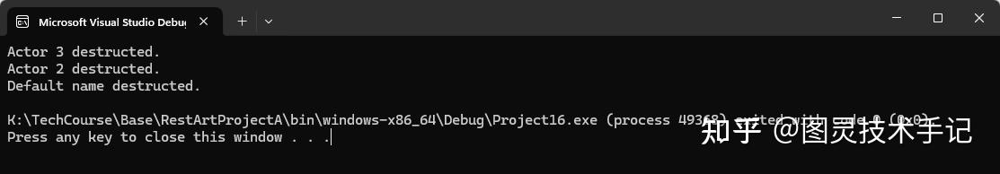

我们已经了解过如何声明一个类，并定义类中的成员变量和成员方法，但是对于类来说我们还有两个核心的过程没有解决，一个就是构建声明，一个就是析构声明

构建声明，顾名思义就是我们在通过这个类模板声明某个具体实例的时候，对其成员变量初始化的过程，实现这个过程的函数就叫构建函数 （Constructor），构建函数可以有多个，它会在每次创建类的新对象时执行。

> 构造函数的名称与类的名称是完全相同的，并且不会返回任何类型，也不会返回 void。构造函数可用于为某些成员变量设置初始值。

析构声明，顾名思义就是我们在某个实例声明周期结束时，对齐变量进行释放的过程，尤其是指针类变量需要判断是否需要delete，实现这个析构过程的函数就是析构函数（Destructor），析构函数有且仅能有一个

> 析构函数的名称与类的名称是完全相同的，只是在前面加了个波浪号（~）作为前缀，它不会返回任何值，也不能带有任何参数。析构函数有助于在跳出程序（比如关闭文件、释放内存等）前释放资源。

|  | 构造函数 (Constructor) | 析构函数 (Destructor) |
| --- | --- | --- |
| 调用时机 | 对象出生时自动触发 | 对象死亡时自动触发 |
| 主要任务 | 初始化属性/分配资源 | 释放资源/保存日志 |
| 游戏类比 | 角色出生时的属性初始化 | 角色死亡后的装备回收 |
| 特殊类型 | 默认构造/拷贝构造/移动构造 | 只能有一个，不能带参数 |

## 一、声明Constructor

Constructor的声明其实也是一个函数，特殊的是它不需要返回值

同时Constructor可以有任意多个不同的传入参数组，以匹配不同类型的构建场景

```cpp
//.h

class Actor
{
public:
    Actor();
    Actor(Vector3 position)

private:
   Vector3 position
    
}

//.cpp

Actor::Actor
  :position({0.f,0.f,0.f})
{}

Actor::Actor(Vector3 position)
  :position(position)
{}

```

这里在头文件中声明了两种方式来初始化Actor，一种是不带任何输入的，另一种是需要传入一个Vector3作为初始化参数的，而Actor本身有一个成员变量就是position。

第一种方式中因为没有任何参数输入，所以我们需要给position提供默认值来初始化

第二种方式因为传入了一个position参数，所以我们就可以使用传入的position来初始化成员变量position

这里大家应该发现了区别，我们并没有将初始化过程写在花括号{}内，而是在函数声明后使用: 来引导初始化变量，这是构建函数特有的性质——在进入函数作用域前，初始化变量需要初始化一次

所以这也回应了很多小伙伴的疑惑，为什么不推荐在构建函数的作用域中对成员变量进行初始化？

```cpp
Actor::Actor(Vector3 position)
{
    this->position = position; // 不推荐
}

```

因为这样的话会导致变量被多次初始化，带来性能消耗

## 二、声明Destructor

析构函数的名称与类的名称是完全相同的，只是在前面加了个波浪号（~）作为前缀，它不会返回任何值，也不能带有任何参数。析构函数有助于在跳出程序（比如关闭文件、释放内存等）前释放资源。

```cpp
// Actor.h
#pragma once

#include "../Basic/valueType.h"

class Actor 
{
public:
    vector direction;

public:
    Actor();
    Actor(vector dirct);
    ~Actor();
    vector directionToPoint(vector pointCoor);


};

```

同样我们声明一个Actor头文件

```cpp
// Actor.cpp
#include "Game/Actor.h"

#include <iostream>

Actor::Actor():
direction({0,0,0})
{
}

Actor::Actor(vector dirct):
direction(dirct)
{
}

Actor::~Actor()
{
    std::cout << "Deconstructor Enabled" << std::endl;
}

vector Actor::directionToPoint(vector pointCoor) {
    float x = pointCoor.x - this -> direction.x;
    float y = pointCoor.y - this -> direction.y;
    float z = pointCoor.z - this -> direction.z;

    return {x,y,z};
};

```

在析构函数~Actor中我们打印"Deconstructor Enabled" 来说明其调用的时机

```cpp
// main.cpp
#include <iostream>

#include "Game/Actor.h"

void actorCreate()
{
    Actor * a = new Actor({5,4,3});
    std::cout <<'('<<a->direction.x << "," << a->direction.y << "," << a->direction.z << ")" << std::endl;
    delete(a);// 调用析构
}


int main(){

    actorCreate();

    return 0;
}

```

在这里我们调用delete的时候就会调用析构函数

所以这里就是我们特别要注意的点了！！！这里声明函数的方式是堆声明，如果不调用delete(a)，则永远不会触发这个析构函数，也就是说指针本身析构了，但是指针指向的这个对象本身却没有析构，就导致了内存泄漏~

## 三、测试用例

```cpp
#include <iostream>


class Actor
{
public:
	Actor();
	Actor(const char* name);

	~Actor();

private:
	const char* mName;
};

Actor::Actor()
	:mName("Default name")
{}

Actor::Actor(const char* name)
	:mName(name)
{
}

Actor::~Actor()
{
	std::cout << mName << " destructed." << std::endl;
}

int main(int argc, char* argv[])
{
	Actor actor1;
	Actor actor2("Actor 2");
	Actor* actor3 = new Actor("Actor 3");
	Actor actor4();

	delete actor3;
	
	return 0;
}

```



这里都是actor1 actor2 actor3都是常规构建和声明，三种不同的方式，actor1调用的是默认构造，actor2调用的是传入一个const char *参数的构造，actor3调用的是传入一个const char *参数的构造，且声明在堆上，必修调用delete actor3来对其析构

这里有一个陷阱就是actor4，这实际上不是一个对象实例化的语句，而是一个函数声明。

在C++中，这行代码被解释为：

1. 声明了一个名为actor4的函数

1. 该函数不接受任何参数

1. 返回一个Actor类型的对象

这就是著名的"C++最令人烦恼的解析"(Most Vexing Parse)问题，编译器把它当作函数声明而不是对象实例化。

## 四、四大注意事项

### 陷阱1：忘记释放资源（内存泄漏）

```cpp
class Texture {
    unsigned char* data;
public:
    Texture() { data = new unsigned char[1024*1024]; } // 分配1MB
    ~Texture() { /* 忘记 delete[] data; */ }          // ❌ 内存泄漏！
};

```

### 陷阱2：浅拷贝导致双重释放

```cpp
class Enemy {
    int* lootTable;
public:
    Enemy() { lootTable = new int[5]; }
    ~Enemy() { delete[] lootTable; }
};

void DuplicateEnemy() 
{
    Enemy e1;
    Enemy e2 = e1;  // 默认拷贝构造是浅拷贝！
}                   // 析构时同一内存被释放两次 → 程序崩溃！

```

这是极其容易报错的地方，如果运行时内存访问被拒绝或者访问的内存地址为空，大部分都是这个问题

同时关于类和类之间的拷贝会在Copy & Copying Constructors一篇中深度说明

### 陷阱3：未正确使用移动语义

```cpp
Weapon CreateLegendaryWeapon() 
{
    Weapon w("剑", 999);
    return w;  // 需要移动构造优化，否则触发拷贝
}

```

### 陷阱4：构造顺序混乱

```cpp
class Player 
{
    int hp;
    Weapon weapon;  // 成员对象先构造！
public:
    Player(int h) : hp(h), weapon("默认武器") {}  // ✅ 正确初始化顺序
    // Player(int h) { hp = h; weapon = Weapon(...); } ❌ 先调用默认构造再赋值
};

```

今天的知识点你都有Get到吗~

有没有什么疑问，我们在评论区见哦~

你们也可以告诉我有什么是你们想知道的


