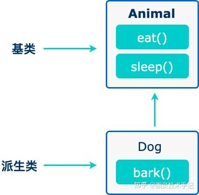

想象你要设计一个《魔兽世界》的角色系统，那所有的角色都有一些共同的特征，我们将这些特征归类为“基础类别”，比如名字、血量、移动方法，但除了这些基础类别，不同的职业也有着不同的技能和特性，比如战士的怒气值、法师的法力值，我们将这些特征归类为“派生类别”

那么从一个基础角色类别派生出来的法师、战士等职业就是对基础角色的继承

在程序中我们将这个基础类别称作“基类”，派生类别称作“派生类”



```cpp
// 基类
class Animal 
{
    // eat() 函数
    // sleep() 函数
};


//派生类
class Dog : public Animal 
{
    // bark() 函数
};

```

比如在这一段代码中我们有一个Animal的基类，而Dog是Animal的合理派生，在Animal的基础上拥有了特殊的bark()函数

在虚幻引擎中，UObject是所有类的基类，对于角色来说AActor就是基类，ACharacter以AActor为基类

## 一、继承的声明

一个类可以派生自多个类，这意味着，它可以从多个基类继承数据和函数。定义一个派生类，我们使用一个类派生列表来指定基类。类派生列表以一个或多个基类命名。

```cpp
class derived-class: access-specifier base-class

```

> 其中，访问修饰符 access-specifier 是public、protected或private其中的一个，base-class 是之前定义过的某个类的名称。如果未使用访问修饰符 access-specifier，则默认为 private。

我们假设需要一个Enemy来实现基类的基本方法，其中包括等级、名字、健康值等基础成员变量，以及普通攻击成员函数

```cpp
// 父类：基础敌人
class Enemy 
{
public:
    int hp = 100;
    std::string name;
    int level;

    void Attack() 
    {
        std::cout << name << " 发动普通攻击！" << std::endl;
    }
};

```

我们现在又需要设计一个火系敌人作为Boss，这个火系Boss有自己的特殊攻击但同时又保留普通攻击的能力，那我们就可以使用继承的方式来设计我们的Boss

```cpp
// 子类：火焰系Boss
class FireBoss : public Enemy {  // ← 关键继承符号
public:
    int firePower = 50;

    void SpecialAttack() {
        std::cout << name << " 发动火焰吐息！伤害：" << firePower * level * .25f << std::endl;
    }
};

```

那么我们在使用的时候就可以声明一个敌人的实例，然后调用父类的方法Attack和派生类的方法SpecialAttack

```cpp
// 使用示例
void SpawnBoss() 
{
    FireBoss dragon;
    dragon.name = "火焰巨龙";
    
    dragon.Attack();        // ✅ 继承自父类
    dragon.SpecialAttack(); //   子类特有
}

```

！！！这里有一个很重要的提示——分清楚IsA和HasA的关系

IsA就是A是B的关系，继承就是IsA的关系

HasA就是A中有B作为成员变量，和IsA是有本质区别的

## 二、公有、保护和私有继承

派生类可以访问基类中所有的非私有成员。因此基类成员如果不想被派生类的成员函数访问，则应在基类中声明为 private

我们可以根据访问权限总结出不同的访问类型

| 访问 | public | protected | private |
| --- | --- | --- | --- |
| 同一个类 | yes | yes | yes |
| 派生类 | yes | yes | no |
| 外部的类 | yes | no | no |

### 1. 公有继承（public）——“家族完全开放”

```cpp
// 父类：基础装备
class Equipment {
public:
    string name;        // 公开属性
protected:
    int durability;     // 保护属性
private:
    string serialCode;  // 私有属性
};

// 子类：传奇武器（公有继承）
class LegendaryWeapon : public Equipment {
public:
    void ShowInfo() {
        cout << name;         // ✅ 可访问（public→public）
        cout << durability;   // ✅ 可访问（protected→protected）
        // cout << serialCode; // ❌ 不可访问（private保持不可见）
    }
};

// 外部使用
LegendaryWeapon excalibur;
excalibur.name = "圣剑";      // ✅ 直接访问
// excalibur.durability = 100; // ❌ 外部不可访问保护成员

```

适用场景：

角色继承体系（Character → Warrior）

武器类型体系（Weapon → Sword）

UE中的Actor继承（AActor → AMyActor）

### 2. 保护继承（protected）——“家族内部传承”

```cpp
// 父类：伤害计算器
class DamageCalculator {
public:
    float baseDamage = 10;
protected:
    float critMultiplier = 2.0;
};

// 子类：火焰伤害计算器（保护继承）
class FireDamageCalc : protected DamageCalculator {
public:
    void Calculate() {
        float dmg = baseDamage;        // ✅ public→protected
        float crit = critMultiplier;   // ✅ protected保持
        cout << "火焰伤害: " << dmg * crit;
    }
};

// 外部使用
FireDamageCalc fireDmg;
// fireDmg.baseDamage = 20;  // ❌ 原public成员变为protected

```

适用场景：

中间工具类继承（不直接暴露给外部）

框架内部实现继承

Unity中的MonoBehaviour扩展工具类

### 3. 私有继承（private）——“家族绝密传承”

```cpp
// 父类：存档加密器
class SaveEncryptor {
public:
    string Encrypt(string data) { /* 加密算法 */ }
protected:
    string key = "A1B2C3";
private:
    string secretAlgorithm() { /* 核心逻辑 */ }
};

// 子类：云存档系统（私有继承）
class CloudSave : private SaveEncryptor {
public:
    void Upload(string data) {
        string encrypted = Encrypt(data);  // ✅ public→private
        // cout << key;                    // ❌ protected→private
        // secretAlgorithm();             // ❌ 不可访问
    }
};

// 外部使用
CloudSave cloud;
// cloud.Encrypt("data");  // ❌ 方法已变为私有

```

适用场景：

实现细节完全封装

适配器模式（Adapter Pattern）

禁止外部访问的继承关系

### 4.继承法则

法则1：权限降级不可逆

```cpp
class Base {
public:    void A() {}
protected: void B() {}
private:   void C() {}
};

class Derived : private Base {
public:
    void Test() {
        A();  // ✅ public→private
        B();  // ✅ protected→private
        // C(); // ❌ 仍然不可访问
    }
};

// 外部访问
Derived d;
// d.A();  // ❌ 已降级为private

```

法则2：继承链权限累积

```cpp
class A { public: void X(); };
class B : protected A {};    // X变为protected
class C : public B {};       // X仍为protected
class D : private C {};      // X变为private

```

法则3：慎用非公有继承

```cpp
// 常见错误：错误使用保护继承
class WeaponSystem : protected InventorySystem {  // ❌ 应使用组合
public:
    void EquipWeapon() {
        // 错误地继承实现细节
    }
};

// 正确做法：使用组合
class WeaponSystem {
    InventorySystem& inventory;  // ✅ 更清晰的依赖关系
public:
    WeaponSystem(InventorySystem& inv) : inventory(inv) {}
};

```

## 三、多继承

多继承即一个子类可以有多个父类，它继承了多个父类的特性

```cpp
class <派生类名>:<继承方式1><基类名1>,<继承方式2><基类名2>,…
{
<派生类类体>
};

```

其中，访问修饰符继承方式是public、protected或private其中的一个，用来修饰每个基类，各个基类之间用逗号分隔

```cpp
#include <iostream>
 
using namespace std;
 
// 基类 Shape
class Shape 
{
   public:
      void setWidth(int w)
      {
         width = w;
      }
      void setHeight(int h)
      {
         height = h;
      }
   protected:
      int width;
      int height;
};
 
// 基类 PaintCost
class PaintCost 
{
   public:
      int getCost(int area)
      {
         return area * 70;
      }
};
 
// 派生类
class Rectangle: public Shape, public PaintCost
{
   public:
      int getArea()
      { 
         return (width * height); 
      }
};
 
int main(void)
{
   Rectangle Rect;
   int area;
 
   Rect.setWidth(5);
   Rect.setHeight(7);
 
   area = Rect.getArea();
   
   // 输出对象的面积
   cout << "Total area: " << Rect.getArea() << endl;
 
   // 输出总花费
   cout << "Total paint cost: $" << Rect.getCost(area) << endl;
 
   return 0;
}

```

## 四、虚拟继承

在聊虚拟继承之前，我们需要了解一个继承的情况——菱形继承

菱形继承的概念——两个不同的派生类继承于同一个父类，又有一个子类多继承于这个两个派生类

基类中的一个属性被两个派生类继承，最终子类继承的时候会从这两个不同的派生类得到两个属性，造成歧义，所以就可以利用虚继承的关键字virtual来确保重复的成员变量有且仅有一份

我们来看一个案例

```cpp
// 祖传宝物类（被重复继承）
class Treasure 
{
public:
    int weight = 10;
    void Shine() { cout << "宝物发光！" << endl; }
};

// 错误继承方式（产生两个Treasure副本）
class Weapon : public Treasure {};  // ← 第一份Treasure
class Armor : public Treasure {};   // ← 第二份Treasure
class LegendaryItem : public Weapon, public Armor {}; // 产生歧义！

// 正确方式：虚拟继承
class Weapon : virtual public Treasure {};  // ⚡ 关键virtual
class Armor : virtual public Treasure {};   // ⚡ 关键virtual
class LegendaryItem : public Weapon, public Armor {};

```

在这个案例中我们使用Treasure作为基础类，Weapon和Armor都继承了Treasure作为基类，但是我们的LegendaryItem使用多继承继承了Weapon和Armor，这就形成了菱形继承关系，其中Treasure的成员变量就被复制了两份，但最后在LegendaryItem中就造成了重复命名变量的问题

```cpp
LegendaryItem excalibur;
// 错误情况：
// excalibur.Shine();   // ❌ 编译错误：ambiguous（两个Treasure副本）
// excalibur.weight = 5;// ❌ 同样错误

```

这时我们就能通过虚拟继承解决问题

```cpp
// 祖传宝物类（被重复继承）
class Treasure {
public:
    int weight = 10;
    void Shine() { cout << "宝物发光！" << endl; }
};

// 错误继承方式（产生两个Treasure副本）
class Weapon : public Treasure {};  // ← 第一份Treasure
class Armor : public Treasure {};   // ← 第二份Treasure
class LegendaryItem : public Weapon, public Armor {}; // 产生歧义！

// 正确方式：虚拟继承
class Weapon : virtual public Treasure {};  // ⚡ 关键virtual
class Armor : virtual public Treasure {};   // ⚡ 关键virtual
class LegendaryItem : public Weapon, public Armor {};

```

在使用中就不会再编译报错

```cpp
excalibur.Shine();      // ✅ 正确调用（共享同一个Treasure）
excalibur.weight = 20;  // ✅ 直接修改

```

## 五、新手三大误区

### 误区1：滥用继承

```cpp
class Pizza {};       // 披萨基类
class HawaiianPizza : public Pizza {};  // ✅ 合理继承

class PizzaOven : public Pizza {};  // ❌ 烤箱继承披萨？应该用组合——是HasA的关系

```

### 误区2：忘记调用父类构造

```cpp
class Boss : public Enemy {
public:
    Boss(int level) : Enemy(level*100) 
    {   // ✅ 正确初始化父类
        // 子类特有初始化...
    }
};

```

### 误区3：破坏封装性

```cpp
class Parent 
{
private:    // ❌ 子类无法访问
    int secretCode;
};

class Child : public Parent 
{
    void Hack() {
        secretCode = 123;  // 编译错误！
    }
};

```

今天的知识点你都有Get到吗~

有没有什么疑问，我们在评论区见哦~

你们也可以告诉我有什么是你们想知道的


