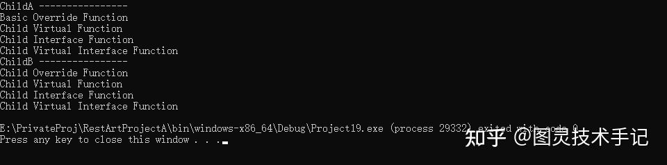

我们再次回到类中的案例，我们说过类 = 造物主的蓝图，从本质上游戏中的人、车、武器都是一种类型，这种类型决定了他们可以做什么不可以做什么，而这些类型之间又可以相互绑定、相互通信来实现更多的任务。

那么我们在设计这些不同类的时候就会有不同的实现，但是这些类之间有没有共同点呢？比如说人和车都可以移动，都可以受到攻击，都可以装载武器，那么我们在游戏中当人坐上了载具之后，这些行为就会发生改变。

## 一、一个“契约”的问题

我们先假设一个没有任何“契约”的情况

```cpp
class Character
{
public:
    void CharacterMove(){......};
    void CharacterLoadWeapon(){......};
}

class Car
{
public:
    void CarMove(){......};
    void CarLoadWeapon{......};
}

void main()
{
    ......
    
    if(controller.IsA<Car>())
    {
        Car * CarController = Cast<Car>(controller);
        CarController.CarMove();
        CarController.CarLoadWeapon();
    }

    if(controller.IsA<Car>())
    {
        Character * CharacterController = Cast<Character>(controller);
        CharacterController .CharacterMove();
        CharacterController .CharacterLoadWeapon();
    }

}

```

在这里Character类和Car类没有任何联系，虽然我们可以将函数进行相同的命名，但是我们依然不可避免地需要使用类型判断后再进行函数调用，依然非常复杂。

那我们有没有一种“契约”可以在不同类之间，架构起某一种规范，使得调用更加简单？

当然有，那就是Interface（接口），也是一种特殊的虚函数（virtual function）——纯虚函数。

我们使用Interface重构一下刚刚的伪代码

```cpp
class IBasicBehavior
{
public:
    virtual void Move() = 0;
    virtual void LoadWeapon() = 0;
}

class Character : public IBasicBehavior
{
public:
    void Move() override{......};
    void LoadWeapon() override{......};
}

class Car : public IBasicBehavior
{
public:
    void Move() override{......};
    void LoadWeapon() override{......};
}

void main()
{
    ......
    IBasicBehavior * controller;
    Character * character = new Character();
    Car * car = new Car();
    
    controller = character;
    controller.Move();
    controller.LoadWeapon();

    controller = car;
    controller.Move();
    controller.LoadWeapon();
}

```

当我们利用Interface实际上是给Character和Car之间提供了一个契约，他们必须要实现Interface中的内容，否则就是不完整的类，是不可以被实例化的，同时我们也可以利用Interface作为解释这两种类的方法，统一调用其中的函数，但是因为其使用了virtual关键字，就可以直接按照子类的最终实现来调用方法了

所以Interface实际上就是一种不同类之间的“契约”，如果大家都按照这个“契约”去实现了，我们就可以安全地通过这个“契约”去解释其他类，然后调用契约中的方法

## 二、非虚函数、虚函数、纯虚函数

### 1.override和virtual关键字

在程序中加override关键字，可以避免派生类中忘记重写虚函数的错误（这是一个非常重要的习惯）

⚠️ 在派生类中，重写继承自基类成员函数的实现时，要满足如下条件：

一虚：基类中，成员函数声明为虚拟的 (virtual)

二容：基类和派生类中，成员函数的返回类型和异常规格 (exception specification) 必须兼容

四同：基类和派生类中，成员函数名、形参类型、常量属性 (constness) 和 引用限定符 (reference qualifier) 必须完全相同

### 2.纯虚函数

纯虚函数，继承的是基类成员函数的接口，必须在派生类中重写该函数的实现

```cpp
class Person {
public:
    virtual void eat() const = 0;               // 1.纯虚函数
    virtual void say(const std::string &msg);   // 2.普通虚函数
    int name() const;                           // 3.非虚函数
};
 
class Student : public Person {
public:
protected:
private:
};
 
class Teacher : public Person {
public:
protected:
private:
};

Person* s1 = new Student;
s1->eat();           // calls Student::eat();
 
Person* t1 = new Teacher;
t1->eat();           // calls Teacher::eat();

```

若想调用基类的 Eat()，须加上 类作用域操作符 ::

```cpp
s1->Person::eat();    // calls Person::eat();

```

### 3.虚函数

普通虚函数，对应在基类中定义一个缺省的实现，表示继承的是基类成员函数的接口和缺省的实现，由派生类自行选择是否重写该函数

实际上，允许普通虚函数同时继承接口和缺省实现是危险的。 如下, CarA 和 CarB 是 Car的两种类型，且二者的运行方式完全相同

```cpp
class Car {
public:
    virtual void run(const Car &destination);
 
};
 
class CarA : public Car {
public:
protected:
private:
};
 
class CarB : public Car {
public:
protected:
private:
};

```

这是典型的面向对象设计，两个类共享一个特性 run，则 run可在基类中实现，并由两个派生类继承

现增加一个新的型号 CarC，其run的方式与 CarA，CarB 并不相同，假如不小心忘了在 CarC 中重写新的 run 函数

```cpp
class CarC : public Car
{
public:
	... // no run function is declared
};

```

则调用 CarC 中的 run 函数，就是调用 Car::run，但是 CarC的运行方式和缺省的并不相同

```cpp
Car * car1 = new CarC;
car1->run(China);  // calls Car::run!!

```

这就是前面所说的，普通虚函数同时继承接口和缺省实现是危险的，最好是基类中实现缺省行为 ，但只有在派生类要求时才提供该缺省行为

一种方法是纯虚函数 + 缺省实现，因为是纯虚函数，所以只有接口被继承，其缺省的实现不会被继承。派生类要想使用该缺省的实现，必须显式的调用:

```cpp
class Car
{
public:
	virtual void run(const Car& destination) = 0;
 
};
 
void Car::run(const Car& destination)
{
	// a pure virtual function default code for run a Car to the given destination
}
 
class CarA : public Car
{
public:
	virtual void run(const Car& destination)
	{
		Car::run(destination);
	}
 
};

```

这样在派生类CarC中，即使一不小心忘记重写 Run函数，也不会调用Car的缺省实现

```cpp
class CarC : public Car
{
public:
	virtual void run(const Car& destination);
};
 
void CarC::run(const Car& destination)
{
	// code for run a CarC Car to the given destination
}

```

可以看到，上面问题的关键就在于，一不小心在派生类 CarC中忘记重写 run函数，我们上文也提到用关键字 override，可以避免这样的“一不小心”

### 4.非虚函数

非虚成员函数没有virtual关键字，表示派生类不但继承了接口，而且继承了一个强制实现，既然继承了一个强制的实现，则在派生类中，无须重新定义继承自基类的成员函数，如下：

使用指针调用 name 函数，则都是调用的 Person::name()

```cpp
class Person {
public:
    virtual void eat() const = 0;               // 1.纯虚函数
    virtual void say(const std::string &msg);   // 2.普通虚函数
    int name() const;                           // 3.非虚函数
};
 
class Student : public Person {
public:
protected:
private:
};
 
class Teacher : public Person {
public:
protected:
private:
};

Student s1;  // s1 is an object of type Student
 
Person* p1 = &s1;  // get pointer to s1
p1->name();        //call name() through pointer
 
Student* s2 = &s1;   // get pointer to s1
s2->name();          // call name() through pointer

```

如果在派生类中重新定义了继承自基类的成员函数 name

```cpp
class Student : public Person
{
public:
   int name() const; // hides Person::name();
 
};
 
p1->name();        //call name() through pointer
s2->name();          // call name() through pointer

```

此时，派生类中重新定义的成员函数会 “隐藏” (hide) 继承自基类的成员函数

> 这是因为非虚函数是 “静态绑定” 的，p1被声明的是 Person* 类型的指针，则通过 p1调用的非虚函数都是基类中的，既使 指向的是派生类
与“静态绑定”相对的是虚函数的“动态绑定”，即无论 p1被声明为 Person* 还是 Student* 类型，其调用的虚函数取决于p1实际指向的对象类型

所以我们可以总结一些要点

接口要公有继承，不要私有继承

纯虚函数 =&gt; 继承的是：接口 (interface)

普通虚函数 =&gt; 继承的是：接口 + 缺省实现 (default implementation)

非虚成员函数 =&gt;继承的是：接口 + 强制实现 (mandatory implementation)

不要重新定义一个继承自基类的非虚函数 (never redefine an inherited non-virtual function)

### 5.案例

```cpp
#include <iostream>


class IInterface
{
public:
	virtual void Interfacefuntion() = 0;
	virtual void VirtualInterfaceFuntion() = 0;
	virtual ~IInterface() = default;
};

class Basic: public IInterface
{
public:
	void OverrideFunction()
	{
		std::cout << "Basic Override Function" << std::endl;
	}

	virtual void VirtualFunction() 
	{
		std::cout << "Basic Virtual Function" << std::endl;
	}

	void Interfacefuntion() override
	{
		std::cout << "Basic Interface Function" << std::endl;
	}

	virtual void VirtualInterfaceFuntion() override
	{
		std::cout << "Basic Virtual Interface Function" << std::endl;
	}
};

class Child : public Basic
{
public:
	void OverrideFunction()
	{
		std::cout << "Child Override Function" << std::endl;
	}

	void VirtualFunction() override
	{
		std::cout << "Child Virtual Function" << std::endl;
	}

	void Interfacefuntion() override
	{
		std::cout << "Child Interface Function" << std::endl;
	}

	void VirtualInterfaceFuntion() override
	{
		std::cout << "Child Virtual Interface Function" << std::endl;
	}
};

int main(int argc, char* argv[])
{
	Basic * childA = new Child();
	Child * childB = new Child();

	std::cout << "ChildA ----------------" << std::endl;
	childA->OverrideFunction();
	childA->VirtualFunction();
	childA->Interfacefuntion();
	childA->VirtualInterfaceFuntion();

	std::cout << "ChildB ----------------" << std::endl;
	childB->OverrideFunction();
	childB->VirtualFunction();
	childB->Interfacefuntion();
	childB->VirtualInterfaceFuntion();

	return 0;
}

```



在这个案例中，我们首先声明了一个接口IInterface，又声明了一个基类Basic，基类继承了接口，又派生出子类Child

接口中有两个方法，virtual void Interfacefuntion() 和 virtual void VirtualInterfaceFuntion()分别在基类中未声明virtual和声明了virtual

基类中除了实现接口，有两个函数，void Override Function() 和 virtual void VirtualFunction()，分别是未声明virtual的非虚函数和声明了virtual的虚函数

子类对于这四个方法均进行了覆写

在实现时，声明了ChildA（以Basic来释义）和ChildB（以Child来释义）

结果我们发现，非虚函数不仅声明不了override，且其结果和其释义的类是相关的，这一点非常重要！！！

而使用virtual定义过的无论是纯虚函数还是虚函数，都可以根据实际类来调用最后结果，而不是释义的类标识

## 三、实践总结

### 1.虚函数使用场景

需要运行时多态（如不同敌人行为）

预期派生类会修改实现（如角色渲染方式）

### 2.override必加原则

```cpp
// 正确示范
void Attack() override;  // 明确表示重写

// 危险做法（可能意外隐藏）
void Attack();  // 当基类函数签名变化时出错

```

### 3.接口设计规范

不要在接口类中做任何实现，且接口也一定要析构

```cpp
class IGameSave {
public:
    virtual void Save() = 0;
    virtual void Load() = 0;
    virtual ~IGameSave() = default;  // 接口也需虚析构！
};

```

### 4.避免虚函数陷阱

```cpp
// 错误：构造函数中调用虚函数
BaseClass() { VirtualFunc(); } // 不会调用派生类实现

// 错误：非public虚函数
private: virtual void HiddenFunc(); // 限制派生类重写

```

今天的知识点你都有Get到吗~

有没有什么疑问，我们在评论区见哦~

你们也可以告诉我有什么是你们想知道的


