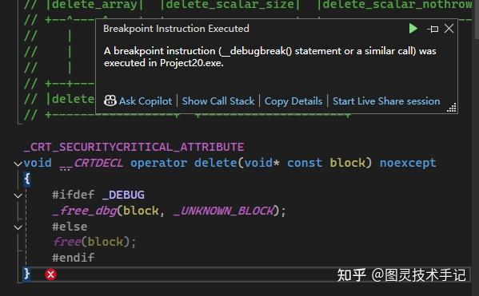
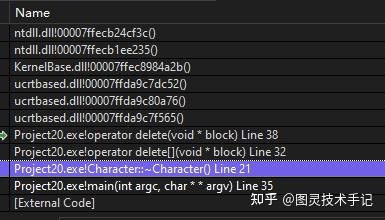
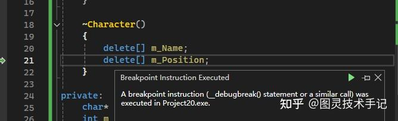

指针必然是C++中最容易让初学者掉进陷阱的东西

今天我们来聊一个在类中包含指针成员时容易形成的陷阱——默认拷贝构造函数

## 一、一个经典的崩溃

我们声明一个角色类，然后为其赋予名称、位置、等级等变量

```cpp
#include <iostream>


class Character
{
public:
	Character(const char* name, int level, float x, float y)
		: m_Level(level)
	{
		m_Name = new char[strlen(name) + 1];
		strcpy(m_Name,name);

		m_Position = new float[2];
		m_Position[0] = x;
		m_Position[1] = y;
	}

	~Character() 
	{
		delete[] m_Name;
		delete[] m_Position;
	}

private:
	char* m_Name;
	int m_Level;
	float* m_Position;
};


int main(int argc, char* argv[])
{
	Character charA("Character",10,255,255);
	Character charB = charA;
	return 0;
}

```

且我们用这个Character类声明一个CharA，然后声明一个CharB，且用赋值的方式将CharA赋值给CharB，等于是将CharA“复制”给了CharB

看起来这是一个“完美”的程序，一切都符合我们类的约定，且使用方式上都不会报错，也不会在编辑器中有任何报错提示

但是一旦当我们运行起来就会出现一个致命的错误







报错信息直接指向了我们在析构函数的时候报了错，大家能发现程序中的错误吗？

其实是因为我们在调用赋值符号的时候，会调用类中的拷贝函数，如果没有定义拷贝函数，就会调用默认拷贝函数

那么在Character类中，我们并没有特殊定义拷贝函数，导致在赋值中调用了默认拷贝函数

这个函数是这样的

```cpp
// 默认拷贝构造
Character(const Character& other)
    : m_Name(other.m_Name),       // 复制指针地址！
      m_Level(other.m_Level),
      m_Position(other.m_Position) // 复制指针地址！
{}

```

这里我们就知道了其中两个指针成员复制的是指针地址，而不是内存

所以当CharA在析构时，释放了这两个指针成员，当CharB在析构是，想要重新释放这两个成员，但是程序发现内存已经不在了，于是就报出了错误

要解决这个问题也很简单，需要我们在Character类中重新定义它的拷贝函数就可以了

```cpp
    Character(const Character& other)
        : m_Level(other.m_Level)
    {
        m_Name = new char[strlen(other.m_Name) + 1];
        strcpy(m_Name, other.m_Name);

        m_Position = new float[2];
        m_Position[0] = other.m_Position[0];
        m_Position[1] = other.m_Position[1];
    }

```

我们在这里总结一下，当类包含指针成员时，默认拷贝构造函数可能会导致：

1️⃣ 双重释放崩溃——两个对象析构时删除同一内存

2️⃣ 数据污染——修改一个对象影响另一个

3️⃣ 内存泄漏——原指针丢失造成泄露

其实我们在标准库中使用的string类，也是使用了自定义拷贝构造函数

```cpp
#include <iostream>
#include <cstring>


class String{
private:
    char * m_Buffer;
    unsigned int m_Size;

public:
    String(const char * string){
        m_Size = (unsigned int)std::strlen(string);
        m_Buffer = new char [m_Size+1];
        memcpy(m_Buffer,string,m_Size);
        m_Buffer[m_Size] = 0;
    };

    String(const String& other): // 在这里定义了copy的方法
        m_Size(other.m_Size)
    {
        m_Buffer = new char[m_Size + 1];
        memcpy(m_Buffer, other.m_Buffer, m_Size+1);
        m_Buffer[m_Size] = 0;
    }

    ~String(){
        delete[] m_Buffer;
    }

    friend std::ostream & operator<< (std::ostream& stream, const String & string);
    friend std::ostream & operator<< (std::ostream& stream, const String * string);

};

std::ostream & operator<< (std::ostream& stream, const String & string){
    stream << string.m_Buffer;
    return stream;
}

int main() {
    String first = "Bullet";
    String second = first;

    return 0;
}

```

> 正是因为有了拷贝构建函数，我们也能解释为什么函数有拷贝传入和引用传入两种区别，const T的传入方式会调用一次拷贝，而const T &的传入方式则不会调用拷贝，而是直接将原对象传入函数

## 二、解决方案——深拷贝四步法

1.分配新内存：为每个指针成员创建独立内存块

2.复制数据：拷贝内容而非指针地址

3.基本类型复制：直接复制值类型成员

4.避免自赋值：检查if(this == &other)

```cpp
// 完整深拷贝实现
Character(const Character& other) {
    // 1. 检查自赋值
    if(this == &other) return;
    
    // 2. 释放现有资源（赋值运算符需要）
    // delete[] m_Name; 
    // delete[] m_Position;
    
    // 3. 深拷贝动态成员
    m_Name = new char[strlen(other.m_Name) + 1];
    strcpy(m_Name, other.m_Name);
    
    m_Position = new float[2];
    m_Position[0] = other.m_Position[0];
    m_Position[1] = other.m_Position[1];
    
    // 4. 复制基本类型
    m_Level = other.m_Level;
}

```

## 三、开发推荐实践原则

### 法则1：三法则（Rule of Three）

如果定义了以下任一，必须定义全部三个：

- 拷贝构造函数

- 拷贝赋值运算符

- 析构函数

```cpp
// 拷贝赋值运算符
CharacterResource& operator=(const CharacterResource& other) {
    if(this == &other) return *this; // 自赋值检查
    
    // 释放旧资源
    delete[] m_Name;
    delete[] m_Position;
    
    // 深拷贝新资源
    m_Name = new char[strlen(other.m_Name) + 1];
    strcpy(m_Name, other.m_Name);
    
    m_Position = new float[2];
    m_Position[0] = other.m_Position[0];
    m_Position[1] = other.m_Position[1];
    
    m_Level = other.m_Level;
    return *this;
}

```

### 法则2：传递const引用避免拷贝

```cpp
// 错误：值传递触发拷贝构造
void ProcessCharacter(CharacterResource character) {
    // 代价高昂的深拷贝！
}

// 正确：传递const引用
void ProcessCharacter(const CharacterResource& character) {
    // 零拷贝，安全高效
}

```

### 法则3：使用=delete禁用拷贝

```cpp
class UniqueTexture {
public:
    UniqueTexture(const UniqueTexture&) = delete; // 禁用拷贝
    UniqueTexture& operator=(const UniqueTexture&) = delete;
    
    // ... 其他实现 ...
};

// 尝试拷贝将编译错误
UniqueTexture tex1;
UniqueTexture tex2 = tex1; // ❌ 错误：拷贝构造函数已删除

```

今天的知识点你都有Get到吗~

有没有什么疑问，我们在评论区见哦~

你们也可以告诉我有什么是你们想知道的


