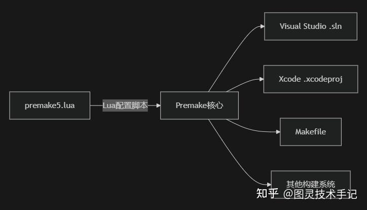

对于我们日常开发，尤其是对于我们的合作开发环境，大家的本地系统或者说本地的环境配置是不一样的，但是我们又要共同开发源码，有没有一种办法可以让我们只同步源码，然后按照一定的规范来生成工程文件呢？

给大家推荐一个工具——Premake，一个使用Lua脚本的构建配置工具，可以生成多种IDE的工程文件（如Visual Studio、Xcode、Makefile等）

## 一、premake的工作原理



premake相当于一个中间转换器，通过配置好的lua脚本，在不同环境下生成最后的结果

所以我们只需要将注意力放在lua脚本的书写上即可，不同编译的转换交给premake

```cpp
-- 最小可用配置
workspace "GameProject"  -- 解决方案名称
   configurations { "Debug", "Release" }  -- 构建配置
   platforms { "Win64", "MacOS" }         -- 目标平台

project "GameClient"      -- 项目名称
   kind "ConsoleApp"     -- 生成类型 (App, Lib等)
   language "C++"        -- 编程语言
   files { "src/**.cpp", "include/**.h" } -- 源文件

```

### 1. 多平台渲染API切换

```cpp
project "RenderCore"
    -- DirectX 12 (Windows)
    filter { "platforms:Win64", "files:**.hlsl" }
        shadermodel "5.0"
        buildcommands "fxc /T %{shader.type}_5_0 /Fo %{cfg.objdir}/%{file.basename}.cso %{file.relpath}"
    
    -- Metal (macOS)
    filter { "platforms:MacOS", "files:**.metal" }
        buildcommands "xcrun -sdk macosx metal -c %{file.relpath} -o %{cfg.objdir}/%{file.basename}.air"

```

### 2. 资源文件智能处理

```cpp
-- 纹理资源自动拷贝到输出目录
resourcefiles = os.matchfiles("assets/textures/**.png")
for _, file in ipairs(resourcefiles) do
    postbuildcommands { 
        "{COPY} " .. file .. " %{cfg.targetdir}/textures/" 
    }
end

-- 游戏数据打包
filter "configurations:Release"
    postbuildcommands "tools/AssetPacker.exe -input assets -output %{cfg.targetdir}/game.pak"

```

### 3. 模块化工程管理

```cpp
-- 引擎核心库
include "engine/premake-module.lua"

-- 游戏逻辑模块
project "GameLogic"
    kind "SharedLib"
    dependson { "EngineCore" }  -- 声明依赖
    files { "game/src/**.cpp" }

```

## 二、使用premake

一般来说我的项目习惯是将premake和调用premake的脚本放在Script文件夹中方便我们进行管理

```cpp
└── MultiExtend
    ├── Build.lua
    ├── Dependencies.lua
    ├── Directory.lua
    ├── Scripts
    │   ├── GenerateWIN.bat
    │   └── premake
    │       ├── premake5.exe
    ├── assets
    ├── include
    ├── shader
    ├── src
    └── Dependencies
```

GenerateWin.bat则是一个简单的脚本文件

```cpp
@echo off
pushd ..
Scripts\Premake\premake5.exe --file=Build.lua vs2022
popd
pause
```

这个脚本意思是使用premake.exe程序将根目录中的Build.lua作为主要的运行脚本来生成一个vs2022的solution，需要不同版本和不同平台的都可以自行修改脚本

而Build.lua中主要是统合了solution的相关内容

```cpp
include "Directory.lua"
include "Dependencies.lua"

workspace "MultiExtend"
	architecture "x64"
	startproject "MultiSandbox"
	configurations{
		"Debug",
		"Release",
                "Dist"
	}

    filter "system:windows"
    buildoptions { "/EHsc", "/Zc:preprocessor", "/Zc:__cplusplus","/utf-8" }
	

group "Sandbox"
	include "xxxx.lua"
	include "xxxx.lua"
	
group "Dependencies"
	include "Dependencies/xxxx.lua"
	include "Dependencies/xxxx.lua"
	include "Dependencies/xxxx.lua"
```

lua文件是可以使用include关键字的，这样我们就可以将不同的工程结构分配到不同的文件中去实现来提升我们的代码可读性了

Build中只定义了整个solution的名字——MultiExtend（RestArt ProjectB会使用到的项目），同时定义了三种不同的打包配置——“Debug”“Release”“Dist”

当我们拿到项目直接运行GenerateWin.bat就能获得我们的solution了

## 三、推荐的premake结构

延续着我们上一节的内容展开，我会推荐大家分出两个文件Dependencies.lua和Directory.lua分别来定义项目依赖的路径和项目打包的目标路径

```cpp
// Dependencies.lua

DepIncludeDir={}
DepIncludeDir["SDL"] = "%{wks.location}/Dependencies/SDL/include"
DepIncludeDir["SDL_image"] = "%{wks.location}/Dependencies/SDL_image/include"

DepIncludeDir["glad"] = "%{wks.location}/Dependencies/glad/include"
DepIncludeDir["glfw"] = "%{wks.location}/Dependencies/glfw/include"
DepIncludeDir["glew"] = "%{wks.location}/Dependencies/glew/include/GL"
DepIncludeDir["imgui"] = "%{wks.location}/Dependencies/imgui"

DepIncludeDir["zlib"] = "%{wks.location}/Dependencies/zlib"
DepIncludeDir["libpng"] = "%{wks.location}/Dependencies/libpng"

DepIncludeDir["dlg"] = "%{wks.location}/Dependencies/dlg/include"
DepIncludeDir["freetype"] = "%{wks.location}/Dependencies/freetype/include"
DepIncludeDir["harfbuzz"] = "%{wks.location}/Dependencies/harfbuzz/src"
DepIncludeDir["SDL_ttf"] = "%{wks.location}/Dependencies/SDL_ttf"

DepIncludeDir["spdlog"] = "%{wks.location}/Dependencies/spdlog/include"

DepIncludeDir["linmath"] = "%{wks.location}/Dependencies/linmath"

DepIncludeDir["lua"] = "%{wks.location}/Dependencies/lua"

DepIncludeDir["luacrypto"] = "%{wks.location}/Dependencies/luacrypto/src"
DepIncludeDir["openssl"] = "%{wks.location}/Dependencies/openssl/include"
DepIncludeDir["cryptopp"] = "%{wks.location}/Dependencies/cryptopp"

ProjIncludeDir={}
ProjIncludeDir["MultiExtend"] = "%{wks.location}/include"

LibDirectories = {}
LibDirectories["SDL_ttf"] =  LibDir.."/SDL_ttf"
LibDirectories["glfw"] =  LibDir.."/glfw"
LibDirectories["glad"] =  LibDir.."/glad"
LibDirectories["glew"] =  LibDir.."/glew"

LibDirectories["lua"] =  LibDir.."/lua"
LibDirectories["openssl"] =  "%{wks.location}/Dependencies/openssl/lib"

Library = {}
```

Dependencies.lua文件中定义了DepIncludeDir（外部依赖头文件路径） ProjIncludeDir（项目头文件路径） LibDirectories（静态库路径） Library（静态库）

将文件include到Build.lua之后，相关的其他文件就可以使用"%{ProjIncludeDir.MultiExtend}"这样的方式来调用相关路径了，使得我们的代码更有可读性

```cpp
// Directory.lua
LocationDir = "%{wks.location}/settings"

DependenciesRoot = "%{wks.location}/Extension/MultiExtend/Dependencies"
ExtensionRoot = "%{wks.location}/Extension"

OutputDir = "%{cfg.system}-%{cfg.architecture}/%{cfg.buildcfg}"

EXEDir = "%{wks.location}/bin/"..OutputDir
LibDir = "%{wks.location}/bin/"..OutputDir
DynamicDir = "%{wks.location}/bin/"..OutputDir
TargetDir = "%{wks.location}/bin/" .. OutputDir .. "/%{prj.name}"
ObjectDir = "%{wks.location}/bin/obj/" .. OutputDir .. "/%{prj.name}"
```

Directory.lua文件相对来说会固定一些，直接定义了项目编译目标的相对路径，即使是不同项目，都可以直接使用这里的定义

核心是EXEDir（可执行文件目录）LibDir（静态库目录）DynamicDir（动态库目录）TargetDir（编译目标目录）ObjectDir（中间文件目录）

而在具体定义一个项目的编译时

```cpp
project "MultiExtend"
    kind "SharedLib"
    language "C++"
    cppdialect "C++20"

    files
    {
        "src/**.cpp",
        "include/**.h"
    }

    includedirs
    {
        "include",
        
        "%{DepIncludeDir.spdlog}",
        "%{DepIncludeDir.openssl}",
        "%{DepIncludeDir.cryptopp}",
        
        "%{DepIncludeDir.SDL}",
        "%{DepIncludeDir.SDL_image}",
        "%{DepIncludeDir.glad}",
        "%{DepIncludeDir.glfw}",
        "%{DepIncludeDir.glew}",
        "%{DepIncludeDir.linmath}",
    }

    libdirs
    {
        "%{LibDirectories.openssl}"
    }

    links
    {
        "spdlog",
        "libcrypto",
        "libssl",
        "cryptopp",
        "SDL",
        "SDL_main",
        "SDL_image",
        "glfw",
        "glad",
        "glew",
        "opengl32.lib"
    }

    defines
	{
        "_CRT_SECURE_NO_WARNINGS",
        "MULTI_EXTEND_BUILD_DLL_EXPORT"
	}

    flags
    {
        "NoRuntimeChecks",
		-- "NoBufferSecurityCheck"
    }

    -- vectorextensions  "SSE"               -- Necessary to run x32.

    -- buildoptions { "/EHsc", "/Zc:preprocessor", "/Zc:__cplusplus"}

    -- warnings "off"

    location (LocationDir)
    targetdir (TargetDir)
    objdir (ObjectDir)

    inlining    "Explicit"
	-- intrinsics  "Off"

    postbuildcommands
	{
		("{COPY} %{cfg.buildtarget.relpath} "..DynamicDir)
	}

    filter "system:windows" 
        staticruntime "Off"
        systemversion "latest"
        defines { "_WINDOWS" }

    filter "configurations:Debug"
        runtime "Debug"
        symbols "On"
        defines { "_DEBUG","SPDLOG_ACTIVE_LEVEL=0","MULTIEXTEND_DEBUG_DETAIL" }

    filter "configurations:Release"
        runtime "Release"
        optimize "On"
        symbols "On"
        defines { "_RELEASE","NDEBUG","SPDLOG_ACTIVE_LEVEL=1" }

    filter "configurations:Dist"
        runtime "Release"
        optimize "On"
        symbols "Off"
        defines { "_DIST","NDEBUG","SPDLOG_ACTIVE_LEVEL=3" }
```

我们就使用了比较固定的代码来控制输出的位置，方便维护和管理

```cpp
    location (LocationDir)
    targetdir (TargetDir)
    objdir (ObjectDir)

    postbuildcommands
	{
		("{COPY} %{cfg.buildtarget.relpath} "..DynamicDir)
	}
```

其中postbuildcommand是编译后的脚本定义，一般是针对动态目录使用的，将dll文件复制到可执行文件目录下

我们看一下完整的工程目录

```cpp
└── MultiExtend
    ├── Build.lua
    ├── Dependencies
    │   ├── FFmpeg
    │   ├── SDL
    │   ├── SDL.lua
    │   ├── SDL_image
    │   ├── SDL_image.lua
    │   ├── SDL_image_Example.lua
    │   ├── SDL_ttf
    │   ├── SDL_ttf.lua
    │   ├── SDL_ttf_Example.lua
    │   ├── cryptopp
    │   ├── cryptopp.lua
    │   ├── dlg
    │   ├── dlg.lua
    │   ├── dlg_example.lua
    │   ├── freetype
    │   ├── freetype.lua
    │   ├── glad
    │   ├── glad.lua
    │   ├── glew
    │   ├── glew.lua
    │   ├── glfw
    │   ├── glfw.lua
    │   ├── harfbuzz
    │   ├── harfbuzz.lua
    │   ├── imgui
    │   ├── imgui.lua
    │   ├── lib
    │   ├── libpng
    │   ├── libpng.lua
    │   ├── linmath
    │   ├── lua
    │   ├── lua.lua
    │   ├── luacrypto
    │   ├── luacrypto.lua
    │   ├── openssl
    │   ├── spdlog
    │   ├── spdlog.lua
    │   ├── zlib
    │   └── zlib.lua
    ├── Dependencies.lua
    ├── Directory.lua
    ├── MultiExtend.lua
    ├── MultiExtend.sln
    ├── MultiSandbox
    │   ├── MultiSandbox.lua
    │   ├── include
    │   │   └── Sandbox.h
    │   └── src
    │       ├── Sandbox.cpp
    │       └── main.cpp
    ├── MultiTemplate
    │   ├── Template.lua
    │   ├── Template01.cpp
    │   ├── Template02.cpp
    │   ├── Template03.cpp
    │   ├── Template04.cpp
    │   ├── Template05.cpp
    │   └── test.lua
    ├── Render
    │   ├── Render.lua
    │   ├── include
    │   │   ├── Render.h
    │   └── src
    │       ├── Main.cpp
    │       ├── Render.cpp
    ├── Scripts
    │   ├── GenerateWIN.bat
    │   └── premake
    │       ├── premake5.exe
    ├── assets
    ├── include
    │   ├── API
    │   │   ├── IActorComponentOwner.h
    │   │   ├── IBasic.h
    │   │   ├── IComponentOwner.h
    │   │   ├── IDraw.h
    │   │   ├── IInput.h
    │   │   ├── ITransform.h
    │   │   └── IUpdate.h
    │   ├── Actor
    │   │   ├── Actor.h
    │   │   └── ActorConfig.h
    │   ├── Component
    │   │   ├── ActorComponent.h
    │   │   ├── ActorComponentConfig.h
    │   │   ├── BasicComponent.h
    │   │   ├── BasicComponentConfig.h
    │   │   ├── Component.h
    │   │   ├── ComponentConfig.h
    │   │   ├── Movement
    │   │   └── Sprite
    │   ├── Config
    │   │   ├── Game.h
    │   │   ├── KeyCodes.h
    │   │   └── MouseCodes.h
    │   ├── Debug
    │   │   ├── Log
    │   │   ├── Message
    │   │   └── Trace
    │   ├── Event
    │   │   ├── ApplicationEvent.h
    │   │   ├── Event.h
    │   │   ├── KeyboardEvent.h
    │   │   └── MouseEvent.h
    │   ├── Math
    │   │   ├── Color.h
    │   │   ├── Math.h
    │   │   ├── MathMicro.h
    │   │   ├── Matrix.h
    │   │   ├── Shader.h
    │   │   ├── Vector.h
    │   │   └── Vertex.h
    │   ├── MultiExtend.h
    │   ├── MultiExtendAPI.h
    │   ├── MultiExtendConfig.h
    │   ├── MultiExtendDebug.h
    │   ├── MultiExtendMicro.h
    │   ├── MultiExtendRender.h
    │   ├── Object
    │   │   ├── GameObject.h
    │   │   ├── GameObjectConfig.h
    │   │   ├── GameStat.h
    │   │   ├── GameStatConfig.h
    │   │   ├── Object.h
    │   │   └── ObjectConfig.h
    │   ├── Shader
    │   │   └── Shader.h
    │   ├── System
    │   │   ├── Directory
    │   │   ├── File
    │   │   ├── Hash
    │   │   └── Operator.h
    │   ├── Texture
    │   │   └── Texture.h
    │   └── Time
    │       ├── Clock
    │       └── Timer
    ├── shader
    │   └── basic.glsl
    └── src
         ├── Actor
         │   └── Actor.cpp
         ├── Component
         │   ├── ActorComponent.cpp
         │   ├── BasicComponent.cpp
         │   ├── Component.cpp
         │   ├── Movement
         │   └── Sprite
         ├── Config
         │   └── Game.cpp
         ├── Debug
         │   ├── Log
         │   ├── Message
         │   └── Trace
         ├── Math
         │   ├── Color.cpp
         │   ├── Math.cpp
         │   ├── Matrix.cpp
         │   ├── Shader.cpp
         │   ├── Vector.cpp
         │   └── Vertex.cpp
         ├── MultiExtend.cpp
         ├── MultiExtendRender.cpp
         ├── Object
         │   ├── GameObject.cpp
         │   ├── GameStat.cpp
         │   └── Object.cpp
         ├── Shader
         │   └── Shader.cpp
         ├── System
         │   ├── Directory
         │   ├── File
         │   ├── Hash
         │   └── Operator.cpp
         ├── Texture
         │   └── Texture.cpp
         └── Time
             ├── Clock
             └── Timer

```

会看到即使针对于Dependencies中诸多的依赖项目，我们都会有专门的lua文件来定义其如何编译，这样可以简化我们的代码结构，同时也保证我们的核心文件是清晰且干净的

这里也为大家整理了几份lua模板，分别针对可执行文件、静态库、动态库等等的

```cpp
project "EXE"
    kind "ConsoleApp"
    language "C++"
    cppdialect "C++20"

    files
    {
    }

    includedirs
    {
    }

    links
    {
    }

    defines
	{
	}

    flags
    {
        -- "NoRuntimeChecks", -- Only used on Visual Studio.
		-- "NoBufferSecurityCheck"
    }

    -- vectorextensions  "SSE"               -- Necessary to run x32.

    buildoptions { "/EHsc", "/Zc:preprocessor", "/Zc:__cplusplus"}

    -- warnings "off"

    location (LocationDir)
    targetdir (EXEDir)
    objdir (ObjectDir)

    -- inlining    "Explicit"
	-- intrinsics  "Off"

    filter "system:windows" 
        -- staticruntime "Off"
        systemversion "latest"
        defines { "_WINDOWS" }

    filter "configurations:Debug"
        runtime "Debug"
        symbols "On"
        defines { "_DEBUG" }

    filter "configurations:Release"
        runtime "Release"
        optimize "On"
        symbols "On"
        defines { "_RELEASE","NDEBUG" }

    filter "configurations:Dist"
        runtime "Release"
        optimize "On"
        symbols "Off"
        defines { "_DIST","NDEBUG" }
```

```cpp
project "Lib"
    kind "StaticLib"
    language "C++"
    cppdialect "C++20"

    files
    {
    }

    includedirs
    {
    }

    links
    {
    }

    defines
	{
	}

    flags
    {
        -- "NoRuntimeChecks", -- Only used on Visual Studio.
		-- "NoBufferSecurityCheck"
    }

    -- vectorextensions  "SSE"               -- Necessary to run x32.

    buildoptions { "/EHsc", "/Zc:preprocessor", "/Zc:__cplusplus"}

    warnings "off"

    location (LocationDir)
    targetdir (TargetDir)
    objdir (ObjectDir)

    -- inlining    "Explicit"
	-- intrinsics  "Off"

    filter "system:windows" 
        -- staticruntime "Off"
        systemversion "latest"
        defines { "_WINDOWS" }

    filter "configurations:Debug"
        runtime "Debug"
        symbols "On"
        defines { "_DEBUG" }

    filter "configurations:Release"
        runtime "Release"
        optimize "On"
        symbols "On"
        defines { "_RELEASE","NDEBUG" }

    filter "configurations:Dist"
        runtime "Release"
        optimize "On"
        symbols "Off"
        defines { "_DIST","NDEBUG" }
```

```cpp
project "Dll"
    kind "SharedLib"
    language "C++"
    cppdialect "C++20"

    files
    {
    }

    includedirs
    {
    }

    links
    {
    }

    defines
	{
	}

    flags
    {
        -- "NoRuntimeChecks", -- Only used on Visual Studio.
		-- "NoBufferSecurityCheck"
    }

    -- vectorextensions  "SSE"               -- Necessary to run x32.

    buildoptions { "/EHsc", "/Zc:preprocessor", "/Zc:__cplusplus"}

    warnings "off"

    location (LocationDir)
    targetdir (TargetDir)
    objdir (ObjectDir)

    -- inlining    "Explicit"
	-- intrinsics  "Off"

    postbuildcommands
	{
		("{COPY} %{cfg.buildtarget.relpath} "..DynamicDir)
	}

    filter "system:windows" 
        staticruntime "Off"
        systemversion "latest"
        defines { "_WINDOWS" }

    filter "configurations:Debug"
        runtime "Debug"
        symbols "On"
        defines { "_DEBUG" }

    filter "configurations:Release"
        runtime "Release"
        optimize "On"
        symbols "On"
        defines { "_RELEASE","NDEBUG" }

    filter "configurations:Dist"
        runtime "Release"
        optimize "On"
        symbols "Off"
        defines { "_DIST","NDEBUG" }

```


