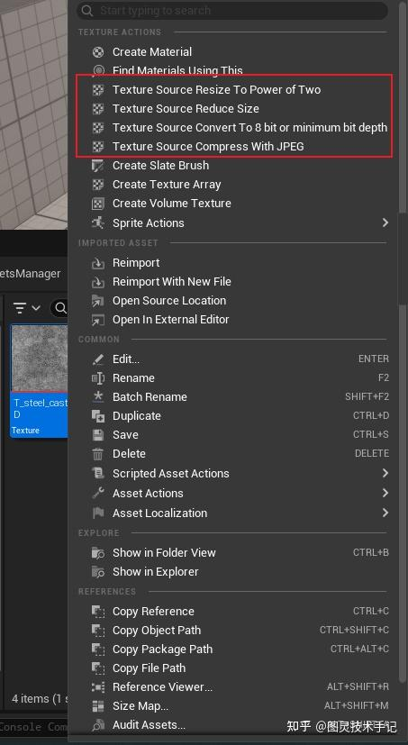
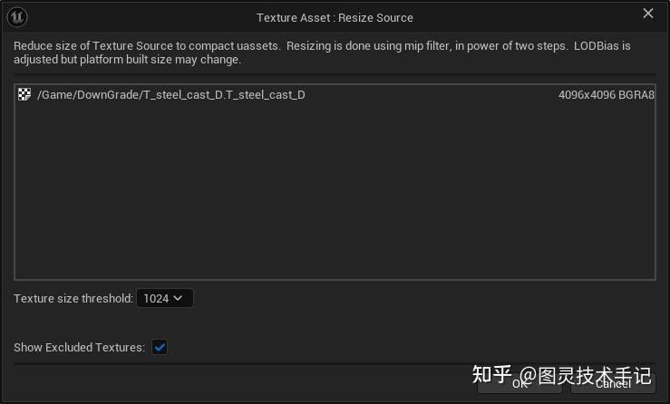
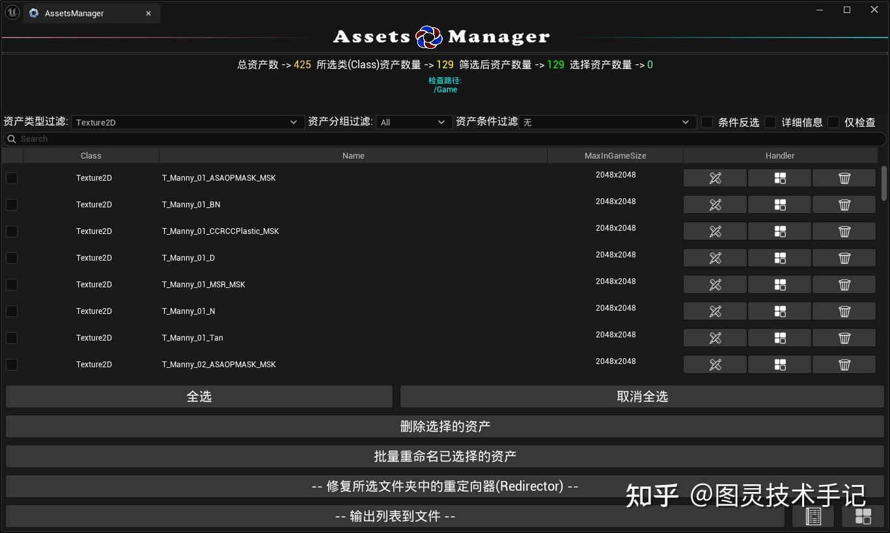
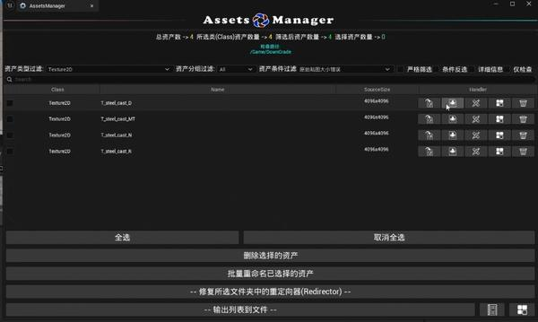
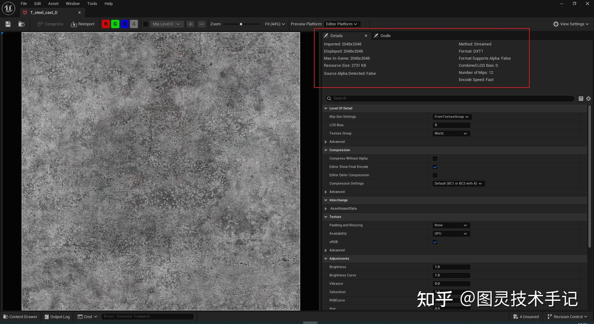
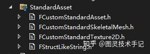

## 一、实现引擎内C++贴图降级有什么意义？

无论是用虚幻引擎做影视开发或者是游戏开发，尤其是游戏开发，都会碰到一个问题，就是贴图的管理。

一般来说贴图进引擎之前都要经过其他DCC软件无论是用SubstancePainter画贴图，还是说用Houdini之类的软件生成一些信息图，比如厚度图、VAT等来补足引擎中信息的缺失，这个过程都比较复杂和繁琐，这个过程是线性的，不可逆的。

可如果这个情况下，因为项目开发需求，或者因为一些性能问题需要批量修改的时候，你DCC中的文件还能找的到吗？找到了我们愿意一张一张去更改吗？（除非本质设计产生了变化）又或者你碰到了项目整体设置的问题，你愿意一个文件一个文件点开去整理吗？

如果这个时候有一个工具可以帮助你自定义你的资产管理管线，那是不是会方便很多？

今天主要讲一下使用C++来进行UE引擎内贴图降级的功能

如果你有一个UE5.5的引擎，应该已经发现，对于贴图资产来说，本身已经有了一些直接降级贴图的功能，但是这个功能是UE封装好的，使用起来相对来说有被动，如果我们可以拆出相应的源码并且集成到自己的工具中，这样是不是更能贴近具体项目需求？而且我们也能通过UE底层来保证贴图精度不会因为反复“导出”“导入”“压缩”等外部操作过分损失。





## 二、效果演示

在我的工具中，我已经写了一个界面，可以对资产进行多方面的筛查和管理。



其中在Texture2D &gt; 原始贴图大小错误的检查中，就根据条件生成了两个按键，一个是Reimport（重新导入），另一个就是Resize，点击之后直接可以限制贴图的大小并保存。






这个Resize的规则走的是Config的逻辑，是通过Plugins &gt; AssetsManager &gt; Config &gt; AssetsManager.ini来配置的（这一块会有专门介绍动态配置的板块来写）

```cpp
[/AssetsManager/Global]
......

[/AssetsManager/Global/Texture]
MaxSize=2048
......

[/AssetsManager/Character/Texture]
MaxSize=2048
......

[/AssetsManager/Hair/Texture]
MaxSize=2048
......
+SuffixStandard=(Suffix=Mask,MaxSize=512,LODGroup=TEXTUREGROUP_CharacterSpecular,sRGB=0,CompressionSettings=TC_Masks)
......

[/AssetsManager/Effect/Texture]
MaxSize=2048
......

[/AssetsManager/UI/Texture]
MaxSize=2048
......

[/AssetsManager/Scene/Texture]
MaxSize=2048
......

[/AssetsManager/Global/Mesh]
......


```

这里就使用到了ini中对应Slot下的MaxSize宽松配置（也可以使用成依据Suffix的严格MaxSize配置）

这样当我们点击Resize就有了具体大小的参考依据

当我们发现了原始贴图大小不合规的资产，就可以点击Resize，进而自动将我们的贴图在原始大小层面合规，以此来缩小硬盘占用。

> 不过要记住，从设计上来讲，这个操作一旦保存就会覆盖磁盘文件，建议使用git或者其他版本管理程序对项目进行管理，否则想要退回原来大小就需要重新导入源文件了

## 三、源码结构

接下来给大家展示一些源码结构，对于标准化的资产管理，我统一放在StandardAsset文件夹下



### UCustomStandardObject

我声明了一个母类UCustomStandardObject，其中包含了对所有UObject资产抽象出来的目前需要的一些方法（随着开发深入肯定有更多扩展），简单看一下头文件明确功能就足够，有兴趣可以直接去看我的源码

```cpp
class ASSETSMANAGER_API UCustomStandardObject
{

public:
	UCustomStandardObject(UObject* InObj, bool StricCheckMode = false);
	virtual ~UCustomStandardObject();

	TWeakObjectPtr<UObject> Get();

	FString GetClassValidObjectName();
	TSharedPtr<FString> GetAssetNameInfoByIndex(const int32& index);
	const TSharedPtr<FString> GetAssetPrefix();
	const TSharedPtr<FString> GetAssetSuffix();

	const uint32 GetAssetNameInfoCount() const;

	FString GetAssetNameWithoutPrefix();

	bool IsPrefixNonstandarized();
	const TSharedPtr<FString> GetAssetStandardPrefix();

	virtual int64 GetMemorySize(bool bEstimatedTotal = true);
	virtual int64 GetMemorySize(AssetsInfoDisplayLevel& DisplayLevel, bool bEstimatedTotal = true);

	AssetCategory GetCommonAssetCategory();
	AssetCategory GetStrictAssetCategory();

	bool IsCatogryStandarized();

protected:
	virtual bool ForceSave();

	bool bStrictCheckMode;
	TArray<FString> AssetNameInfoList;
	TSharedPtr<FString> AssetConfigGlobalSection;

private:
	TWeakObjectPtr<UObject> Object;
};

```

### UCustomStandardTexture2D

基于UCustomStandardObject，我声明了UCustomStandardTexture2D用来专门处理UTexture2D对象

```cpp
class ASSETSMANAGER_API UCustomStandardTexture2D : public UCustomStandardObject
{
public:
	
	UCustomStandardTexture2D(UObject* InObj, bool StricCheckMode = false);
	UCustomStandardTexture2D(UTexture2D* InTexture2D, bool StricCheckMode = false);
	virtual ~UCustomStandardTexture2D();

	TWeakObjectPtr<UTexture2D> Get();

	bool IsTexture2D();


	//......

	void ResizeSource(int targetSize, bool forceSave = false);
	void ResizeSourcePowerOf2(bool forceSave = false);
	
        //......

	FVector2D GetSourceSize();

	//......
protected:
	//......

	bool IsTextureSourceOverSize();

	//......
	
	TSharedPtr<FString> TextureGlobalConfigSection;
	TSharedPtr<FString> TextureCategoryCommonConfigSection;
	TSharedPtr<FString> TextureCategoryStrictConfigSection;
};

```

其构建可以通过传入我们获得的Asset存储的UObject指针即可，这样我们就能对这个Object进行抽象查验了。

void ResizeSource(int targetSize,bool forceSave =false);就是核心，可以直接基于贴图长边保留比例的条件下缩小尺寸。

void ResizeSourcePowerOf2(bool forceSave =false);可以帮助我们判断贴图的大小是否为2的指数，如果不是就将其优化为2的指数

> 如果贴图边长不满足2的指数这个条件，贴图就不会生成MipMaps，进而就会导致游戏内在观察时产生摩尔纹，同时带来大量内存消耗。

### 实现void ResizeSource(int targetSize,bool forceSave =false);

```cpp
void UCustomStandardTexture2D::ResizeSource(int targetSize, bool forceSave)
{
	if(!this->IsTexture2D())
	{
		return;
	}

	// we do the resizing considering only Mip/LOD/build settings for the running Editor platform (Windows ...)
	const ITargetPlatform* RunningPlatform = GetTargetPlatformManagerRef().GetRunningTargetPlatform();

	int32 BeforeSizeX;
	int32 BeforeSizeY;
	this->Get()->GetBuiltTextureSize(RunningPlatform, BeforeSizeX, BeforeSizeY);

	const FIntPoint BeforeSourceSize = this->Get()->Source.GetLogicalSize();
	MsgLog(FString::Printf(TEXT("Texture (%s) Resizing to <= %d Source Size=%dx%d Built Size=%dx%d"), *this->Get()->GetName(), targetSize,
		BeforeSourceSize.X, BeforeSourceSize.Y, BeforeSizeX, BeforeSizeY));

	if (!UE::TextureUtilitiesCommon::Experimental::DownsizeTextureSourceData(this->Get().Get(), targetSize, RunningPlatform))
	{
		MsgLog(FString::Printf(TEXT("Texture (%s) did not resize."), *this->Get()->GetName()));

		// did not resize, but may have done PreEditChange
		return;
	}

	const FIntPoint AfterSourceSize = this->Get()->Source.GetLogicalSize();

	this->Get()->LODBias = 0;

	int32 AfterSizeX;
	int32 AfterSizeY;
	this->Get()->GetBuiltTextureSize(RunningPlatform, AfterSizeX, AfterSizeY);

	// if AfterSize > BeforeSize , kick up LODBias
	//	to try to preserve GetBuiltTextureSize
	this->Get()->LODBias = FMath::RoundToInt32(FMath::Log2((double)FMath::Max(AfterSizeX, AfterSizeY) / FMath::Max(BeforeSizeX, BeforeSizeY)));
	this->Get()->LODBias = FMath::Max(0, this->Get()->LODBias);

	// recompute AfterSize if we changed LODBias
	if (this->Get()->LODBias != 0)
	{
		this->Get()->GetBuiltTextureSize(RunningPlatform, AfterSizeX, AfterSizeY);
	}

	MsgLog(FString::Printf(TEXT("Texture (%s) did resize Source Size=%dx%d Built Size=%dx%d"), *this->Get()->GetName(),
		AfterSourceSize.X, AfterSourceSize.Y, AfterSizeX, AfterSizeY));

	if (BeforeSizeX != AfterSizeX || BeforeSizeY != AfterSizeY)
	{
		// not a warning, just FYI
		// changing built size is totally possible and expected to happen sometimes
		//	basically any time you resize smaller than the previous in-game size
		MsgLog(FString::Printf(TEXT("DoResizeTextureSource failed to preserve built size; was: %dx%d now: %dx%d on [%s]"),
			BeforeSizeX, BeforeSizeY,
			AfterSizeX, AfterSizeY,
			*this->Get()->GetFullName()));
	}

	// this counts as a reimport :
	UE::TextureUtilitiesCommon::ApplyDefaultsForNewlyImportedTextures(this->Get().Get(), true);

	// DownsizeTextureSourceData did the PreEditChange
	this->Get()->PostEditChange();

	if(forceSave)
	{
		this->ForceSave();
	}
}

```

这一段我直接将UE实现的源码进行轻量化后放在了我的函数中，直接根据我的需求对贴图进行降级

### 实现void UCustomStandardTexture2D::ResizeSourcePowerOf2(bool forceSave)

```cpp
void UCustomStandardTexture2D::ResizeSourcePowerOf2(bool forceSave)
{
	if (!this->IsTexture2D())
	{
		return;
	}

	check(!this->Get()->Source.AreAllBlocksPowerOfTwo()); // already filtered for

	const FIntPoint BeforeSourceSize = this->Get()->Source.GetLogicalSize();

	if (!UE::TextureUtilitiesCommon::Experimental::ResizeTextureSourceDataToNearestPowerOfTwo(this->Get().Get()))
	{
		MsgLog(FString::Printf(TEXT("Texture (%s) did not resize."), *this->Get()->GetName()));

		// did not resize, but may have done PreEditChange
		return;
	}

	const FIntPoint AfterSourceSize = this->Get()->Source.GetLogicalSize();

	MsgLog(FString::Printf(TEXT("Texture (%s) did resize Before Size=%dx%d After Size=%dx%d"), *this->Get()->GetName(),
		BeforeSourceSize.X, BeforeSourceSize.Y, AfterSourceSize.X, AfterSourceSize.Y));

	// ?? if Texture was set to stretch to Pow2, we could remove that now, but leaving it is harmless
	//Texture->PowerOfTwoMode = ETexturePowerOfTwoSetting::None;

	// if Texture was set to MipGen = NoMipMaps, change to FromTextureGroup ?
	// assume that since we changed to Pow2, we want mips and streaming
	if (this->Get()->MipGenSettings == TMGS_NoMipmaps)
	{
		this->Get()->MipGenSettings = TMGS_FromTextureGroup;
	}
	this->Get()->NeverStream = false;

	// this counts as a reimport :
	UE::TextureUtilitiesCommon::ApplyDefaultsForNewlyImportedTextures(this->Get().Get(), true);

	// DownsizeTextureSourceData did the PreEditChange
	this->Get()->PostEditChange();

	if (forceSave)
	{
		this->ForceSave();
	}
}

```

### Bind

最后将这个方法绑定到按钮上即可实现啦~

```cpp
TSharedRef<SButton> SManagerSlateTab::ConstructSingleAssetResizeTextureSourceButtonBox(const TSharedPtr<FAssetData>& AssetDataToDisplay)
{
	TSharedRef<SButton> SingleAssetResizeTextureSourceButton =
		SNew(SButton)
		.OnClicked(this,&SManagerSlateTab::OnSingleAssetResizeTextureSourceButtonClicked,AssetDataToDisplay)
		.ContentPadding(FMargin(2.f))
		.ToolTipText(FText::FromString(L"Limit Source Size"));

	const FSlateBrush* ButtonImg = FAssetsMangerStyle::GetStyleSet()->GetBrush("ContentBrowser.LimitSize");
	TSharedRef<SImage> ButtonImgComponent = SNew(SImage).Image(ButtonImg);

	TSharedRef<SScaleBox> ButtonImgScaler =
		SNew(SScaleBox)
		.Stretch(EStretch::ScaleToFitY)
		[
			ButtonImgComponent
		];

	SingleAssetResizeTextureSourceButton->SetContent(ButtonImgScaler);

	return SingleAssetResizeTextureSourceButton;
}

FReply SManagerSlateTab::OnSingleAssetResizeTextureSourceButtonClicked(TSharedPtr<FAssetData> ClickedAssetData)
{
	UCustomStandardTexture2D StandardTexture(ClickedAssetData->GetAsset());

	if(!StandardTexture.IsTexture2D())
	{
		NtfyMsgLog(FString::Printf(L"Asset is not in texture type.[%s]",*StandardTexture.Get()->GetFName().ToString()));
		return FReply::Handled();
	}

	StandardTexture.Fix(SOURCESIZE,true,true);

	RefreshAssetsListView();

	return FReply::Handled();
}

```

## 四、源码解析

> 和这一部分相关的模块为"TextureUtilitiesCommon"，一定要记得添加在.Build.cs文件中

### 1. 前置检查

```cpp
if(!this->IsTexture2D()) { return; }

```

作用：确保当前对象是有效的 2D 纹理资源，否则直接退出

### 2. 获取当前平台和原始尺寸

```cpp
const ITargetPlatform* RunningPlatform = GetTargetPlatformManagerRef().GetRunningTargetPlatform();
int32 BeforeSizeX, BeforeSizeY;
this->Get()->GetBuiltTextureSize(RunningPlatform, BeforeSizeX, BeforeSizeY);
const FIntPoint BeforeSourceSize = this->Get()->Source.GetLogicalSize();

```

获取当前运行的平台（如 Windows）

记录纹理的原始逻辑尺寸（Source 中的分辨率）和实际运行时尺寸（考虑 Mipmap、压缩等后的尺寸）

### 3. 调用实际缩放函数

```cpp
if (!UE::TextureUtilitiesCommon::Experimental::DownsizeTextureSourceData(...))
{
    return; // 缩放失败
}

```

调用引擎内部函数 DownsizeTextureSourceData 尝试将纹理的源数据（Source）缩放到目标分辨率（targetSize）

关键点：

- 如果缩放失败（如目标尺寸无效），直接退出。

- 成功时会触发 PreEditChange（标记资源状态为“已修改”）

### 4. 调整 LODBias 以保持运行时尺寸

```cpp
this->Get()->LODBias = 0; // 重置 LODBias
this->Get()->LODBias = FMath::RoundToInt32(FMath::Log2(...));
this->Get()->LODBias = FMath::Max(0, this->Get()->LODBias);

```

通过调整LODBias（纹理的细节级别偏移），尽量让缩放后的纹理在游戏中的实际渲染尺寸接近原始尺寸。

LODBias = log2(缩放后最大边长 / 缩放前最大边长）

如果缩放后尺寸变大（理论上不应该发生），LODBias会被限制为 0（不偏移）

### 5. 验证并输出结果

```cpp
this->Get()->GetBuiltTextureSize(RunningPlatform, AfterSizeX, AfterSizeY);
MsgLog(...); // 输出缩放前后的尺寸对比

```

### 6. 后处理与保存

```cpp
UE::TextureUtilitiesCommon::ApplyDefaultsForNewlyImportedTextures(...);
this->Get()->PostEditChange();
if(forceSave) { this->ForceSave(); }

```

1. 应用默认设置：将纹理的压缩、Mipmap 等参数重置为引擎默认值（模拟重新导入的效果）。

1. 触发修改事件：PostEditChange 通知编辑器资源已更新。

1. 可选保存：根据 forceSave 参数决定是否立即保存到磁盘。


