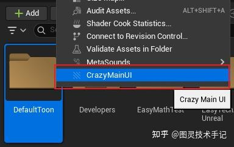
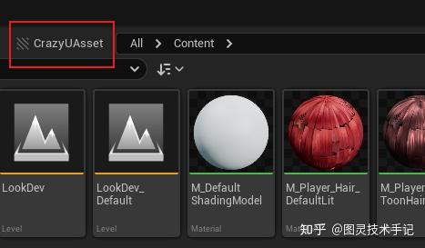

（文章基于此CrazyUAsset库-开发中）

想要检查资产，第一步就是要获取当前检查的文件夹路径

我们获取路径的方式要满足两点：

1.能随时调用相应的函数

2.分为获取当前内容浏览器路径和选择的文件夹路径两种方式

## 一、声明并实现函数

```cpp
// CrazyChecker.h

/*
 * 获取当前内容浏览器下所选择的所有文件夹路径
 */
static TArray<FString> GetCurrentContentBrowserSelectedPaths(bool bRemoveStartTag = false);

/*
 * 获取当前内容浏览器的路径
 */
static FString GetCurrentContentBrowserPath(bool bRemoveStartTag = false);

```

实现中需要依赖头文件

```cpp
// CrazyChecker.cpp

#include "ContentBrowserModule.h"
#include "IContentBrowserSingleton.h"

```

实现函数

```cpp
// CrazyChecker.cpp

TArray<FString> FCrazyAssetChecker::GetCurrentContentBrowserSelectedPaths(bool bRemoveStartTag)
{
	FContentBrowserModule& ContentBrowserModule = FModuleManager::LoadModuleChecked<FContentBrowserModule>(TEXT("ContentBrowser"));
	IContentBrowserSingleton& ContentBrowser = ContentBrowserModule.Get();

	TArray<FString> SelectedPaths;
	ContentBrowser.GetSelectedFolders(SelectedPaths);

	if(bRemoveStartTag)
	{
		for (FString& path : SelectedPaths)
		{
			path.RemoveFromStart(L"/All");
		}
	}
	
	return SelectedPaths;
}

FString FCrazyAssetChecker::GetCurrentContentBrowserPath(bool bRemoveStartTag)
{
	FContentBrowserModule& ContentBrowserModule = FModuleManager::LoadModuleChecked<FContentBrowserModule>(TEXT("ContentBrowser"));
	IContentBrowserSingleton& ContentBrowser = ContentBrowserModule.Get();

	FContentBrowserItemPath Path = ContentBrowser.GetCurrentPath();
	FString PathStr = Path.GetVirtualPathString();

	if (bRemoveStartTag)
		PathStr.RemoveFromStart(L"/All");

	return PathStr;
}

```

## 二、使用函数

我们再思考一下这两个函数分别调用的位置

第一个GetCurrentContentBrowserSelectedPaths函数我们希望在选择了文件夹的时候调用



第二个GetCurrentContentBrowserPath我们希望在一个ContentBrowser的按钮下调用



所以我们必然要将两个函数绑定到不同的位置来调用

那我们首先在整个插件中声明一个同步插件声明周期的变量，以及两个在不同语境调用的函数

```cpp
// CrazyUAsset.h

class FCrazyUAssetModule : public IModuleInterface
{
public:
        ......

	/** This function will be bound to Command (by default it will bring up plugin window) */
	void OnCrazyMainUIClicked_CurrentBrowser();
	void OnCrazyMainUIClicked_Selected();
	
private:
	......

private:

	......

	TArray<FString> CrazyMainUISelectedFolderPaths;

        ......

        TSharedPtr<class SDockTab> CrazyMainUIDockerTa

        ......
	
};

```

接着我们声明这两个函数

```cpp
// CrazyUAsset.cpp

void FCrazyUAssetModule::OnCrazyMainUIClicked_CurrentBrowser()
{
	this->CrazyMainUISelectedFolderPaths.Empty();
	this->CrazyMainUISelectedFolderPaths.Add(FCrazyAssetChecker::GetCurrentContentBrowserPath());

	FGlobalTabmanager::Get()->TryInvokeTab(CrazyUAssetMainUIName);

	if (this->CrazyMainUIDockerTab.IsValid())
	{
		
	}
	else
	{
		FGlobalTabmanager::Get()->TryInvokeTab(CrazyUAssetMainUIName);
	}
}

void FCrazyUAssetModule::OnCrazyMainUIClicked_Selected()
{
	this->CrazyMainUISelectedFolderPaths.Empty();
	this->CrazyMainUISelectedFolderPaths.Append(FCrazyAssetChecker::GetCurrentContentBrowserSelectedPaths());

	if (this->CrazyMainUIDockerTab.IsValid())
	{
		
	}
	else
	{
		FGlobalTabmanager::Get()->TryInvokeTab(CrazyUAssetMainUIName);
	}
}

```

其中为了防止我们开启多个实例造成内存卡顿，我们做了一下限制

```cpp
if (this->CrazyMainUIDockerTab.IsValid())

```

只有在主UI没有打开的情况下才允许重新生成新的UI

同时每次当这些内容调用的时候我们都会清空原有的路径然后重新传入

## 三、绑定到事件中

我们已经拥有的两个函数会继续被绑定到我们的命令中

```cpp
// CrazyUAsset.cpp

CrazyUAssetCommandList->MapAction(
		FCrazyUAssetCommands::Get().Command_CrazyMainUI_Current,
		FExecuteAction::CreateRaw(this, &FCrazyUAssetModule::OnCrazyMainUIClicked_CurrentBrowser),
		FCanExecuteAction());

CrazyUAssetCommandList->MapAction(
		FCrazyUAssetCommands::Get().Command_CrazyMainUI_Selected,
		FExecuteAction::CreateRaw(this, &FCrazyUAssetModule::OnCrazyMainUIClicked_Selected),
		FCanExecuteAction());

```

Command_CrazyMainUI_Current， Command_CrazyMainUI_Selected这两个命令是我们在CrazyUAssetCommandList这个变量中单独声明的，其原始定义为

```cpp
// CrazyUAssetCommands.h

#include "Framework/Commands/Commands.h"
#include "CrazyUAssetStyle.h"

class FCrazyUAssetCommands : public TCommands<FCrazyUAssetCommands>
{
public:

	FCrazyUAssetCommands()
		: TCommands<FCrazyUAssetCommands>(TEXT("CrazyUAsset"), NSLOCTEXT("Contexts", "CrazyUAsset", "CrazyUAsset Plugin"), NAME_None, FCrazyUAssetStyle::GetStyleSetName())
	{
	}

	// TCommands<> interface
	virtual void RegisterCommands() override;

public:
	TSharedPtr< FUICommandInfo > Command_CrazyMainUI_Current;
	TSharedPtr< FUICommandInfo > Command_CrazyMainUI_Selected;
};

```

这样做保证了我们整个框架的统一性，同时我们在未来的开发中还可以添加更多的Command，结构都会很清晰

至于如何将Command放到指定的位置不是本篇的主题，具体可以参考——引擎注册自定义UI图标部分

## 四、接下来做什么

我们全局已经可以记录当下选择的检查路径了，接下来再把检查路径带入资产检查的路径参数即可

```cpp
// CrazyUAsset.cpp

TSharedRef<SDockTab> FCrazyUAssetModule::OnCrazyMainUISpawn(const FSpawnTabArgs& SpawnTabArgs)
{
	return SAssignNew(this->CrazyMainUIDockerTab, SDockTab)
		.TabRole(ETabRole::NomadTab)
		.OnTabClosed(SDockTab::FOnTabClosedCallback::CreateLambda(
			[this](TSharedRef<SDockTab> DockTab) 
			{
				this->CrazyMainUI = nullptr;
				this->CrazyMainUIDockerTab = nullptr; 

				this->CrazyMainUISelectedFolderPaths.Empty();
				this->CrazyMainUISelectedPackageNames.Empty();
			}))
		[
			SAssignNew(this->CrazyMainUI, SCrazyUAssetMainUI)
			.SelectedFolderPaths(this->CrazyMainUISelectedFolderPaths)
		];
}

```

在这里是唯一的传入接口，通过SAssignNew传入了我们自己构建的Widget类（SCrazyUAssetMainUI）中进一步做处理

我们获取检查路径的工作到这里也就结束了，如何处理这个路径以及更新这个路径就是我们下一步在UI构件中该考虑的事情了


