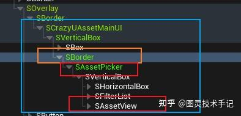
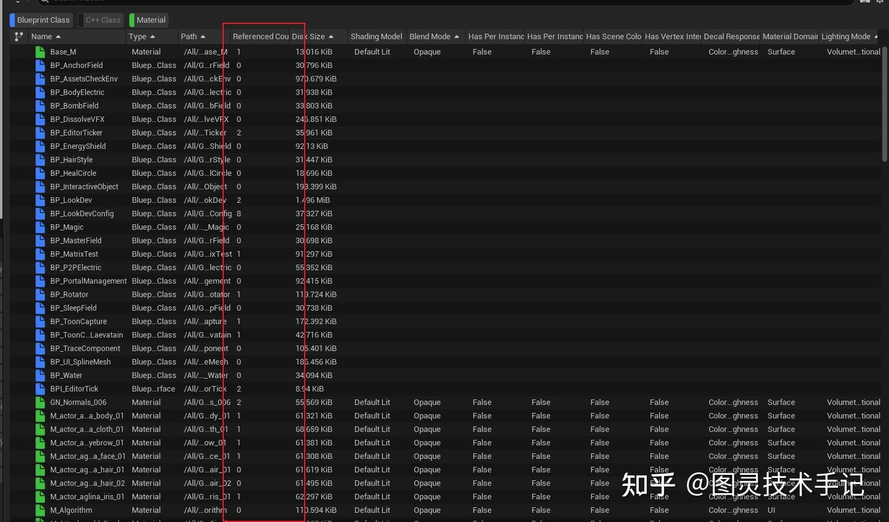
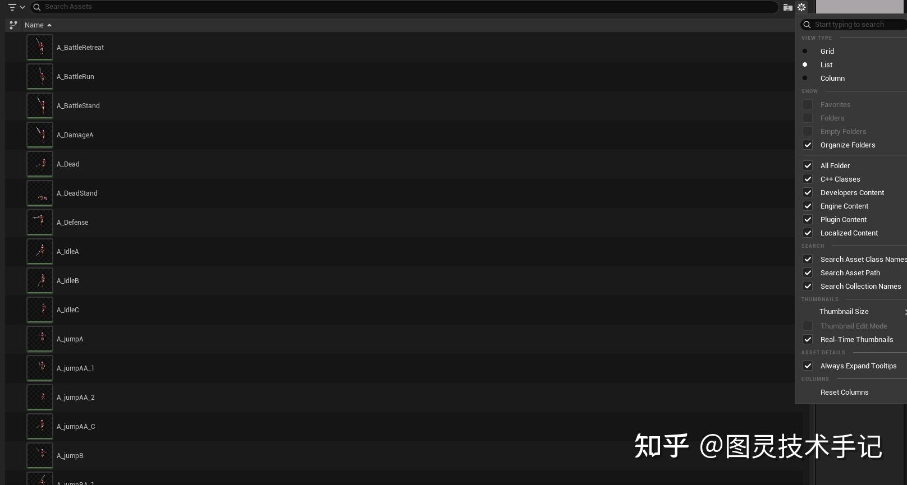

（文章基于此CrazyUAsset库-开发中）

之前有一个旧的库（AssetsManager），其中资产显示列表是我自己重构的类，相对来说构建起信息会自由一些，但是其远远没有原生集成的SAssetView功能丰富程度和兼容程度高

下一步我也会继承SAssetView进行进一步开发，这样可拓展面更广，这篇文章我们先看如何调用这个类

## 一、构建SAssetView

这个原生类的路径在引擎中是Engine\Source\Editor\ContentBrowser\Public\SAssetView.h

不过其构建方式由于参数太多一般不通过slate传统的方式构建，而是通过ContentBrowser工厂类模块来创建

```cpp
FContentBrowserModule& ContentBrowserModule = FModuleManager::Get().LoadModuleChecked<FContentBrowserModule>("ContentBrowser");
// 配置AssetPicker
FAssetPickerConfig AssetPickerConfig = CreatePickerConfig(ScanningFolderPaths);
TSharedPtr<SWidget> AssetPickerWidget = ContentBrowserModule.Get().CreateAssetPicker(AssetPickerConfig);

```

不过有一个比较特殊的点，通过这种方式创建的返回值只是一个SWidget，是被封装好的，一个SWidget指针什么接口也用不了，所以我们打开debug会发现，这个返回的SWidget中的层级关系



这个SWidget实际上是一个SBorder，在Border之中只有一个类就是这个SAssetPicker，这个类不仅包含了我们需要的SAssetView，还包含了一些内置的比如搜索、排序等组件

如果需要类比可以比较这两个头文件

Engine\Source\Editor\ContentBrowser\Public\SAssetView.h

Engine\Source\Editor\ContentBrowser\Private\SAssetPicker.h

前者开放性更高，后者是用于工厂类调用，接口较少

既然如此我们知道了如何创建，也知道了层级关系，那么我们有没有可能既使用工厂类，又能直接获得SAssetView呢？

此般“逃课”方法当然是有的~这就需要一个模板类函数了

> 不过在此声明！这种方法获取SAssetView很简单，但是如果说未来要继承SAssetView来拓展一些功能，就不能再用这种方式来获取了（每一种“逃课”方法定有利弊）

```cpp
template <typename T>
TSharedPtr<T> FindChildInWidgetByType(TSharedPtr<SWidget>& Widget, bool bEnableDebugLog = false)
{
	static_assert(std::is_base_of<SWidget, T>::value, "Template parameter T must be derived from SWidget");

	if (!Widget.IsValid())
	{
		return nullptr;
	}

	FString TargetTypeName = FString(ANSI_TO_TCHAR(typeid(T).name()));
	TargetTypeName.RemoveFromStart("class ");

	// 使用数组来存储待检查的Widget
	TArray<TSharedRef<SWidget>> WidgetsToCheck;
	WidgetsToCheck.Add(Widget.ToSharedRef());

	for (int32 Index = 0; Index < WidgetsToCheck.Num(); ++Index)
	{
		TSharedRef<SWidget> CurrentWidget = WidgetsToCheck[Index];
		FString WidgetTypeName = CurrentWidget->GetTypeAsString();

		if (bEnableDebugLog)
		{
			CrazyLogOnly("Checking widget: " + WidgetTypeName);
		}

		if (WidgetTypeName.Contains(TargetTypeName))
		{
			if (bEnableDebugLog)
			{
				CrazyLogOnly("FindChildInWidgetByType: Found target widget!");
			}
			return StaticCastSharedRef<T>(CurrentWidget);
		}

		// 将子Widget添加到检查列表
		FChildren* Children = CurrentWidget->GetChildren();
		if (Children)
		{
			for (int32 i = 0; i < Children->Num(); ++i)
			{
				WidgetsToCheck.Add(Children->GetChildAt(i));
			}
		}
	}

	if (bEnableDebugLog)
	{
		CrazyLogOnly("FindChildInWidgetByType: Could not find widget of type: " + TargetTypeName);
	}

	return nullptr;
}

```

看声明很简单，定义一个模板类型（这里也就是SWidget类型），然后在这个传入的Widget中搜寻子Widget，直到搜索到一个模板类型的Widget

> 这个方法无法满足多个子层级同一个类型的情况，但是目前从层级关系来看，已经满足了这里的需求，所以可以直接使用

比如我们可以在刚刚的创建类型的基础上加入对SAssetView的引用

```cpp
FContentBrowserModule& ContentBrowserModule = FModuleManager::Get().LoadModuleChecked<FContentBrowserModule>("ContentBrowser");
// 配置AssetPicker
FAssetPickerConfig AssetPickerConfig = CreatePickerConfig(ScanningFolderPaths);
TSharedPtr<SWidget> AssetPickerWidget = ContentBrowserModule.Get().CreateAssetPicker(AssetPickerConfig);
TSharedPtr<SAssetView> AssetViewWidget = FindChildInWidgetByType<SAssetView>(AssetPickerWidget);

```

这样我们就可以直接获得我们需要的SAssetView类了

## 二、配置SAssetView（FAssetPickerConfig）

因为我们是通过SAssetPicker的创建来实例化的SAssetView列表，UE原生也给我们配备了比较完备的FAssetPickerConfig类来统一配置，所以我们只需要一个专门的函数来实现我们的配置就可以做到集中化管理了

```cpp
// CrazyPickerConfig.h

/**
 * Creates an asset picker configuration with specified folder and package paths.
 *
 * This function generates a FAssetPickerConfig object that can be used to configure
 * asset selection dialogs or widgets in the Unreal Engine content browser.
 *
 * @param FolderPaths    Array of folder paths to include in the asset picker.
 * @param PackagePaths   Array of package paths to include in the asset picker.
 * @param AutoFixPath    If true, automatically fixes invalid path formats to ensure
 *                       they start with "/All". Default is true.
 *
 * @return FAssetPickerConfig    Configured asset picker ready for use.
 *
 * @note All paths in FolderPaths and PackagePaths arrays must start with "/All".
 *       If AutoFixPath is enabled, the function will attempt to correct invalid paths.
 *
 * Example usage:
 * @code
 * TArray<FName> Folders = {TEXT("/All/Content/Meshes"), TEXT("/All/Content/Textures")};
 * TArray<FName> Packages = {TEXT("/All/Game/Characters")};
 * FAssetPickerConfig Config = MakeAssetPickerConfig(Folders, Packages);
 * @endcode
 */
FAssetPickerConfig CreatePickerConfig(TArray<FName> FolderPaths = {}, TArray<FName> PackgePaths = {}, bool bAutoFixPath = true);

FAssetPickerConfig CreatePickerConfig(TArray<FString> FolderPaths = {}, TArray<FString> PackgePaths = {}, bool bAutoFixPath = true);

```

这里用了两个函数来处理不同的传入类型，但是传入的信息都是一样的，一个是需要检测的文件夹路径，一个是需要包含的资产包路径（就是一个.uasset，具体UE的存储结构可以另外查询文章解读）

```cpp
// CrazyPickerConfig.cpp

FAssetPickerConfig CreatePickerConfig(TArray<FName> FolderPaths, TArray<FName> PackgePaths, bool bAutoFixPath)
{
	// 配置AssetPicker
	FAssetPickerConfig AssetPickerConfig;
	AssetPickerConfig.InitialAssetViewType = EAssetViewType::List;
	AssetPickerConfig.InitialThumbnailSize = EThumbnailSize::Large;
	AssetPickerConfig.AssetShowWarningText = FText::FromString(L"No results !!!");
	AssetPickerConfig.bAddFilterUI = true;
	AssetPickerConfig.bAllowDragging = true;
	AssetPickerConfig.bAllowRename = true;

	AssetPickerConfig.bAllowNullSelection = false;	

	AssetPickerConfig.bCanShowClasses = true;
	AssetPickerConfig.bCanShowDevelopersFolder = true;

	AssetPickerConfig.bCanShowFolders = false;

	AssetPickerConfig.bCanShowRealTimeThumbnails = true;
	AssetPickerConfig.bFocusSearchBoxWhenOpened = true;

	AssetPickerConfig.bShowBottomToolbar = true;
	AssetPickerConfig.bShowPathInColumnView = true;
	AssetPickerConfig.bShowTypeInColumnView = true;
	AssetPickerConfig.bSortByPathInColumnView = true;

	AssetPickerConfig.OnAssetDoubleClicked = FOnAssetDoubleClicked::CreateStatic(&UCrazyAssetOperator::OpenEditorUI);

	// Referenced Column

	AssetPickerConfig.CustomColumns.Add(FAssetViewCustomColumn(
		FName(L"Referenced"),
		FText::FromString(L"Referenced Count"),
		FText::FromString("How many times referenced by other assets."),
		UObject::FAssetRegistryTag::TT_Numerical,
		FOnGetCustomAssetColumnData::CreateLambda(
			[](const FAssetData& AssetData, const FName& ColumnName) -> FString
			{
				TArray<FString> ReferencedPath = UCrazyAssetChecker::GetAssetReferencedPath(AssetData);
				return FString::FromInt(ReferencedPath.Num());
			})));

	
	if (bAutoFixPath) 
	{
		for (FName& path : FolderPaths)
		{
			if (!path.ToString().StartsWith("/All"))
			{
				FString fixPath = "/All" + path.ToString();
				path = FName(*fixPath);
			}
		}

		for (FName& name : PackgePaths)
		{
			if (!name.ToString().StartsWith("/All"))
			{
				FString fixName = "/All" + name.ToString();
				name = FName(*fixName);
			}
		}
	}

	AssetPickerConfig.Filter.PackagePaths.Empty();
	AssetPickerConfig.Filter.PackageNames.Empty();
	AssetPickerConfig.Filter.bRecursivePaths = true;

	AssetPickerConfig.Filter.PackagePaths.Append(FolderPaths);
	AssetPickerConfig.Filter.PackageNames.Append(PackgePaths);

	return AssetPickerConfig;
}

FAssetPickerConfig CreatePickerConfig(TArray<FString> FolderPaths, TArray<FString> PackgePaths, bool bAutoFixPath)
{
	TArray<FName> folderPaths_FName;
	TArray<FName> packageNames_FName;

	for(const FString& path: FolderPaths)
	{
		folderPaths_FName.Add(*path);
	}

	for (const FString& name : PackgePaths)
	{
		packageNames_FName.Add(*name);
	}

	return CreatePickerConfig(folderPaths_FName, packageNames_FName, bAutoFixPath);
}

```

这两个函数本质上是同一个实现，只是处理了不同的数据类型

```cpp
// 配置AssetPicker
FAssetPickerConfig AssetPickerConfig;
AssetPickerConfig.InitialAssetViewType = EAssetViewType::List;
AssetPickerConfig.InitialThumbnailSize = EThumbnailSize::Large;
......

```

前半部分是配置一些基础显示的属性，包括列表模式、缩略图大小等等，这一部分直接查文档即可

其中有几个比较有意思的地方我们可以展开

### 1.绑定事件

SAssetPicker其实已经提供了一些用于绑定鼠标事件的接口，比如OnAssetDoubleClicked事件

这里我们作为一个案例将其绑定向了打开资产

```cpp
AssetPickerConfig.OnAssetDoubleClicked = FOnAssetDoubleClicked::CreateStatic(&UCrazyAssetOperator::OpenEditorUI);

```

这里用到的是UE中比较常见的Delegate的用法

我们也对打开资产进行了方法的重定向

```cpp
// CrazyOperator.cpp

void UCrazyAssetOperator::OpenEditorUI(const FAssetData& Asset)
{
	GEditor->GetEditorSubsystem<UAssetEditorSubsystem>()->OpenEditorForAsset(Asset.GetObjectPathString());
}

```

### 2.Folder和Package

在配置中有两个特别容易混淆的属性，但却至关重要

一个是PackagePaths，一个是PackageNames，什么区别？

其实很简单SAssetView所显示的内容是完全以Package为基础的，所以它可以进行排序、分类或者其他的操作，所以PackagePaths就是指向了存放Package的文件夹路径，而如果你不想传入整个文件夹，只是把几个单独的资产传入也是可以的

```cpp
AssetPickerConfig.Filter.PackagePaths.Append(FolderPaths);
AssetPickerConfig.Filter.PackageNames.Append(PackgePaths);

```

### 3.自定义内容显示

这里有另外一个值得关注的就是可以自定义的内容显示

FAssetPickerConfig中提供了一个CustomColumns属性，可以添加我们自己想定义的内容

> 不过要注意，这里的显示必须返回一个FString，也就是说必须是文本信息，至于想返回每一行一个按钮，这样的方法还需要再研究一下

```cpp
AssetPickerConfig.CustomColumns.Add(FAssetViewCustomColumn(
	FName(L"Referenced"),
	FText::FromString(L"Referenced Count"),
	FText::FromString("How many times referenced by other assets."),
	UObject::FAssetRegistryTag::TT_Numerical,
	FOnGetCustomAssetColumnData::CreateLambda(
		[](const FAssetData& AssetData, const FName& ColumnName) -> FString
		{
			TArray<FString> ReferencedPath = UCrazyAssetChecker::GetAssetReferencedPath(AssetData);
			return FString::FromInt(ReferencedPath.Num());
		})));

```

在这些传入参数中比较重要的是第4位参数，它决定了在排序中会以什么类型对这个字符串进行排序

这里选择的是UObject::FAssetRegistryTag::TT_Numerical，就是将内容在排序中识别为自然数

常见的类型包括这些

```cpp
enum ETagType
{
	/** This tag should not be shown in the UI */
	TT_Hidden,
	/** This tag should be shown, and sorted alphabetically in the UI */
	TT_Alphabetical,
	/** This tag should be shown, and is a number */
	TT_Numerical,
	/** This tag should be shown, and is an "x" delimited list of dimensions */ 
	TT_Dimensional,
	/** This tag should be shown, and is a timestamp formatted via FDateTime::ToString */
	TT_Chronological,
};

```

## 三、构建并封装SAssetView

为了构建和封装SAssetView到主UI界面中，我们的UI界面类（在这个项目中是SCrazyUAssetMainUI）需要声明一个变量来持有SAssetView的指针

```cpp
class CRAZYUASSET_API SCrazyUAssetMainUI : public SCompoundWidget
{
	SLATE_BEGIN_ARGS(SCrazyUAssetMainUI) {}
		SLATE_ARGUMENT(TArray<FString>, SelectedFolderPaths)
	SLATE_END_ARGS()

public:
	virtual void Construct(const FArguments& InArgs);

	virtual void Update();

	void OnAnyAssetSelected(const FAssetData& AssetData);

private:
	TArray<FString> ScanningFolderPaths;

	TSharedPtr<SWidget> AssetPickerWidget;
	TSharedPtr<SAssetView> AssetViewWidget;

	TArray<FAssetData> SelectedAssets;
};

```

这里我声明了两个，一个是AssetPickerWidget，用来持有工厂类返回的SAssetPicker类实例，另一个是AssetViewWidget用来持有从SAssetPicker实例中寻找到的SAssetView类，以便进一步直接操控SAssetView实例（当然这里要注意一些层级关系，避免SAssetView中切换状态之后，SAssetPicker的状态没有切换）

这里获取资产路径的方式参考下面这一篇，当每次构建时就已经获取的是插件的本地变量SelectedFolderPaths，传入时就已经是当前需要使用的文件夹路径了

```cpp
this->ScanningFolderPaths = InArgs._SelectedFolderPaths;

```

```cpp
// CrazyMainUI.cpp

FContentBrowserModule& ContentBrowserModule = FModuleManager::Get().LoadModuleChecked<FContentBrowserModule>("ContentBrowser");

// 配置AssetPicker
FAssetPickerConfig AssetPickerConfig = CreatePickerConfig(this->ScanningFolderPaths);

......

TSharedPtr<SVerticalBox> MainBox = SNew(SVerticalBox);

......

// 创建AssetPicker widget
this -> AssetPickerWidget = ContentBrowserModule.Get().CreateAssetPicker(AssetPickerConfig);
this -> AssetViewWidget = FindChildInWidgetByType<SAssetView>(this->AssetPickerWidget);

......

MainBox->AddSlot()
	.FillHeight(1.f)
	[
		SNew(SBorder)
		.Padding(FMargin(3))
		.BorderImage(FAppStyle::GetBrush("ToolPanel.GroupBorder"))
		[
			this->AssetPickerWidget.ToSharedRef()
		]
	];

......

```

这样我们就得到了一个基于SAssetView构建的列表，且包含了UE原生列表的所有功能






