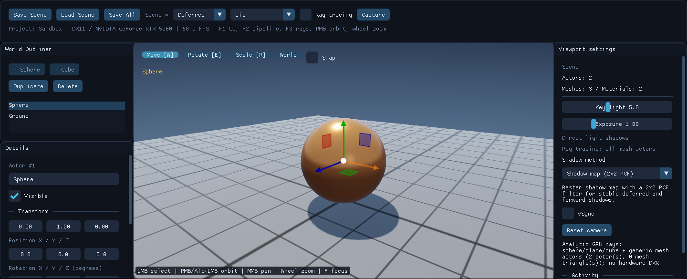
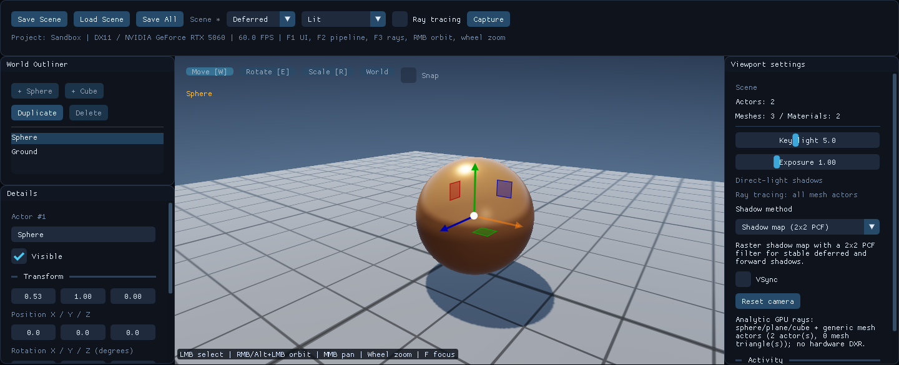
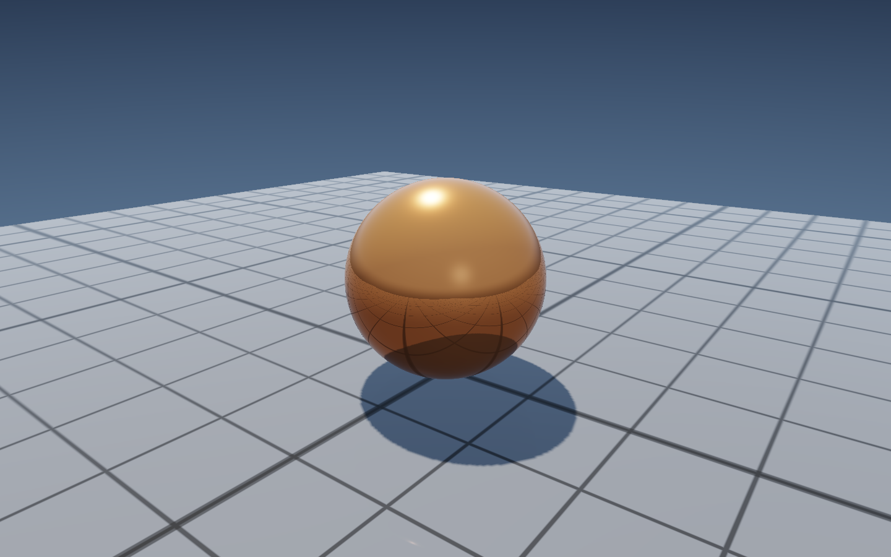
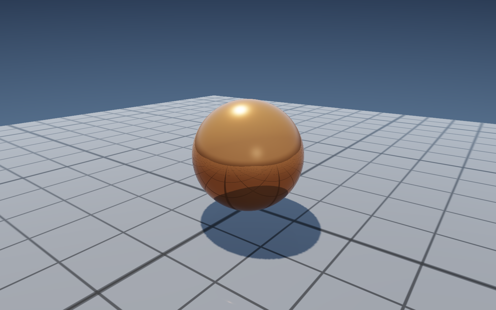
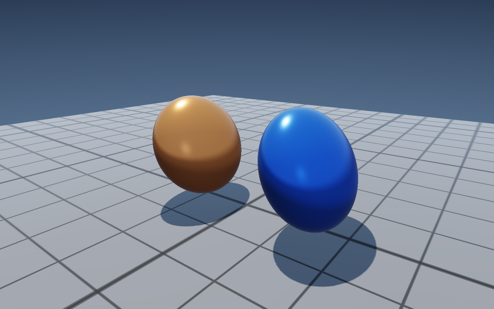
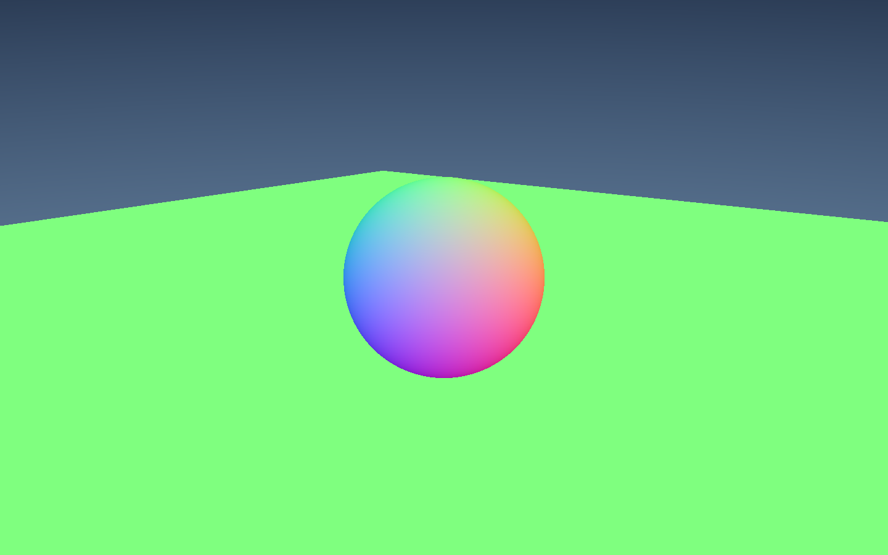
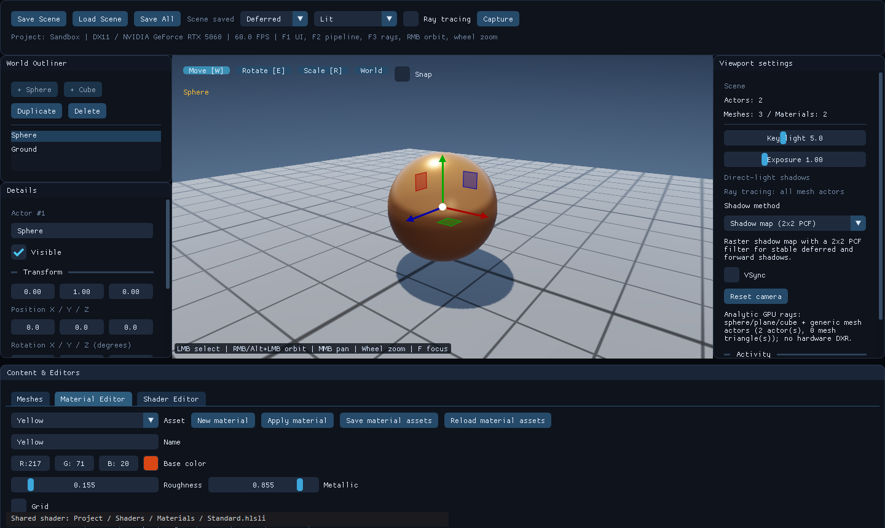

Section 01｜2026-10-20

RestArtEngine v0.2.0

Commit：from 8d80547 to cb8fb25

https://github.com/CaptainRex0428/RestArtEngine.git


# 0. 搭建框架

## 0.1 Codex 配置地图

这期的协作并非是「开一个对话框，让 AI 写引擎」就完成了。
从一开始就利用Codex进行了分层，每层Agents/Skills只放一类东西

| 层 | 位置 | 这期怎么用 |
| --- | --- | --- |
| 模型/provider | `~/.codex/config.toml` | `model_provider = "custom"`，DeepSeek 从这里接入；文章不写网关和 token |
| 全局规则 | `~/.codex/AGENTS.md` | 跨项目常驻规则；这期主要靠项目规则 |
| 项目规则 | 仓库根 `AGENTS.md` | 目录、命名、验证命令、红线；每次会话先读 |
| 领域知识 | `docs/`、`README.md` | 架构、文件格式、当前边界；按需读，不塞进常驻提示 |
| 技能 | `~/.codex/skills/<name>/SKILL.md` | 可复用的流程 |
| 技能接口 | `.../agents/openai.yaml` | 展示名、短描述、默认提示 |
| 命令规则 | `~/.codex/rules/default.rules` | 常用只读命令的允许列表，减少重复审批 |
| 任务状态 | `docs/ZhihuSeriesLedger.md` | 写到哪、下次从哪开始 |

项目规则里真正起作用的是这几条
（这个过程因为太烧Token，部分工作也利用了Deepseek进行微开发和优化）

```markdown
- Codex CLI 是本仓库的 agent 协作框架；文档、开发、AI 相关结构均遵循 Codex 规范。
- DeepSeek 作为补充模型，通过 Codex 的自定义 model provider 接入。
- 引擎开发约定请以 `docs/Architecture.md` 与 `README.md` 为准。
```

它们分别解决三件事：谁在读代码、模型从哪来、遇到细节去哪个文件查。没有这三条，AI 会自己在仓库里猜目录，猜错一次就要返工一轮。

## 0.2 思路路径

这期的起点不是「做个引擎」，而是三个约束：

1. 工程必须是纯数据，能单独拷走、单独提交，不能绑死引擎源码。
2. 只产出一个 `RestArtEngine.exe`，它同时是 Project Manager 和编辑器，不另做 launcher。
3. 编辑器里改材质和 Shader 要立刻看到结果，不能每次重编 C++。

这三个约束不是并列的口号。它们各自落到后面的模块里，形成一条路径：

$$
\begin{array}{c}
\text{想法}\\[2pt]
\downarrow\ \text{约束}\\[2pt]
\boxed{\text{工程纯数据}}\quad
\boxed{\text{单 exe}}\quad
\boxed{\text{编辑即见}}\\[2pt]
\downarrow\ \text{拆解}\\[2pt]
\boxed{\text{工程/启动}}\ \rightarrow\
\boxed{\text{编辑器/视口}}\ \rightarrow\
\boxed{\text{渲染路径}}\ \rightarrow\
\boxed{\text{材质/Shader}}\\[2pt]
\downarrow\ \text{验证}\\[2pt]
\text{自测 + 截图 + 数字}\\[2pt]
\downarrow\ \text{固化}\\[2pt]
\text{AGENTS.md / docs / skill}
\end{array}
$$

约束定完，再拆成四个能单独验证的块：

```text
工程/启动 → 编辑器/视口 → 渲染路径 → 材质/Shader
```

每块先定契约，再让 AI 写实现：

- 工程：`.raproject` 字段、`Engine.raeengine` 身份、`engineAssociation` 解析。
- 启动：`initializeDevice()` 与 `initializePipeline()` 两段，中间插加载界面。
- 编辑器：Actor 用稳定 ID，视口拾取和 gizmo 只通过 `World` 改 Transform。
- 渲染：前向和延迟都调用 `ShadeSurface()`，G-buffer 只负责传参。
- 材质：唯一开放入口是 `EvaluateMaterial()`，签名和 `Surface` 结构不能随便改。
- 验证：`--editor-self-test` 和 `Validate-Render.ps1` 是硬验收。

回路也很固定：

```text
改代码 → 编译 → --editor-self-test → Validate-Render.ps1 → 看截图/数字 → 下一轮
```

最后一步是固化：哪些决定要写进 `AGENTS.md`、`docs/` 或 skill，下次不再解释。这期的产物是 `docs/Architecture.md` 的目录约定、`AGENTS.md` 的验证入口，以及这份写作规范。

## 0.3 怎么把想法喂给 AI

给 AI 的上下文分四层，缺一层就容易跑偏

| 层 | 放什么 | 这期的例子 |
| --- | --- | --- |
| 常驻规则 | 每次会话都读 | `AGENTS.md` 的目录、命名、验证、红线 |
| 领域知识 | 按需读 | `docs/Architecture.md`、`docs/EditorGuide.md`、`docs/ShadowMethods.md` |
| 本次任务 | 会话里的任务说明 | 目标、非目标、现状、约束、验收、失败样例、输出格式 |
| 证据 | 代码、截图、日志、命令输出 | `--editor-self-test` 的输出、渲染对比图、帧率 |

任务说明按这个模板写：

```text
目标：
非目标：
现状/证据：
约束：
验收：
失败样例：
输出格式：
```

这期拆「工程和引擎分开」时，任务说明大致是：

> 目标：把 Project Manager 和编辑器分成两个启动入口，但仍然只产出一个 exe。非目标：这轮不改渲染。现状：`.raproject` 和引擎目录还绑在一起。约束：工程目录保持纯数据，不生成 `.sln`；引擎根目录用 `Engine.raeengine` 标识。验收：`--editor-self-test` 通过，Project Manager 能打开 Sandbox，工程移动后能按 `engineAssociation` 恢复。失败样例：工程拷到另一台机器后打不开，算失败。输出：改了哪些文件、命令、结果。

几条硬规矩：

- 先让 AI 复述计划、风险和要改的文件，再让它动手。
- 一次只改一个可验证点。不要一次给五个目标。
- 给它看真实代码和截图，不要只说「优化一下」。
- 要求它返回文件路径、命令和结果，不接受「已完成」。
- 人保留取舍、命名、边界和发布权。

## 0.4 Agents 与 Skills

这期没有开很多角色。实际就三个职责：

| 角色 | 负责 | 不负责 |
| --- | --- | --- |
| 规划/实现 | 拆任务、改代码、跑验证 | 不给自己签字 |
| 独立审查 | 看冻结字段、版本、测试证据、边界 | 不参与本轮实现 |
| 记录/截图 | 存命令、截图、结果、失败 | 不改技术结论 |

把这三个职责画成一条链：

$$
\begin{array}{ccc}
\boxed{\text{规划/实现}} & \xrightarrow{\text{提交证据}} & \boxed{\text{独立审查}}\\
& & \downarrow\ \text{签字}\\
\boxed{\text{记录/截图}} & \xleftarrow{\text{归档}} & \boxed{\text{发布/下一轮}}
\end{array}
$$

这条链只能单向走：实现者不能给自己签字，审查者不能参与本轮实现，记录者只归档证据、不改结论。

这期没有做到「独立审查」：规划、实现、验证都在同一个会话里完成。这是下一期要补的。
审查者不能是实现者，否则「能编译」很容易被当成「能跑」。

Skill 这边，这期用到的只有 `diagnose-windows-sandbox-acl`，处理 PowerShell 的沙箱权限问题。

`rules/default.rules` 是另一层：把 `git status`、`git diff`、`Get-ChildItem` 这类只读命令加进允许列表，减少重复审批。它不改变角色职责，只降低执行成本。

## 0.5 这期的复盘

- 有用的一步：先把验收写成命令。`--editor-self-test` 和 `Validate-Render.ps1` 一跑，「能编译」和「能跑」就分开了。
- 返工的一步：沙箱在给工作区补写权限时失败，命令根本起不来。最后改用完全权限才跑通；这不是代码问题，是环境问题。
- 没做好的一步：没有独立 reviewer，截图底部的本机路径也是发布前才处理。下一期要在流程里加「截图隐私检查」。
- 要固化的一步：把「构建 + 自测 + 截图」写成 RestArtEngine skill，下次不再靠会话记忆。

# 1. 工程与启动：一个 exe，两个角色

工程和引擎的边界，是这期最先要定的事。只要工程里还藏着引擎源码、构建文件或绝对路径，工程就不能单独拷走；反过来，引擎也会被某个工程绑死。Project Manager 和编辑器如果拆成两个程序，编译和分发还要多一步。

这一版把两边拆开：

- `RestArtEngine.exe` 同时是 Project Manager 和编辑器。不带参数启动显示 Project Manager，带 `--project` 直接进编辑器。
- 工程是纯数据：`.raproject` + `Content/` + 工程自己的 `Shaders/`。工程不包含 C++，也不生成自己的 `.sln`。
- 引擎身份写在 `Engine.raeengine`：版本、hash、名字。工程用 `engineAssociation` 记录「我要哪个版本」，再用每用户的 `engines.json` 解析到具体目录。
- `engineRoot` 只做缓存/回退。工程移动后，优先用当前引擎或注册表恢复，再把相对路径写回去；跨盘符时只留 `engineAssociation`，不写死绝对路径。

## 源码

`.raproject` 现在是这样的：

```json
{
  "format": "RAEngine.Project",
  "version": 3,
  "name": "Sandbox",
  "engineRoot": "../..",
  "engineAssociation": "0.2.0",
  "engineVersion": "0.2.0",
  "engineHash": "dev-0.2.0",
  "contentRoot": "Content",
  "shaderRoot": "Shaders",
  "defaultScene": "Content/Scenes/Default.rascene"
}
```

启动也拆成了两段。设备创建快，Shader 编译慢，中间正好放加载界面：

```cpp
// app/MinimalApp.cpp
if (!renderer.initializeDevice(window.handle, windowState.width, windowState.height, error))
    throw std::runtime_error(error);
if (interactive) presentLoading(renderer, ui, loading, 0.15f, "Initializing render device");
if (!renderer.initializePipeline(error)) throw std::runtime_error(error);
if (interactive) presentLoading(renderer, ui, loading, 0.65f, "Compiling shader pipeline");
```

这段代码解决的是「启动黑屏」：设备好了就先显示加载界面，管线编译完再进编辑器。加载界面的文案、百分比和进度条按背景图的相对比例定位，换图不用改代码。


# 2. 编辑器与视口：能选、能拖、能聚焦

视口交互是这期补的重点。没有拾取和 gizmo，摆一个 Actor 只能改场景 JSON 或代码；没有相机操作，检查场景要反复改数值。

这一版的编辑器分成三栏加一个底部编辑器：

- Outliner 选 Actor，Details 改变换、Mesh、Material，Content 管 Mesh / Material / Shader。
- 视口左键拾取；W / E / R 切移动、旋转、缩放，Space 循环；World / Local 切换坐标；Snap 打开步进吸附。
- 相机支持右键或 Alt+左键环绕、中键平移、滚轮缩放、F 聚焦选中 Actor。
- Actor 用稳定 ID，删除和复制不会让别的 ID 漂移；文本输入时 W / E / R / Delete 不会作用到场景。

## 源码

gizmo 这一段的代码不长，关键在最后一行：缩放永远沿 Actor 自己的轴，因为世界空间缩放一个旋转过的物体会产生剪切，而 Transform 只有位置、欧拉旋转和缩放，存不下剪切。

```cpp
// src/Editor/ViewportInteraction.cpp
const ImGuizmo::OPERATION operations[] = {ImGuizmo::TRANSLATE, ImGuizmo::ROTATE, ImGuizmo::SCALE};
const float step = operation_ == 0 ? .5f : operation_ == 1 ? 15.0f : .1f;
const float snap[3] = {step, step, step};
if (ImGuizmo::Manipulate(&viewData._11, &projectionData._11, operations[operation_],
    local_ || operation_ == 2 ? ImGuizmo::LOCAL : ImGuizmo::WORLD, &matrix._11,
    nullptr, snap_ ? snap : nullptr)) changed = applyMatrix(matrix, operation_, actor->transform);
```






# 3. 渲染路径：一个材质，两条路径

前向和延迟如果各写一套材质，改一次颜色要在两个地方各改一遍。改漏一处，两条路径的画面就不一致，调试时很难判断是材质错了还是路径错了。这一版让两条路径共用 `ShadeSurface()`：

- 前向在绘制几何时直接着色。
- 延迟先写三个 G-buffer（Albedo/Roughness、World Normal/Metallic、World Position/Coverage），再全屏光照。
- 两条路径都调用同一个 `ShadeSurface()`，材质表达式只写一次。
- 检查视图有 Lit、Unlit、Albedo、World normals、World position，方便一层层拆。

阴影方案有 9 种，共用一张 2048² 深度图：2×2 PCF、硬比较、3×3 PCF、PCSS、两级 CSM、GTAO、Deferred Contact Shadow、解析光追、禁用。PCSS 在深度图上先搜 blocker，再按估计的半影半径做比较采样；两级 CSM 把相机远近切成两段，近处用细的阴影图，远处用粗的。

解析光追不是 DXR：内置 Sphere / Plane / Cube 用精确求交，OBJ 和其余网格走 `StructuredBuffer` 的三角形路径，用来做阴影和反射。

## 源码

核心着色代码在 `Scene.hlsl`。下面是删掉环境光和反射细节后的关键段，保留 GGX、Fresnel、直接光和阴影：

```hlsl
// Shaders/Private/Scene.hlsl
float3 ShadeSurface(float3 position, float3 normal, float3 view, Surface material, float2 uv, bool deferred)
{
    float3 light = normalize(lightDirectionIntensity.xyz);
    float3 halfway = normalize(light + view);
    float nv = max(dot(normal, view), 0.001);
    float nl = saturate(dot(normal, light));
    float nh = saturate(dot(normal, halfway));
    float vh = saturate(dot(view, halfway));
    float alpha = material.roughness * material.roughness;
    float alphaSquared = alpha * alpha;
    float denominator = nh * nh * (alphaSquared - 1.0) + 1.0;
    float distribution = alphaSquared / max(PI * denominator * denominator, 0.000001);
    float k = (material.roughness + 1.0) * (material.roughness + 1.0) / 8.0;
    float geometry = (nv / (nv * (1.0 - k) + k)) * (nl / max(nl * (1.0 - k) + k, 0.001));
    float3 f0 = lerp(float3(0.04, 0.04, 0.04), material.albedo, material.metallic);
    float3 fresnel = Fresnel(vh, f0);
    float3 specular = distribution * geometry * fresnel / max(4.0 * nv * nl, 0.001);
    float3 diffuse = (1.0 - fresnel) * (1.0 - material.metallic) * material.albedo / PI;
    float visibility = ShadowVisibility(position, normal, light, uv, deferred);
    // 环境光和反射在真实函数里还有两行，这里只保留直接光。
    return (diffuse + specular) * nl * max(lightDirectionIntensity.w, 0.0)
        * float3(1.0, 0.87, 0.72) * visibility;
}
```

高光项用的 GGX 法线分布是：

$$D(h)=\frac{\alpha^2}{\pi\left((n\cdot h)^2(\alpha^2-1)+1\right)^2}$$

其中 $\alpha$ 是粗糙度的平方（代码里 `roughness * roughness`），$n$ 是法线，$h$ 是半程向量。粗糙度越低，$\alpha$ 越小，高光越集中；粗糙度越高，高光越散。这个公式和上面的 `distribution` 一行是同一件事。











图形 API 只有 DirectX 11；光追是解析求交加三角形遍历，不是 DXR，也没有通用网格 BVH 或路径追踪。光源只有单方向光，没有后处理栈、HDR 交换链和 MSAA。延迟路径的 GTAO 和接触阴影依赖 G-buffer，前向路径会回退到普通深度阴影。

# 4. 材质与 Shader 改完就能看到

材质和 Shader 如果都靠重编译 C++，调一次参数的成本太高：改颜色要等编译，改一行 HLSL 要重启引擎。所以这一版我们把材质和 Shader 都做成了「草稿 → Apply → Save」两段式：

- 材质参数：Base Color、Roughness、Metallic，加一个程序化 `Grid`。改草稿不影响场景，Apply 后所有引用该材质的 Actor 一起更新，Save 才写 `.ramat`。
- Shader：编辑当前工程的 `Shaders/Materials/Standard.hlsli`，Apply / Compile 在引擎进程内编译，成功后整体替换 6 个 shader 阶段；失败保留上一版可用 Shader，显示诊断。
- 反射校验：常量缓冲布局、资源绑定、入口签名不兼容时直接拒绝，不会留下新旧混用的半更新状态。
- 保存：`Save All` 先应用草稿，再保存材质、Shader 和场景；关闭窗口时有未保存修改会询问。

## 源码

材质唯一开放入口是 `EvaluateMaterial()`。它同时被前向和延迟调用，所以改一次两边一起变：

```hlsl
// Projects/Sandbox/Shaders/Materials/Standard.hlsli
Surface EvaluateMaterial(float3 worldPosition, float3 normal, Surface material)
{
    if (material.grid > 0.5)
    {
        float3 view = cameraPosition.xyz - worldPosition;
        float footprint = max(0.002, length(view) * 0.93 / max(viewportDebug.y, 1.0));
        footprint /= max(abs(dot(normalize(view), normal)), 0.12);
        float minor = GridLines(worldPosition.xz, 1.0, 0.018, footprint);
        float major = GridLines(worldPosition.xz, 5.0, 0.045, footprint);
        material.albedo *= lerp(0.55, 0.10, minor);
        material.albedo *= lerp(1.0, 0.25, major);
    }
    // Example: material.albedo *= 0.5 + 0.5 * sin(worldPosition.y * 8.0);
    return material;
}
```

这段代码里有两个值得看的点。第一，`GridLines` 用解析像素足迹算线宽，所以反射命中里也能用，不依赖屏幕导数。第二，`EvaluateMaterial` 只改 `Surface`，不碰常量缓冲和资源绑定，所以 Apply 的反射校验不会因为材质逻辑变化而误报。




材质是参数式的，没有节点图、材质继承、纹理采样参数和多材质槽；顶点只有 Position + Normal，没有 UV、切线和贴图。复杂材质还是得写 HLSL。Shader 编译失败时不能保存退出，需要修正草稿或明确丢弃。

# 5. 验证

这期的验证不是「看一眼画面」。构建、编辑器自测、渲染回归各跑了一遍：

| 验证 | 命令 | 结果 |
| --- | --- | --- |
| 构建 | `cmake --preset windows-vs2022` + `cmake --build --preset windows-debug` | 成功，输出 `build/cmake-vs2022/Debug/RestArtEngine.exe` |
| 编辑器自测 | `RestArtEngine.exe --editor-self-test --capture-dir artifacts\editor-validation` | PASS；Forward/Deferred actor mean RGB difference `0.017776/255`；D3D11 validation errors 0；29 张 BMP |
| 渲染回归 | `.\scripts\Validate-Render.ps1 -Executable .\build\cmake-vs2022\Debug\RestArtEngine.exe` | PASS；forward vs deferred MAE `0.0113/255`（关光追）、`0.0140/255`（开光追）；unlit 光照独立性 max channel error 0；14 张 PNG |
| 窗口生命周期 | `.\scripts\Test-Window.ps1 -Executable .\build\cmake-vs2022\Debug\RestArtEngine.exe` | 缩放、最小化恢复、F2/F3、WM_CLOSE 都走通；脚本在退出码检查处取到空值报错，应用已正常关闭，未记为完整 PASS |

编辑器自测覆盖了：Actor 变换、材质 / 网格赋值、Shader Apply 成功与失败回滚、资源契约校验、Shader 保存/重载、场景存读回环、拾取、移动/旋转/局部缩放手柄拖拽、相机环绕/平移/聚焦、Actor 删除和文本输入隔离。渲染回归覆盖了前向/延迟一致性、光追开关、Unlit、法线、窗口缩放和编辑器面板。

引擎开发之初，我们主要做的是约束先定、契约先定、验收先定

如果没有这三样，AI 写得越快，返工越大

