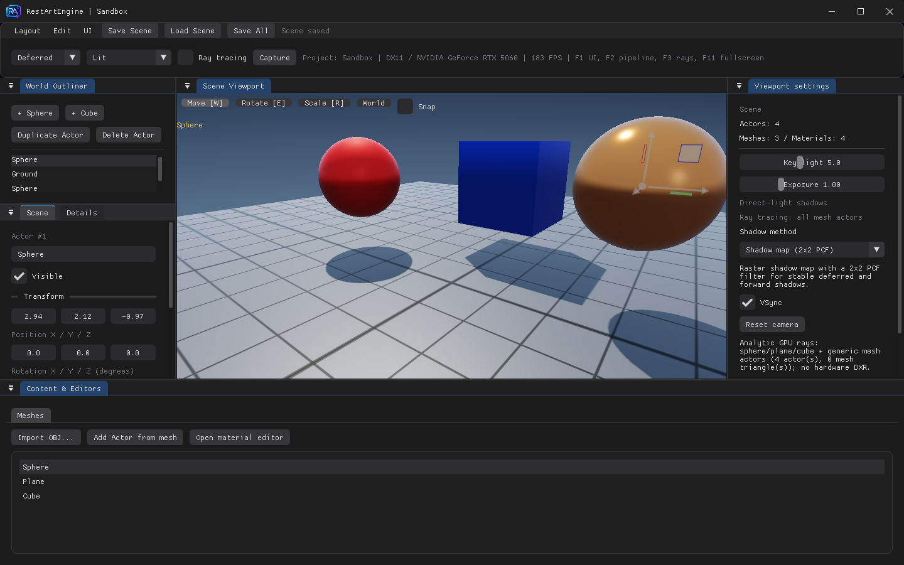
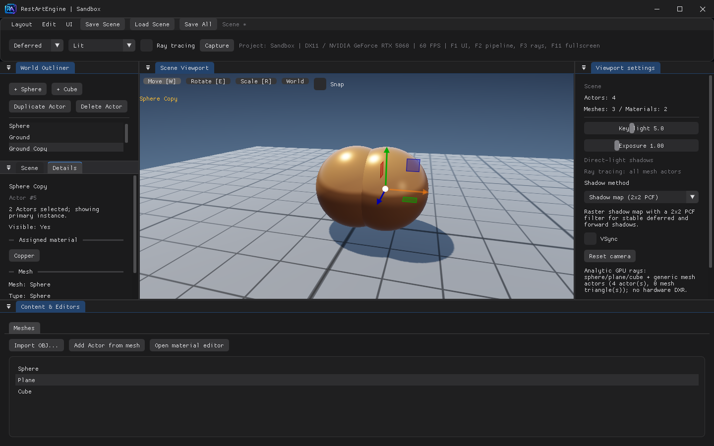
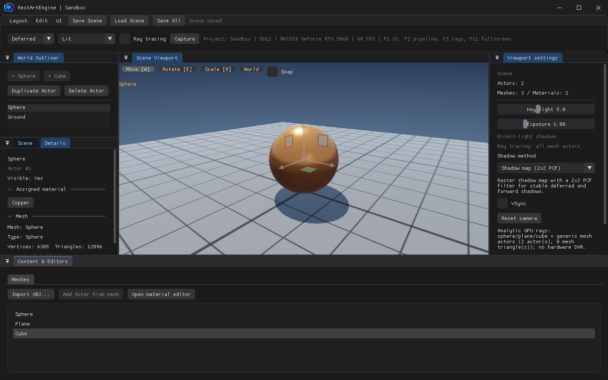
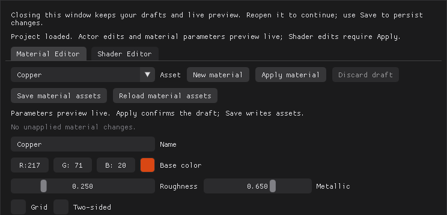
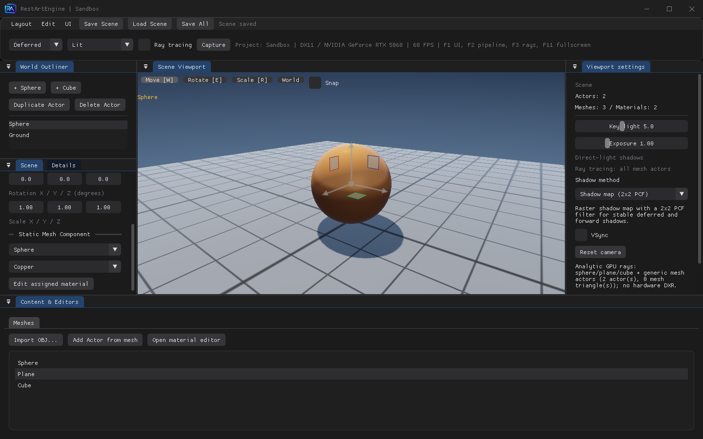
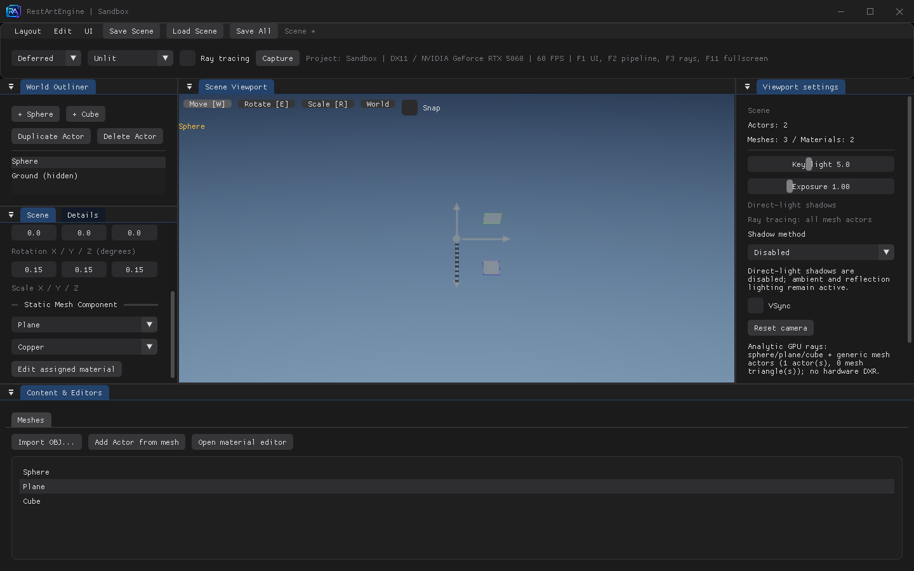
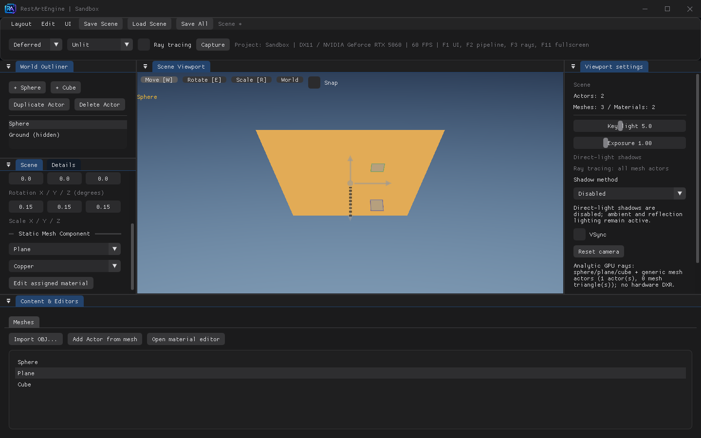
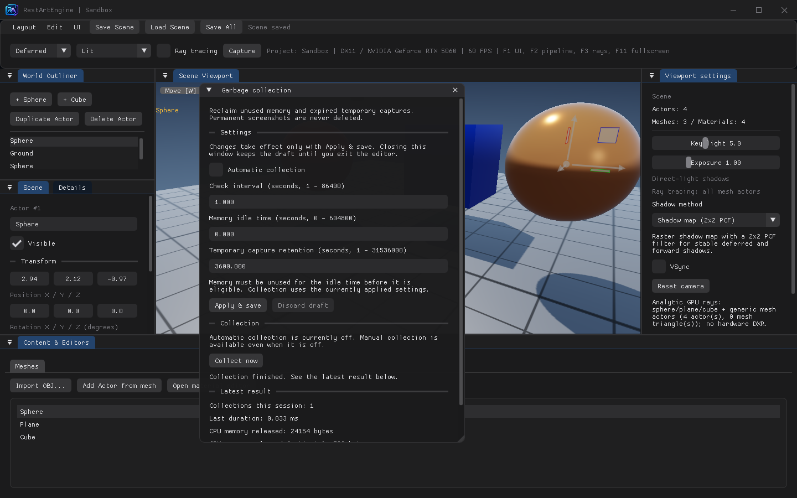

Section 02｜2026-10-26

RestArtEngine v0.3.1

Commit：from 6236ce3 to 4193f55

https://github.com/CaptainRex0428/RestArtEngine

上一期让 RestArtEngine 能选物体、改材质、看细节，并且标准化了我们的工作区。

# 0. 这期是怎么和 AI 一起做的

## 0.1 把“编辑器更好用”拆成行为

“做得像一个编辑器”太宽了。面板能拖走，可能只是把一个矩形挪了位置；颜色会变，也可能已经把未确认的草稿写进了资产。这期我们把需求拆到能检查的行为：拖开面板后视口重新分配空间，点击仍命中画面里的物体；Alt 拖出一组副本，一次撤销把整组拿掉；调材质时场景跟着变，Discard 又回到已应用版本。

这几件事跨了模块。布局涉及 ImGui 和视口输入，材质预览涉及编辑器草稿与渲染数据，撤销涉及选择集合和 Actor 生命周期。

给 AI 的约束因此先写状态，再写界面：谁拥有草稿，哪一步写入资产，哪一步写盘，失败后留下哪一版。验收也跟着状态走，不能只检查按钮在不在。

## 0.2 两次返工留下的规则

布局先做过手写吸附，后来换成 ImGui Docking。手写方案能展示拖动，却要自己维护分割、合并、遮挡和保存，新增面板后还得继续补。Details 也改过一次方向：最初强调 Mesh 资产信息，后来重新以场景中选中的实例为目标。读者想查的是这个球正在用哪个材质，单看“它引用 Sphere 网格”回答不了这个问题。

这两次调整都影响了验收方式。布局要检查视口和输入是否随面板一起变；Details 要同时核对选中的 Actor 和它当前的材质。我们没有测量 AI 节省了多少小时，本期能展示的是这些约束如何进入实现，以及最后怎样检查。

# 1. 工作区：面板移动以后，画面和输入一起移动

固定布局时，视口的位置可以写死。面板一旦能拖离、分割、重新贴合，写死的矩形就会出问题：画面占一块区域，拾取计算却还在用另一块区域，Gizmo 也会跟着偏。布局变化影响的不只是窗口摆放。

这版主窗把 Outliner、Scene、Details、Scene Viewport、Viewport settings 和 Content 交给同一棵 Dock 树。Scene 与 Details 默认在同组页签里，材质与 Shader 共享一个系统工具窗口，分别放在两个页签。顶部图片 Logo、菜单、工具栏与 Dock 内容划清边界；工具栏高度从字体和样式计算，工作区从它下面开始。



图1：看顶部两行控件与下方 Dock 区域的分界。主窗的六个面板按用途组织，其中 Scene／Details 共用一组页签；这不表示六个面板都能变成独立系统窗口。

## 源码

`src/Editor/EditorDockManager.cpp`，`4193f55`：

```cpp
const ImGuiID dockId = ImHashStr("RestArtEngine.DockSpace.v1");
if (resetRequested_ || !ImGui::DockBuilderGetNode(dockId)) {
    buildDefault(dockId, size.x, size.y);
    resetRequested_ = false;
} else {
    migrateScenePanel();
}
applyFocusRequest();
ImGui::DockSpace(dockId, {0, 0});
ImGui::End();
```

默认布局只在首次建立或明确重置时生成。已有布局走迁移，给新增 Scene 页签找位置，保留用户原来的分割。否则每次新增一个面板，用户刚排好的工作区就会被清空。

视口不再把整个主窗当作画面。`ViewportInteraction.cpp` 用当前可用区域算出 `viewportX/Y/Width/Height`，从场景纹理中取对应区域合成到窗口；投影、拾取和 Gizmo 使用同一套矩形。可以把这个约束写成：

$$
R_{\mathrm{image}}=R_{\mathrm{projection}}=R_{\mathrm{picking}}=R_{\mathrm{gizmo}}
$$

这里的 $R$ 指同一帧中、统一换算到主窗客户区坐标后的图像区域。图像合成与 Gizmo 使用桌面坐标，渲染使用主窗局部坐标，两者通过主视口原点转换。公式表达的是实现约束：面板挪动后，四个使用者必须一起更新。隐藏视口标签时也不能回退为整窗绘制，否则面板盖住的区域仍可能接收场景输入。


图2：本轮实际桌面连续录制，演示 Content 从底部停靠区拖离后视口重排。画面按原速播放，发布尺寸为 960×600；这段只展示拖离，不包含重新贴合。不是用测试截图拼接的动画。

本期保留 Black／Dark Blue 两种主题，切换只改颜色，共用几何样式。F11 使用无边框窗口覆盖当前显示器，返回时恢复窗口与 UI 状态。这些工作仍限于 Windows/DX11；跨显示器字体 DPI、系统吸附弹窗和命名布局还没有完整验收。

# 2. 编辑事务：一次手势，应当能一次撤销

上一期可以拖物体，却缺少可靠的恢复动作。若每帧的微小位移都进历史，拖一次就要撤销几十次；只记最后一次位移，又回不到起点。因此编辑器需要记录用户的一次操作，而不是鼠标经过的每一帧。

本期的 `UndoStack` 保存修改前后两个方向，历史默认保留 64 步。Gizmo 在拖动开始时记下变换，松手后提交一条记录。Scene 面板的数值编辑另有 700ms 合并窗口：同一 Actor 的同一变换字段连续提交时，保留最早的撤销状态，只更新最新的重做状态。撤销后再做新操作，原来的重做分支会被截断。

多选让这件事更具体。主 Actor 决定 Gizmo 枢轴，选择集合决定哪些对象跟随变换。Alt 拖动则要把“创建副本”和“把副本移到最终位置”合成一条事务。否则第一次撤销只是把副本移回去，第二次才删除，操作感觉与用户的手势不一致。

## 源码

`src/Editor/SceneEditor.cpp`，`4193f55`，Alt 拖动结束时登记的事务：

```cpp
undo_.push("Duplicate and transform Actors",
    [this, copySelection, sourceSelection, sourcePrimary] {
        for (const auto id : copySelection) eraseActor(id);
        selection_ = sourceSelection;
        selectedActor_ = sourcePrimary;
        sceneDirty_ = true;
    },
    [this, copies, copySelection, copyPrimary] {
        for (const auto& actor : copies) world_.actors.push_back(actor);
        selection_ = copySelection;
        selectedActor_ = copyPrimary;
        sceneDirty_ = true;
    });
```

`copies` 是松手时副本的值快照，包含最终变换。撤销删除副本并恢复原选择，重做恢复副本和副本选择。复制等到首次有效变换才发生：按住 Alt 点一下手柄不会凭空新增对象，多帧拖动也只复制一次。Gizmo 接管鼠标后，相机的 Alt 环绕不再同时响应。



图3：本轮编辑器自测的整组复制结果，左侧显示“2 Actors selected”，场景同时保留原球和副本。这是结果截图；一次撤销删除整组副本、重做恢复副本的过程由同轮输入测试检查，不将静态图当作全过程录屏。

菜单、Outliner 按钮和快捷键通过命令注册表调用同一动作，减少“按钮不能点，快捷键却还能执行”的分叉。文本输入、Gizmo 操作或材质窗口取得焦点等情形下，SceneEditor 会屏蔽这组场景快捷键。

撤销的覆盖仍有限。Ctrl+D 的多选复制目前逐个 Actor 入栈，只有 Alt 拖动复制已经合成整组一条；名称、可见性、Mesh／Material 引用及材质／Shader 草稿还没有通用属性撤销。Shift 当前切换多选成员，不做连续范围选择。Alt 复制的自动化回归覆盖平移，不能据此声称旋转、缩放的所有组合也已测完。

# 3. 实例与材质：看的是哪个对象，改的是哪一份状态

同一个 Sphere 网格可以被多个 Actor 引用，每个实例又可以指向不同材质。因此 Details 必须从主选中的 Actor 出发，再查它的 Mesh 和 Material。仅显示 Content 当前浏览的 Mesh，会把“正在浏览的资产”与“正在编辑的场景对象”混在一起。



图4：底部浏览的是 Cube，左侧 Details 仍是 Sphere／Actor #1／Copper。这个画面用于检查两种选择是否独立：浏览网格不会悄悄把实例检查器的目标换掉。

材质编辑移到独立系统窗口后，主窗保留摆场景的空间。窗口关闭不代表放弃草稿，重新打开继续编辑；退出主程序时仍要处理未保存内容。它的价值也不只在“能挪到旁边”，更在于参数编辑会话不再随主窗面板的开合丢失。



图5：原生材质窗口渲染目标的参数区裁剪图。它展示编辑内容与按钮，不用这张局部图证明窗口已移到主窗外；底部本机 Shader 路径已从发布图中裁去。

## 源码

上一期材质参数需要 Apply 才影响场景。这期草稿通过只读覆盖进入渲染：先看效果，确认和写盘仍是后面的动作。`src/Renderer/SceneRenderer.cpp`，`4193f55`：

```cpp
const assets::MaterialAsset* resolveMaterial(const assets::AssetLibrary& assets, assets::AssetId id,
                                            const assets::MaterialAsset* materialOverride) {
    const auto* material = assets.findMaterial(id);
    return material && materialOverride && materialOverride->id == id ? materialOverride : material;
}
```

编辑器的 `materialPreview()` 先筛掉无效草稿；渲染器找到已应用资产后，仅在覆盖存在且 ID 匹配时读取草稿，不通过上面这个函数修改资产。光栅和光追消费者使用同一选择规则，避免主画面的球已经变粗糙，反射或阴影还停在旧状态。

可以把三份状态记成 $D$（草稿）、$A$（已应用资产）和 $F$（磁盘文件）：

$$
M_{\mathrm{render}}=
\begin{cases}
D,&\text{valid preview with matching ID}\\
A,&\text{otherwise}
\end{cases}
$$

拖动参数改变 $D$；Apply 把草稿提交给资产，Save 才把相应内容写盘；Discard 从已应用资产恢复草稿。图像已经变化，不代表文件已经保存。Shader 源码也没有变成每个按键自动编译，它仍需要显式 Apply／Compile，失败保留上一版管线。


图6a：本轮隔离 Sandbox 自测，Deferred／Lit、光追关闭，曝光 1.0；先记录已应用材质的画面。



图6b：相同镜头和渲染设置，取自滑块仍按下时的第三个采样帧。只改变 Roughness 草稿，已应用资产参数未变；独立材质窗不在这张主窗捕获内。这是离散状态对照，不用于测量反馈延迟。


图6c：Discard 后，测试逐像素比较场景区域与图6a一致。三张图共同说明预览和恢复的状态关系，不冒充连续录屏。

本期还补了 Two-sided。双面并非只关闭背面剔除：从背面看见几何后，着色法线也得处理，拾取、镜像变换、光追和阴影的面规则都要一起考虑。`Shaders/Private/Scene.hlsl`，`4193f55`：

```hlsl
float3 SurfaceNormal(float3 normal, bool frontFace)
{
    normal = normalize(normal);
    return IsTwoSided(objectParameters) && !frontFace ? -normal : normal;
}
```

前向与 G-buffer 写入共用这个函数，双面材质的背面把法线翻转。新建材质默认单面；旧文件如果没有该字段，按双面读取，保留旧场景的显示习惯。



图7a：测试把所选 Actor 的 Mesh 改为 Plane，名称仍是 Sphere，三轴缩放均为 0.15。相机 yaw 0、pitch −0.6、distance 6；使用 Deferred／Unlit，关闭光追与阴影，从背面观察。



图7b：仅切换 Two-sided，几何与镜头不变。开关位于独立材质窗，因此没有出现在主窗口图中；Unlit 对照用于隔离面剔除差异，不用它判断背面光照质量。

材质仍然是共享资产。两个 Actor 引用同一个材质 ID，会一起看到这份草稿预览及 Apply 后的结果；Details 按实例检查，不等于自动为实例复制材质。纹理、UV／切线、节点材质和其他图形后端都没有因此完成，本期也没有新增 DXR 或完整间接光照。

# 4. 资源与 Capture：什么可以回收，什么必须留下

编辑器会不断隐藏物体、切换光追、打开工具窗。如果派生缓存一直保留，使用时间越长，闲置资源就越多。但“清理不用的东西”也很危险：刚删除的 Actor 可能下一次撤销就回来，用户保存的截图更不能因为名字像临时文件就被删掉。

这期的资源 GC 只管理有明确所有者的派生缓存和已登记临时截图。CPU Mesh 资产继续保留，暂时不用的 GPU 顶点／索引缓存达到闲置时间后可以释放，重新显示时再生成。光追三角缓冲同样要确认反射和解析光追阴影都不再使用它。字体上传后的 CPU 像素、ImGui 闲置临时缓冲也有各自的释放条件；加载图在 Ready 的最后一次绘制提交后释放。

默认每 60 秒检查一次，内存资源闲置 60 秒才有资格回收，临时截图保留 3600 秒。手动 Collect now 只是把请求排到安全点，仍遵守闲置和保留条件，不能在 UI 正组装绘制命令时随意删资源。



图8：本轮 GC 自测把自动回收关闭，检查间隔设为 1 秒、闲置时间设为 0 秒、临时保留设为 3600 秒，用于检查手动请求。它们是测试值，默认值仍为前文的 60／60／3600 秒。统计记录的是逻辑资源释放，不代表驱动显存立即下降相同字节数。

## 源码

截图的保存边界也被明确下来。F9 与工具栏 Capture 打开系统“另存为”，取消就返回。`app/MinimalApp.cpp`，`4193f55`：

```cpp
dialog.Flags = OFN_EXPLORER | OFN_PATHMUSTEXIST | OFN_OVERWRITEPROMPT | OFN_NOCHANGEDIR;
if (!GetSaveFileNameW(&dialog)) {
    const DWORD code = CommDlgExtendedError();
    if (code) {
        const auto message = L"Could not open the save dialog (error " + std::to_wstring(code) + L").";
        MessageBoxW(owner, message.c_str(), L"Capture", MB_OK | MB_ICONERROR);
    }
    return; // Cancel never falls back to an automatic output path.
}
```

这条返回很直接：取消后不会偷偷改写默认目录。手动保存的图片和显式 `--capture-dir` 输出都是需要保留的结果，自测证据也不参与自动清理。批量临时截图必须显式选择 `--capture-temp`，写完并完成登记后才进入回收范围。

临时清理会比对登记的文件大小和修改时刻。用户改过的、正在写的、没有登记的都保留；不能扫描整个 artifacts 再按年龄猜哪些文件没用。每轮最多检查 512 个目录项，限制一次遍历的数量，但这不是一个严格的毫秒耗时预算。

