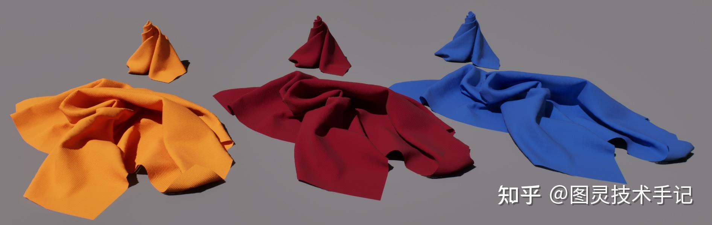

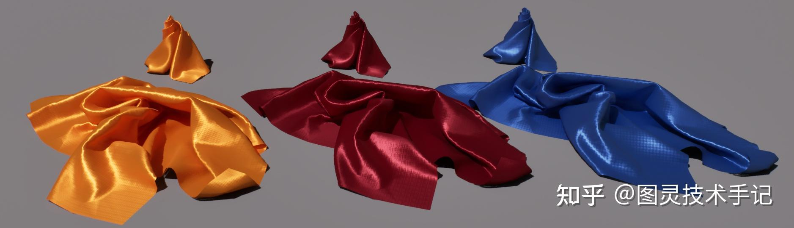

丝绸和布料一直是游戏渲染中比较敏感的效果，也是最考验如何调和光影反馈的质感

对于布料来说，表面高光的分散效果是比较考验使用的模型的

对于丝绸来说，各向异性的计算、高光颜色和吸收度是比较考验我们所使用的算法的，同时也要在物理上将其各向异性和金属的各向异性区分开

从Buffer中也可以看到我们并没有通过非物理的方式提升Metallic来强化其各向异性的表现，这个方法保留了基础的物理信息

## 一、UnrealEngine - Cloth Shading Model

虚幻原生使用的布料渲染模型在ShadingModels.ush中，使用的是Asperity Scattering - Inverse Beckmann Layer这个方法

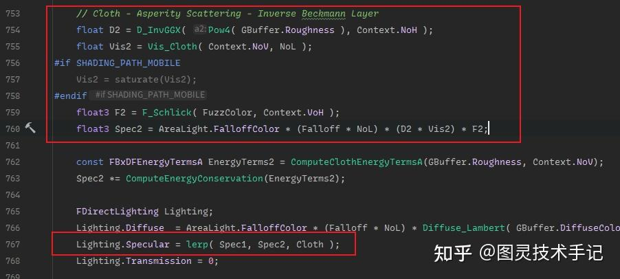

这种模型会有一些小问题就是在处理飘带一类的渲染效果时，表面高光分布过于集中，会有比较奇怪的边缘光出现

但是其高光计算的方式给我们提供了一个很好的思路

Spec1和Spec2分别是SpecularGGX计算的高光和布料单独计算的高光，通过Cloth属性进行插值

那么我们写的新模型也可以通过获取部分信息来插值SpecularGGX高光、布料高光和各向异性高光

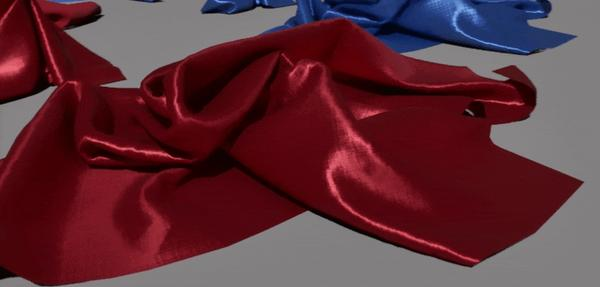

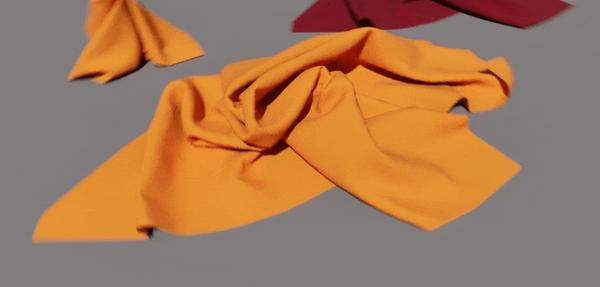

另外我们从运算中可以看到对于其渲染依然是基于很标准的BRDF模型的

这里可以回忆一下BRDF的基本公式结构

f(\omega_o,\omega_i) = \frac{F\cdot D \cdot G}{4|\omega_o \cdot N||\omega_i \cdot N|}

源码中D2是D项分布，Vis2是G项分布，F2是F项分布

## 二、启用各向异性通道

Material.cpp中声明材质编辑器的接口（Anisotropy和Tangent）

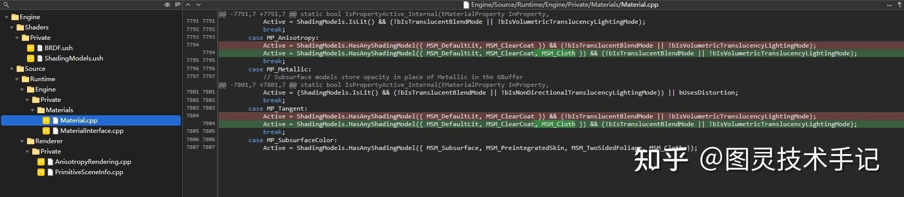

MaterialInterface.cpp中声明使用Anisotropy通道的标签

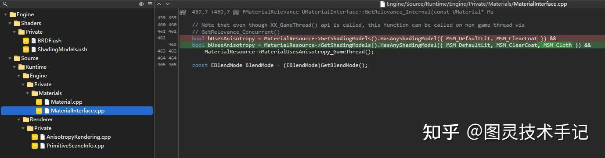

AnisotropyRendering.cpp中声明启用各向异性通道和绘制通道

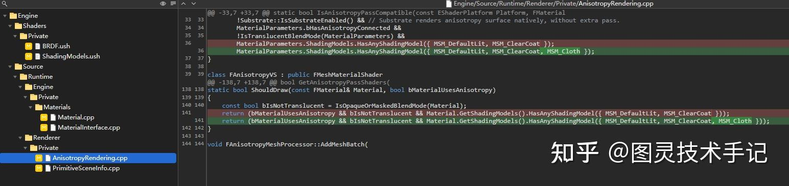

PrimitiveSceneInfo.cpp中声明使用Anisotropy通道的标签

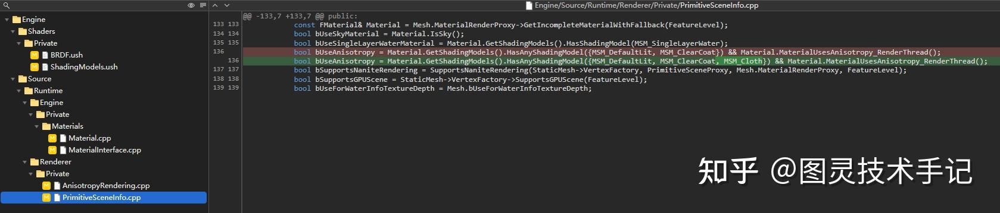

这里为了不影响原始ClothBxDF的内容，我重新声明另一个CustomClothBxDF

先把源码附上再解释

```cpp
FDirectLighting CustomClothBxDF( FGBufferData GBuffer, half3 N, half3 V, half3 L, float Falloff, half NoL, FAreaLight AreaLight, FShadowTerms Shadow )
{
	const float Cloth = saturate(GBuffer.CustomData.a);

	BxDFContext Context;

#if SUPPORTS_ANISOTROPIC_MATERIALS
	bool bHasAnisotropy = HasAnisotropy(GBuffer.SelectiveOutputMask);
#else
	bool bHasAnisotropy = false;
#endif

	float NoV, VoH, NoH;
	BRANCH
	if (bHasAnisotropy)
	{
		half3 X = GBuffer.WorldTangent;
		half3 Y = normalize(cross(N, X));
		Init(Context, N, X, Y, V, L);

		NoV = Context.NoV;
		VoH = Context.VoH;
		NoH = Context.NoH;
	}
	else
	{
#if SHADING_PATH_MOBILE
		InitMobile(Context, N, V, L, NoL);
#else
		Init(Context, N, V, L);
#endif

		NoV = Context.NoV;
		VoH = Context.VoH;
		NoH = Context.NoH;

		SphereMaxNoH(Context, AreaLight.SphereSinAlpha, true);
	}

	Context.NoV = saturate(abs( Context.NoV ) + 1e-5);

	float3 SpecularColor = ComputeF0(GBuffer.Specular, GBuffer.BaseColor, abs(GBuffer.Anisotropy));
	GBuffer.SpecularColor = lerp(GBuffer.SpecularColor, SpecularColor, Cloth);
	
	float3 SpecOrigin;
	if(IsRectLight(AreaLight))
		SpecOrigin = RectGGXApproxLTC( GBuffer.Roughness, GBuffer.SpecularColor, N, V, AreaLight.Rect, AreaLight.Texture );
	else
		SpecOrigin = AreaLight.FalloffColor * (Falloff * NoL) * SpecularGGX( GBuffer.Roughness, GBuffer.SpecularColor, Context, NoL, AreaLight );

	const FBxDFEnergyTerms EnergyTerms1 = ComputeGGXSpecEnergyTerms(GBuffer.Roughness, Context.NoV, GBuffer.SpecularColor);
	SpecOrigin *= ComputeEnergyConservation(EnergyTerms1);
	
	float invAlpha = rcp(GBuffer.Roughness);
	float cos2h = Context.NoH * Context.NoH;
	float sin2h = max(1-cos2h, 0.0078125f);
	float3 D = (2.f + invAlpha) * pow(sin2h, invAlpha ) / (2.f * PI);

	float a2 = Pow4(GBuffer.Roughness);
	float vis_SmithJoint = Vis_SmithJointApprox(a2, Context.NoV, NoL);
	float vis = Vis_SmithJoint_soften(GBuffer.Roughness, Context.NoV, NoL);
	float vis_bias = vis + (1-vis) * 0.05;
	
	float3 F = F_Schlick(GBuffer.SpecularColor, Context.VoH);
	
	float3 SpecCloth = AreaLight.FalloffColor * (Falloff * NoL) * D *  F * vis_bias;
	const FBxDFEnergyTermsA EnergyTerms2 = ComputeClothEnergyTermsA(GBuffer.Roughness, Context.NoV);
	SpecCloth *= ComputeEnergyConservation(EnergyTerms2);

	float Aniso = lerp(GBuffer.Anisotropy, GBuffer.Anisotropy * 0.75 ,Cloth);
	float3 SpecAnisotropy = AreaLight.FalloffColor * (Falloff * NoL) * SpecularGGX(GBuffer.Roughness, Aniso, GBuffer.SpecularColor, Context, NoL, AreaLight);
	FBxDFEnergyTerms EnergyTerms3 = ComputeGGXSpecEnergyTerms(GBuffer.Roughness, Context.NoV, GBuffer.SpecularColor);
	SpecAnisotropy *= ComputeEnergyConservation(EnergyTerms3);

	// anisotropy zone 0.3-0.7
	float SilkAnisoWeight = saturate(abs(GBuffer.Anisotropy) * 2.5-0.75); 
	float3 SpecSilk = SpecAnisotropy * SilkAnisoWeight + SpecCloth * (1-SilkAnisoWeight);

	const float AnisoWeight  = saturate(abs(GBuffer.Anisotropy));
	float3 SpecClothSilk = lerp(SpecCloth, SpecSilk, AnisoWeight);
	float3 SpecOthers = lerp(SpecOrigin, SpecAnisotropy, AnisoWeight);

	float3 DiffuseColor = lerp(GBuffer.DiffuseColor, GBuffer.DiffuseColor - GBuffer.DiffuseColor * abs(GBuffer.Anisotropy), Cloth);
	
	// Spec1 - metal, Spec2 - cloth, Spec3 - silk
	FDirectLighting Lighting;
	Lighting.Diffuse  = AreaLight.FalloffColor * (Falloff * NoL) * Diffuse_Lambert(DiffuseColor);  
	Lighting.Specular = lerp( SpecOthers, SpecClothSilk, Cloth);
	Lighting.Transmission = 0;

	Lighting.Diffuse *= lerp(ComputeEnergyPreservation(EnergyTerms1), ComputeEnergyPreservation(EnergyTerms2), Cloth);
	
	return Lighting;
	
}

```

最开始根据是否有连接Anisotropy的节点来决定如何初始化Context信息

然后整个计算中我们分成了三个比较重要的高光计算板块——SpecOrigin, SpecCloth, SpecSilk

SpecOrigin和SpecSilk走的都是基础的SpecularGGX，可以根据各向异性的输入控制高光位置和形状，两者之间不同的是最大可接受的Anisotropy的值不同，同时SpecSilk需要和Cloth本身的高光进行一定程度的融合来保留布料部分的特性

SpecCloth使用了新模型——SheenBRDF模型的D项分布，并且对遮蔽项（G项）进行了重新计算和柔化

## 三、Sheen BRDF

在文章Production Friendly Microfacet Sheen BRDF中将Cloth渲染下的D项修改成了

D(m)=\frac{(2+1/r)sin^{1/r}\theta}{2\pi}

所以对应到代码中我们可以修改自己的SpecCloth

```cpp
float invAlpha = rcp(GBuffer.Roughness);
float cos2h = Context.NoH * Context.NoH;
float sin2h = max(1-cos2h, 0.0078125f);
float3 D = (2.f + invAlpha) * pow(sin2h, invAlpha ) / (2.f * PI);

float a2 = Pow4(GBuffer.Roughness);
float vis_SmithJoint = Vis_SmithJointApprox(a2, Context.NoV, NoL);
	
float3 F = F_Schlick(GBuffer.SpecularColor, Context.VoH);
	
float3 SpecCloth = AreaLight.FalloffColor * (Falloff * NoL) * D *  F * vis_SmithJoint;
const FBxDFEnergyTermsA EnergyTerms2 = ComputeClothEnergyTermsA(GBuffer.Roughness, Context.NoV);
SpecCloth *= ComputeEnergyConservation(EnergyTerms2);

```

这里我们将公式转换成了代码得到了D项的反馈，其高光扩散更加自然

## 四、G Term

上面这段代码和我们源码使用的G项有一些不同，上面的计算使用的是SmithJointApprox的算法，其边缘过渡比较硬，所以我们又针对G项在文章Production Friendly Microfacet Sheen BRDF的方法下进行了插值

就有了我们自己的G项算法float Vis_SmithJoint_soften( float roughness, float NoV, float NoL )，写在BRDF.ush中

```cpp
float L(float NoX, float roughness)
{
	float interpolateValue = pow(1-roughness, 2);

	float al = 25.3245;
	float ah = 21.5473;
	float a = lerp(al, ah, interpolateValue);

	float bl = 3.32435;
	float bh = 3.82987;
	float b = lerp(bl, bh, interpolateValue);

	float cl = 0.16801;
	float ch = 0.19823;
	float c = lerp(cl,ch, interpolateValue);

	float dl = -1.27393;
	float dh = -1.9776;
	float d = lerp(dl, dh, interpolateValue);

	float el = -4.85967;
	float eh = -4.32054;
	float e = lerp(el, eh, interpolateValue);

	return a * rcp(1 + b*pow(NoX, c)) + d * NoX + e;
}

float ShadowTermHeitz(float NoX, float roughness)
{
	float n = 0;
	BRANCH if (NoX < 0.5f)
	{
		n = L(NoX,roughness);
	}
	else
	{
		n = 2 * L(0.5,roughness) - L(1-NoX,roughness);
	}
	
	return exp(n);
}

float Vis_SmithJoint_soften( float roughness, float NoV, float NoL )
{
	float Vis_SmithV = ShadowTermHeitz(NoV, roughness );
	float kv = 1+2*Pow2(Pow4(1-NoV));
	Vis_SmithV = pow(Vis_SmithV,kv);
	
	float Vis_SmithL = ShadowTermHeitz(NoL, roughness );
	float kl = 1 + 2*Pow2(Pow4(1-NoL));
	Vis_SmithL = pow(Vis_SmithL,kl);

	return rcp(1 + Vis_SmithV + Vis_SmithL);
}

```

然后我们将这个方法应用到源码中

```cpp
float invAlpha = rcp(GBuffer.Roughness);
float cos2h = Context.NoH * Context.NoH;
float sin2h = max(1-cos2h, 0.0078125f);
float3 D = (2.f + invAlpha) * pow(sin2h, invAlpha ) / (2.f * PI);


float vis = Vis_SmithJoint_soften(GBuffer.Roughness, Context.NoV, NoL);
float vis_bias = vis + (1-vis) * 0.05;
	
float3 F = F_Schlick(GBuffer.SpecularColor, Context.NoH);
	
float3 SpecCloth = AreaLight.FalloffColor * (Falloff * NoL) * D *  F * vis_bias;

```

这里没有让Vis彻底变黑是希望遮蔽能保留一些暗处的高光细节

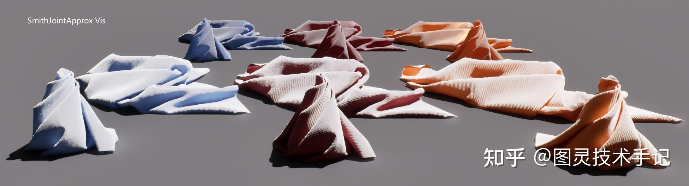

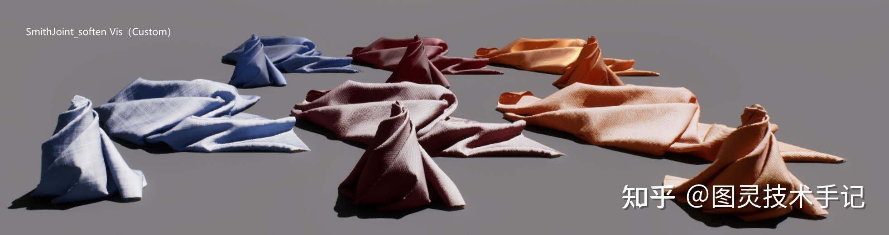

## 五、丝绸高光优化

如果不对高光做ComputeF0的优化，不对基础色做吸收度的变化，我们得到的高光和布料之间的分离感就会比较严重，导致很像皮具

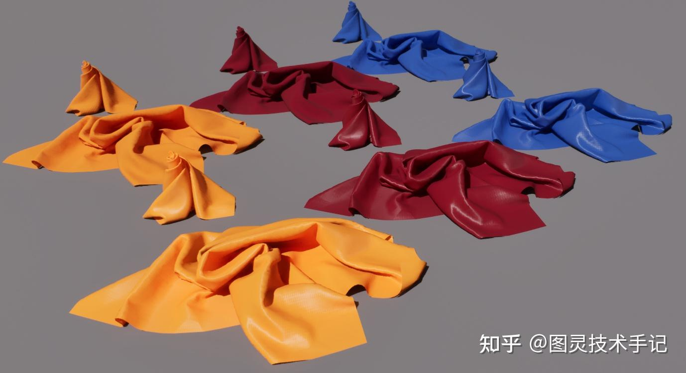

所以我们找到在Metallic变化的时候，源码中SpecluraColor的颜色会根据Metallic的强度在ComputeF0中做插值处理，DiffuseColor也会随着Metallic的变化出现明度的变化，我们也学习这样的一种方法，只是其驱动在丝绸状态下不是Metallic而是Anisotropy（这是一个偏经验化的使用，可以在视觉上达到目的，同时也不会完全改变物理属性）

SpecularColor部分：

```cpp
float3 SpecularColor = ComputeF0(GBuffer.Specular, GBuffer.BaseColor, abs(GBuffer.Anisotropy));
GBuffer.SpecularColor = lerp(GBuffer.SpecularColor, SpecularColor, Cloth);

```

DiffuseColor部分：

```cpp
float3 DiffuseColor = lerp(GBuffer.DiffuseColor, GBuffer.DiffuseColor - GBuffer.DiffuseColor * abs(GBuffer.Anisotropy), Cloth);

```

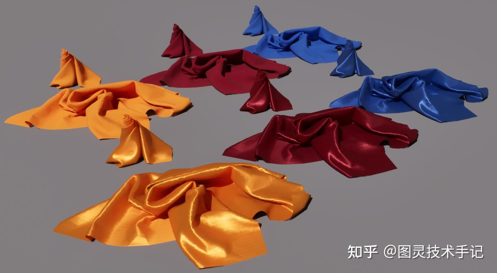

至于材质编辑器中其实很简单地连线就能满足基本需求了，不展开了

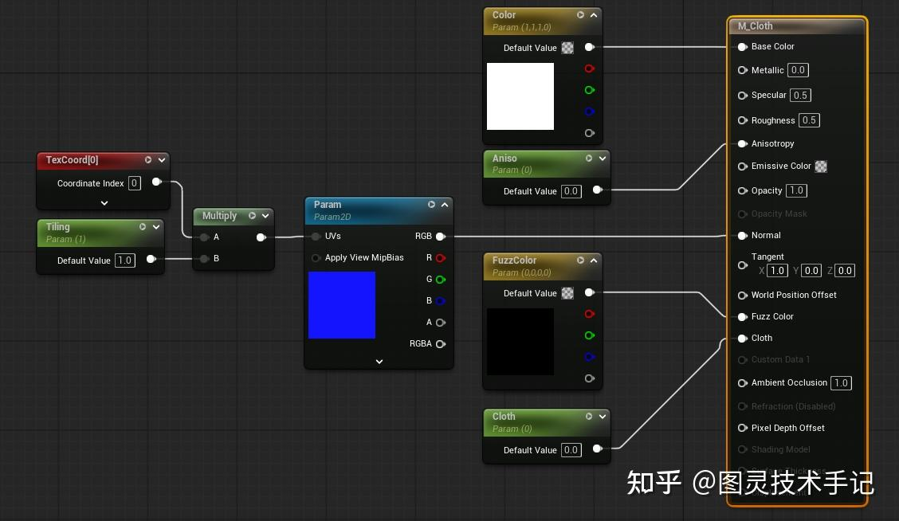

## 参考文章

Production Friendly Microfacet Sheen BRDF

虚幻5渲染编程(材质篇)[第三卷: Microfacet Sheen BRDF in UnrealEngine]

[Heitz 2014]Understanding the masking-shadowing function in microfacet-based brdfs.

## Patch


## 一些优化

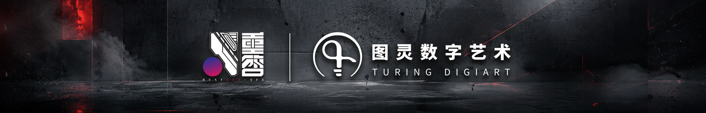
