引擎UI算法变化千千万，想要的效果我们都可以拆解，这篇文章给大家拆分一些研究的一个动态能量条的方案，可以适配角色体力、进度条、子弹容量等等需求，目前实现的是环形，理解原理也可以做更多形状上的拓展

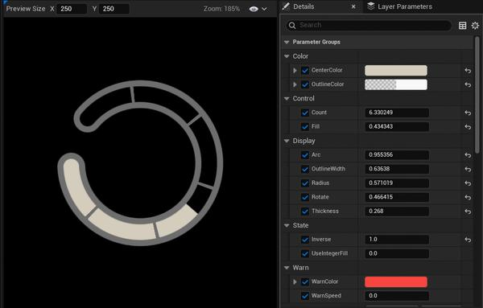

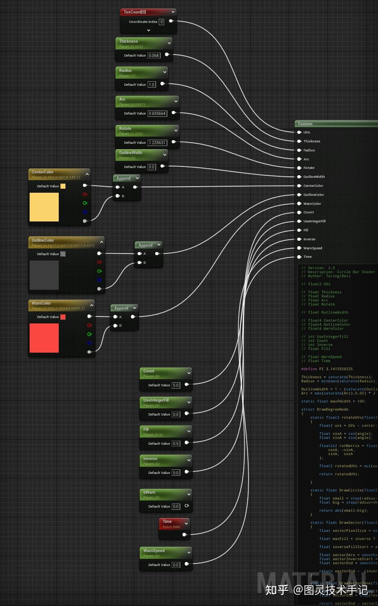

输入提示

```cpp
// float2 UVs

// float Thickness
// float Radius
// float Arc
// float Rotate

// float OutlineWidth

// float4 CenterColor
// float4 OutlineColor
// float4 WarnColor

// int UseIntegerFill
// int Count
// int Inverse
// float Fill

// float WarnSpeed
// float Time

```

源码展示

```cpp
// Version: 2.0
// Description: Circle Bar Shader
// Author: Turing(Rex)


#define PI 3.1415926535

Thickness = saturate(Thickness);
Radius = min(max(saturate(Radius),Thickness/2),1-Thickness/2);

OutlineWidth = 1 - (saturate(OutlineWidth) * 0.6 + 0.15);
Arc = max(saturate(Arc),0.05) * 2 * PI;

struct DrawDegreeNode
{
    static float2 rotateUVs(float2 UVs, float2 center, float angle)
    {
        float2 uvs = UVs - center;      

        float cosA = cos(angle);
        float sinA = sin(angle);

        float2x2 rotMatrix = float2x2(
            cosA, -sinA,
            sinA,  cosA
        );

        float2 rotatedUVs = mul(uvs, rotMatrix) + center;

        return rotatedUVs;

    }

    static float DrawCircle(float2 TexCoordPolar, float radius, float thickness)
    {
        float small = step(radius-thickness/2,TexCoordPolar.y);
        float big = step(radius+thickness/2,TexCoordPolar.y);

        return abs(small-big);
    }

    static float DrawSector(float2 TexCoordPolar, float fill, float arc, float inverse)
    {
        float sectorPixelSize = fwidth(TexCoordPolar.x);
    
        float maxFill = inverse ? arc : fill;

        float inverseFillStart = arc -fill;

        float sectorZero = smoothstep(2 * sectorPixelSize, sectorPixelSize,TexCoordPolar.x);
        float sectorInverseStart = smoothstep(inverseFillStart+sectorPixelSize, inverseFillStart-sectorPixelSize,TexCoordPolar.x);
        float sectorEnd = smoothstep(maxFill+sectorPixelSize, maxFill-sectorPixelSize,TexCoordPolar.x);

        return sectorEnd -  (inverse ? sectorInverseStart : sectorZero);
    }

    static float DrawSectorZone(float2 TexCoordPolar, float radius, float thickness, float arc, float bias)
    {
        float sectorStart = step(TexCoordPolar.x, bias);
        float sectorEnd = step(TexCoordPolar.x,arc-bias);

        return sectorEnd - sectorStart;
    }

    static float DrawCurveMask(float2 TexCoordPolar, float radius, float thickness, float arc)
    {
        float bias = asin((thickness/2)/radius);

        float circleMask = DrawDegreeNode::DrawCircle(TexCoordPolar,radius,thickness);
        float sectorEP = DrawDegreeNode::DrawSectorZone(TexCoordPolar,radius, thickness, arc,bias);

        float result = saturate(sectorEP * circleMask);

        return result;
    }

    static float DrawRoundSDF(float2 TexCoord, float radius, float thickness, float arc, float bias)
    {
        float r = thickness/2;

        bias += arc;
        bias -= PI/2;

        float2 coord = float2(radius * sin(bias),radius * cos(bias));

        float dist = distance(coord, TexCoord);

        return smoothstep(0,r,dist);
    }

    static float DrawCurveSDF(float2 TexCoordPolar, float radius, float thickness, float arc)
    {
        float dist =  abs(TexCoordPolar.y - radius);
        
        float mask = DrawCurveMask(TexCoordPolar, radius, thickness, arc);

        return max(smoothstep(0,thickness/2,dist), 1-mask);
    }

    static float DrawBarSDF(float2 TexCoordPolar, float2 TexCoord, float radius, float thickness, float arc, float bias)
    {
        TexCoord *= float2(1,-1);
        float curveSDF = DrawCurveSDF(TexCoordPolar, radius, thickness, arc);
        float roundSDFS = DrawRoundSDF(TexCoord, radius, thickness, 0,  bias);
        float roundSDFE = DrawRoundSDF(TexCoord, radius, thickness, arc - 2*bias,  bias);

        return 1-min(min(curveSDF, roundSDFS),roundSDFE);
    }

     static float MaskSpan(float2 TexCoordPolar, float arc, int count, float outlineW, float thickness)
    {
        float span = (1-outlineW) * thickness * 0.3f;
        float arcUnit = (arc + span) / count;
        float pos = fmod(TexCoordPolar.x, arcUnit);

        float feather = 0.005;

        return 1-min(smoothstep(feather,2*feather,pos),1- smoothstep(arcUnit-span,arcUnit-span +feather + feather,pos));
    }

    static float4 DrawSDF(float SDF, float outline, float4 CenterColor, float4 OutlineColor, float sectorMask, float spanMask)
    {
        float SDFPixelSize = fwidth(SDF);

        float CenterZone = smoothstep(1-outline-SDFPixelSize,1-outline+SDFPixelSize,SDF);
        float OutlineZone = smoothstep(0.05 - SDFPixelSize ,0.05 + SDFPixelSize,SDF);

        float SpanZone = OutlineZone * spanMask;

        return  max((OutlineZone - CenterZone),SpanZone) * OutlineColor + saturate(CenterZone-SpanZone) * CenterColor * sectorMask;
    };

    static float IntegerLimitFill(float arc, int fill, int count, float bIntegerFill)
    {

        float unit = arc / count;

        int countResult = count - max(0 , count - fill);

        return countResult * unit / arc;
    }

    static float4 DrawColor(float4 CenterColor, float4 WarnColor, float WarnSpeed, float time)
    {
        if (WarnSpeed)
        {
            return lerp(CenterColor, WarnColor, (sin(time*10*WarnSpeed)+1)/2);
        }

        return CenterColor;
    }   

   
};


float2 CenterUV = DrawDegreeNode::rotateUVs(UVs, float2(0.5,0.5), Rotate) * 2 -1;

float angleRamp = atan2(CenterUV.y, CenterUV.x)+PI;
float radiusRamp = length(CenterUV); 
float2 TexCoordPolar = float2(angleRamp,radiusRamp);

float ResultFill = UseIntegerFill ? DrawDegreeNode::IntegerLimitFill(Arc, Fill, Count, UseIntegerFill) : Fill;

float sectorMask = DrawDegreeNode::DrawSector(TexCoordPolar,Arc * ResultFill, Arc, Inverse);

float bias = asin((Thickness/2)/Radius);
float BarSDF = DrawDegreeNode::DrawBarSDF(TexCoordPolar, CenterUV ,Radius,Thickness,Arc,bias);

if(BarSDF <= 0 || Radius == 0 || Thickness == 0)
{
    return 0;
}

float maskSpan = DrawDegreeNode::MaskSpan(TexCoordPolar,Arc,Count,OutlineWidth, Thickness);

float4 energyColor = DrawDegreeNode::DrawColor(CenterColor, WarnColor, WarnSpeed, Time);
float4 result = DrawDegreeNode::DrawSDF(BarSDF,OutlineWidth, energyColor, OutlineColor, sectorMask, maskSpan);

return result;

```

## 一、参数和原理说明

这个能量条的主要构建逻辑是在UI中重写距离场，根据距离场来判断我们需要的自定义形状的厚度、半径、弧度、数量等信息

在像素抗锯齿上用了屏幕空间求导的ddx和ddy综合算法fwidth，在像素足够的前提下优化了UI边缘锯齿的问题

> ddx(a)数学表达式a(x+1,y) - a(x,y)
ddy(a)数学表达式a(x,y+1) - a(x,y)
fwidth(a)数学表达式abs(ddx(a)) + abs(ddy(a))

| 参数名 | 类型 | 意义 |
| --- | --- | --- |
| 系统传入 |  |  |
| UVs | float2 | 输入的原始UV |
| Time | float | 系统时间 |
|  |  |  |
| 颜色控制 |  |  |
| CenterColor | float4 | 填充颜色 |
| OutlineColor | float4 | 外轮廓颜色 |
|  |  |  |
| 填充控制 |  |  |
| Count | int | 填充单元数量 |
| Fill | float | 填充值 |
|  |  |  |
| 显示控制 |  |  |
| Arc | float | 弧度 |
| OutlineWidth | float | 外轮廓厚度 |
| Radius | float | 圆环半径 |
| Rotate | float | 圆环旋转弧度 |
| Thickness | float | 圆环厚度 |
|  |  |  |
| 状态控制 |  |  |
| Inverse | int | 反向填充 |
| UseIntegerFill | int | 使用整数填充 |
|  |  |  |
| 警告控制 |  |  |
| WarnColor | float4 | 警告颜色 |
| WarnSpeed | float | 警告闪烁速度 |

## 二、矩阵旋转

我们整个圆环的构建以原始UV为核心，为了可以整体旋转圆环，我们只需要旋转原始UV即可，所以在方法上我们构建了static float2 rotateUVs(float2 UVs, float2 center, float angle)来旋转整个UV，其中构建了一个二维旋转矩阵

```cpp
float2x2 rotMatrix = float2x2(
            cosA, -sinA,
            sinA,  cosA
        );

```

利用这个二维旋转矩阵进行矩阵乘法可以获得旋转后的UV坐标

```cpp
 float2 rotatedUVs = mul(uvs, rotMatrix) + center;

```

## 三、极坐标

基于旋转后的UV结果需要将UV中心化即常用的*2-1的操作

然后为了简化圆环的计算，需要将中心化后的UV转换成极坐标来计算实现

这里极坐标的x分量使用到了hlsl内置的函数atan2，可以将坐标值转换为角度，其范围为 [-\pi ,\pi]

极坐标的y分量使用道理内置函数length，可以将做标准化为标量距离

这样我们就得到了中心化之后UV的极坐标

```cpp
float2 CenterUV = DrawDegreeNode::rotateUVs(UVs, float2(0.5,0.5), Rotate) * 2 -1;

float angleRamp = atan2(CenterUV.y, CenterUV.x)+PI;
float radiusRamp = length(CenterUV); 
float2 TexCoordPolar = float2(angleRamp,radiusRamp);

```

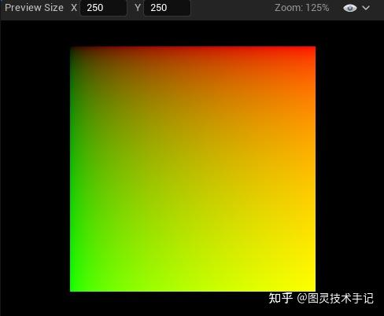

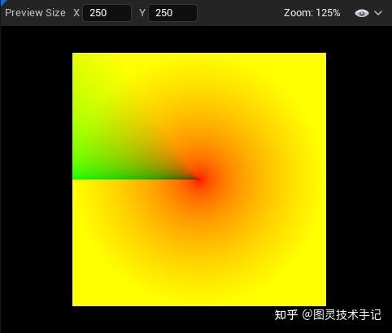

## 四、绘制遮罩

### 1.环形遮罩

利用我们已经构建好的极坐标的y轴分量，我们很容易能利用step函数的特性框出圆环的区域，只是要注意我们在计算中要将圆环半径Radius和厚度Thickness考虑在内

```cpp
static float DrawCircle(float2 TexCoordPolar, float radius, float thickness)
    {
        float small = step(radius-thickness/2,TexCoordPolar.y);
        float big = step(radius+thickness/2,TexCoordPolar.y);

        return abs(small-big);
    }

```

这里为了限制Radius和Thickness的关系，我们在这些值传入的时候就对其做了限值，避免整个图形失效

```cpp
Thickness = saturate(Thickness);
Radius = min(max(saturate(Radius),Thickness/2),1-Thickness/2);

```

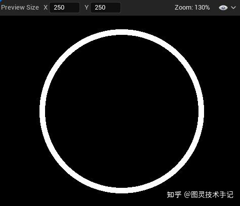

### 2.填充扇区遮罩

扇区直接利用我们已经构建好的极坐标的x轴分量，同样可以利用step的特性框选出扇区

不过我们因为有动态填充的需要，所以加入了正向填充和反向填充两种算法

```cpp
static float DrawSector(float2 TexCoordPolar, float fill, float arc, float inverse)
    {
        float sectorPixelSize = fwidth(TexCoordPolar.x);
    
        float maxFill = inverse ? arc : fill;

        float inverseFillStart = arc -fill;

        float sectorZero = smoothstep(2 * sectorPixelSize, sectorPixelSize,TexCoordPolar.x);
        float sectorInverseStart = smoothstep(inverseFillStart+sectorPixelSize, inverseFillStart-sectorPixelSize,TexCoordPolar.x);
        float sectorEnd = smoothstep(maxFill+sectorPixelSize, maxFill-sectorPixelSize,TexCoordPolar.x);

        return sectorEnd -  (inverse ? sectorInverseStart : sectorZero);
    }

```

> 正向填充即填充目标值减去0值
反向填充即1值减去剩余填充值

这里有一个比较特殊的用法就是fwidth，用来进行屏幕空间求导，防止图形边缘产生的锯齿

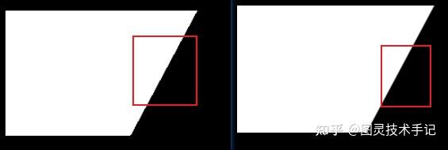

### 3.整体扇区遮罩（不含端点）

我们已经知道利用我们已经构建好的极坐标的x轴分量可以构建扇区，且利用step的特性更适用于GPU计算，那么在我们的目标效果扇区制作中，我们有比较特殊的两个圆形端点，需要另外计算，所以需要在运算之初就将这两个端点剔除掉

不过秉持一个函数只做一件事情的原则，static float DrawSectorZone(float2 TexCoordPolar, float radius, float thickness, float arc, float bias) 接受一个bias的角度偏移传入来剔除前后需要预留的距离

其实现通过考虑偏移后的首尾相减来实现

```cpp
float sectorStart = step(TexCoordPolar.x, bias);
float sectorEnd = step(TexCoordPolar.x,arc-bias);

return sectorEnd - sectorStart;

```

而在实际操作过程中我们也可以预知端点需要预留的偏移角度，需要通过Radius和Thickness的计算来实现

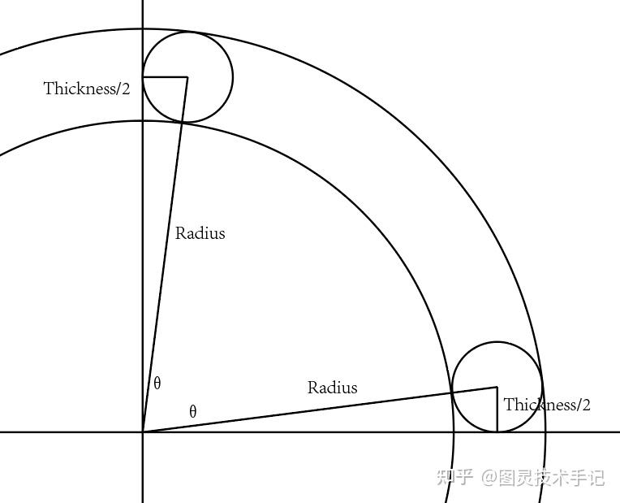

在任何情况下我们可以发现 sin(\Theta)=(\frac{Thickness/2}{Radius})

所以我们就可以通过内置函数asin反求得到弧度，虽然asin的取值空间为 [-\frac{\pi}{2},\frac{\pi}{2}] ，相对于atan2的取值偏小，但是我们的实际使用情况是不会超出这个区间的，所以可以直接使用，不需要作任何角度转换

```cpp
float bias = asin((Thickness/2)/Radius);

```

进一步我们就可以根据环形区域的绘制和扇区的绘制来确定非端点的图形段落的区域了，就有了这里的static float DrawCurveMask(float2 TexCoordPolar, float radius, float thickness, float arc)函数

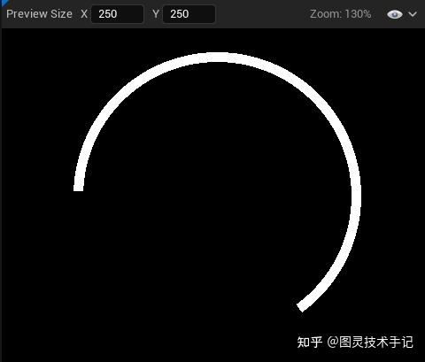

> 这里有人会有疑问，为什么边缘不做抗锯齿处理？
因为这里只是框选了区域，且最后我们计算的距离场被包含在这个区域之内，甚至不触及这个边缘，所以不需要对其作处理。同时这种处理还可以简化我们的算法，也避免了在像素信息过少时的计算误差。

### 4.间隔扇区计算（待优化）

这里也是此方案可以优化的地方

优化点一是其算法，目前的算法会带来一定的边缘锯齿，待优化

优化点二是在这个算法中，我们的填充会重复计算间隔区域，这一块可以从填充算法上统一解决，但复杂度会大大增高 ，酌情处理

这里根据传入的Count OutlineWidth等数值做了fmod的循环处理，根据我们推理的每个单元格的大小来划定间隔区域

同时为了边缘平滑，使用了feather参数来划定其边界smoothstep的抖动值，这个值在优化时也可以处理为动态

```cpp
 static float MaskSpan(float2 TexCoordPolar, float arc, int count, float outlineW, float thickness)
    {
        float span = (1-outlineW) * thickness * 0.3f;
        float arcUnit = (arc + span) / count;
        float pos = fmod(TexCoordPolar.x, arcUnit);

        float feather = 0.005;

        return 1-min(smoothstep(feather,2*feather,pos),1- smoothstep(arcUnit-span,arcUnit-span +feather + feather,pos));
    }

```

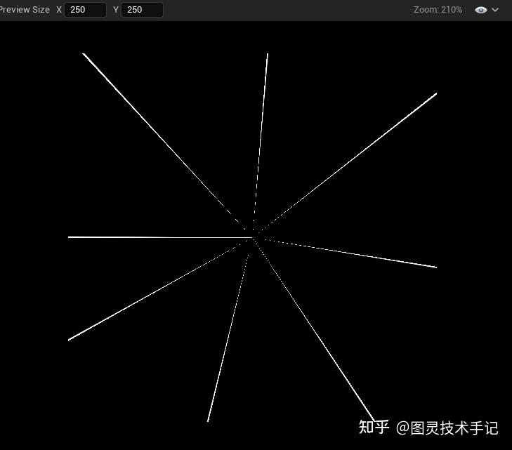

## 五、绘制距离场

距离场是这个方案的核心所在，使用距离场可以避免重复计算和逻辑计算带来的性能压力，更是后GPU并行处理

### 1.圆形距离场

圆形距离场的计算是为了端点使用

我们计算圆形距离场需要基于中心化之后的UV，UV的计算方式一定要对齐!、

函数static float DrawRoundSDF(float2 TexCoord, float radius, float thickness, float arc, float bias)通过radius，thickness就可以构建出其笛卡尔坐标，bias则是我们上文提到的预留空间

```cpp
float2 coord = float2(radius * sin(bias),radius * cos(bias));

```

然后通过distance就可以获取中心化UV到某一点的具体距离

```cpp
float dist = distance(coord, TexCoord);

```

最后使用smoothstep将半径内的值归化到 (0,1) 内，后通过distance就可以获取中心化UV到某一点的具体距离

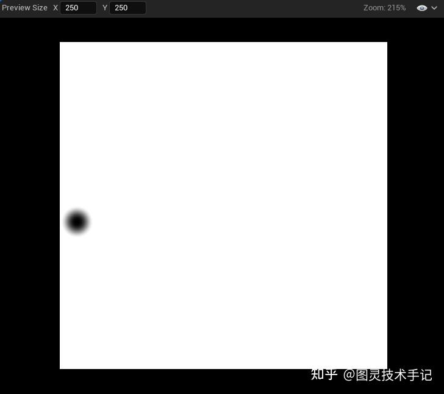

### 2.曲线距离场

曲线距离场则是利用刚刚计算得到的扇区遮罩和极坐标的y轴分量来共同计算得到

曲线距离长就是y轴分量距离某一具体值的距离

```cpp
float dist =  abs(TexCoordPolar.y - radius);

```

然后通过max将其和扇区遮罩进行合并，切记这里不可以用加减乘除

```cpp
float mask = DrawCurveMask(TexCoordPolar, radius, thickness, arc);

return max(smoothstep(0,thickness/2,dist), 1-mask);

```

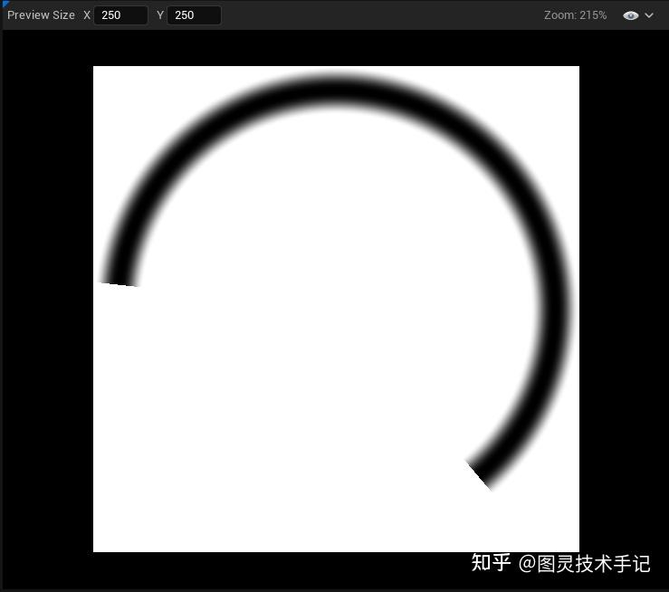

### 3.距离场合并

这里合并同样需要注意，不可以使用加减乘除！！！否则会导致值溢出或者过渡不均匀

```cpp
static float DrawBarSDF(float2 TexCoordPolar, float2 TexCoord, float radius, float thickness, float arc, float bias)
    {
        TexCoord *= float2(1,-1);
        float curveSDF = DrawCurveSDF(TexCoordPolar, radius, thickness, arc);
        float roundSDFS = DrawRoundSDF(TexCoord, radius, thickness, 0,  bias);
        float roundSDFE = DrawRoundSDF(TexCoord, radius, thickness, arc - 2*bias,  bias);

        return 1-min(min(curveSDF, roundSDFS),roundSDFE);
    }

```

这里简单将一个曲线距离场和两个圆形距离场通过min函数进行了混合，并进行了obverse处理后，得到了我们需要的距离场

> 有人会关注到这里的 TexCoord *=float2(1,-1); 这里只是为了计算的统一性，将坐标系统的y轴置为朝上

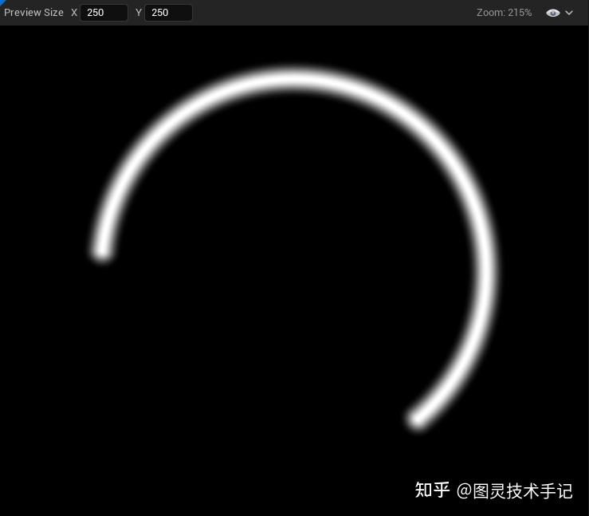

## 六、处理距离场、填充颜色

### 1.绘制并处理距离场

我们已经可以得到一个完整的距离场了，接下来就是要将距离场通过我们的计算转换为有边界的填充条即可

函数static float4 DrawSDF(float SDF, float outline, float4 CenterColor, float4 OutlineColor, float sectorMask, float spanMask)接受SDF结果直接传入

在处理中这里就要使用fwidth来调整边缘锯齿化的问题了，代入smoothstep获得中心填充区域CenterZone和外框区域OutlineZone，同时结合我们间隔扇区的计算结果，就可以得到最终的混合方式了

```cpp
static float4 DrawSDF(float SDF, float outline, float4 CenterColor, float4 OutlineColor, float sectorMask, float spanMask)
    {
        float SDFPixelSize = fwidth(SDF);

        float CenterZone = smoothstep(1-outline-SDFPixelSize,1-outline+SDFPixelSize,SDF);
        float OutlineZone = smoothstep(0.05 - SDFPixelSize ,0.05 + SDFPixelSize,SDF);

        float SpanZone = OutlineZone * spanMask;

        return  max((OutlineZone - CenterZone),SpanZone) * OutlineColor + saturate(CenterZone-SpanZone) * CenterColor * sectorMask;
    };

```

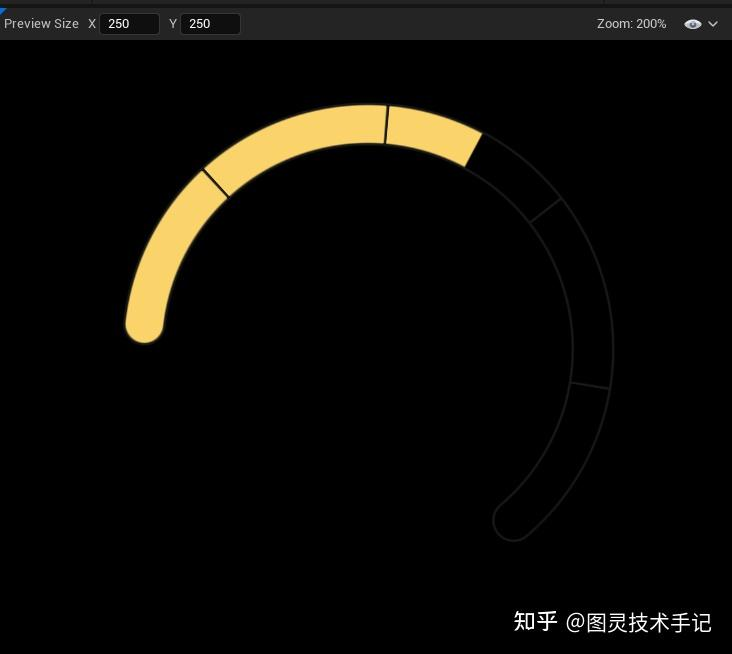

### 2.填充处理

当然这里针对于我们的填充方式有两种，一种是通过 (0,1) 来填充，一种是通过填充小于Count的整数来实现，所以我们就要有一个独立的函数对输入值Fill进行特殊处理

```cpp
static float IntegerLimitFill(float arc, int fill, int count, float bIntegerFill)
    {

        float unit = arc / count;

        int countResult = count - max(0 , count - fill);

        return countResult * unit / arc;
    }

```

这里主要是实现了如果使用整数填充，那么我们的运行逻辑应该是限制于Count的，并且要转换为最后使用的 (0,1) 范围内容的浮点值

使用中我们就可以根据我们的条件输出来判断是否使用整数填充的逻辑，这里使用了三元运算符来优化代码

```cpp
float ResultFill = UseIntegerFill ? DrawDegreeNode::IntegerLimitFill(Arc, Fill, Count, UseIntegerFill) : Fill;

```

### 3.颜色处理

颜色处理简单提示一下，就是根据输入的速度判断是否要闪烁， 然后返回填充的颜色，加入最终处理即可

闪烁的实现使用的是sin函数，且将其规化到 (0,1) 范围内方便控制

```cpp
static float4 DrawColor(float4 CenterColor, float4 WarnColor, float WarnSpeed, float time)
  {
      if (WarnSpeed)
      {
          return lerp(CenterColor, WarnColor, (sin(time*10*WarnSpeed)+1)/2);
      }
      return CenterColor;
  }   

```

### 4.像素优化处理

在源代码的流程处理中有一个小细节值得注意，我们通过Radius Thickness和SDF来判断了某一个像素是否需要进一步绘制，如果SDF为0或者本身Radius和Thickness等于了0，后面的所有判断就不需要进行，在像素层面就不需要继续计算了，降低了一些不必要的像素计算消耗

```cpp
if(BarSDF <= 0 || Radius == 0 || Thickness == 0)
{
    return 0;
}

```

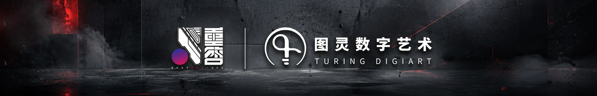
