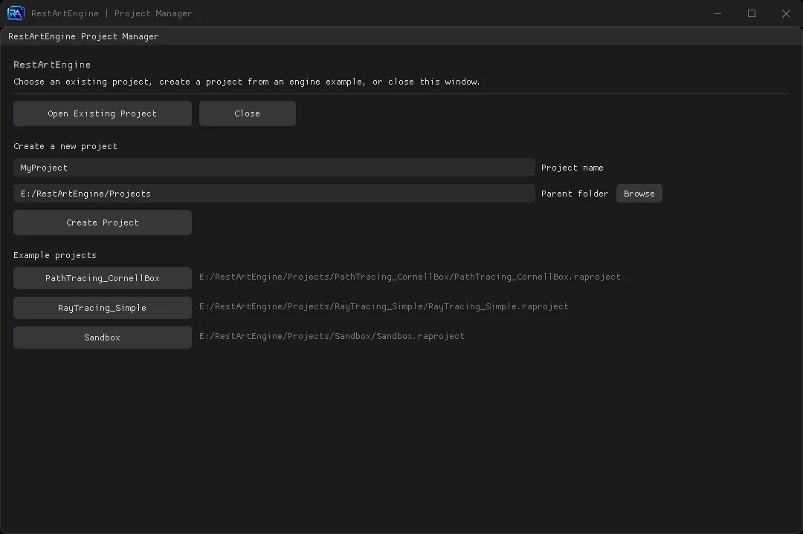
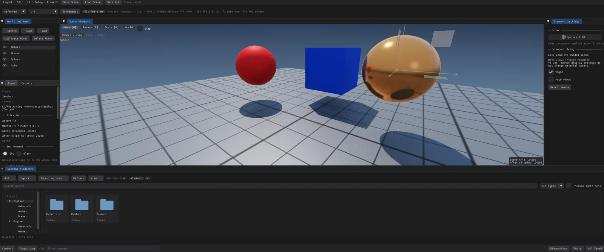
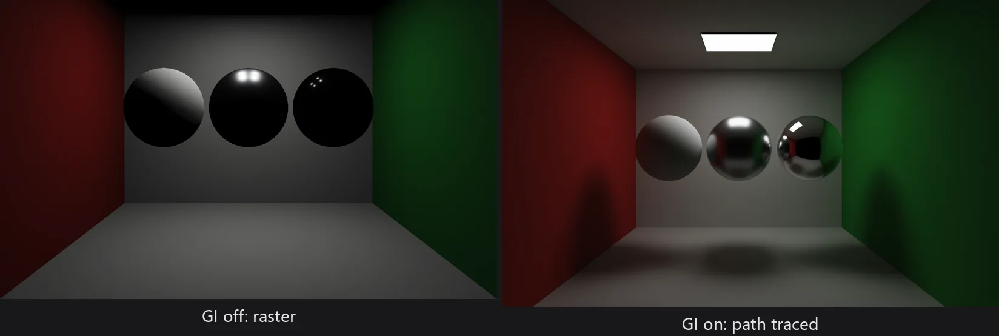
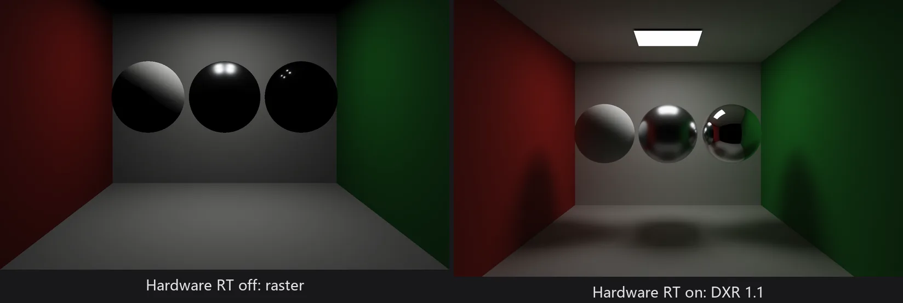
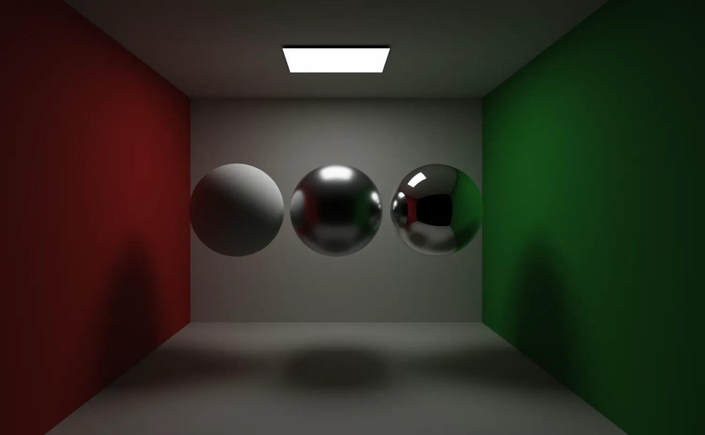
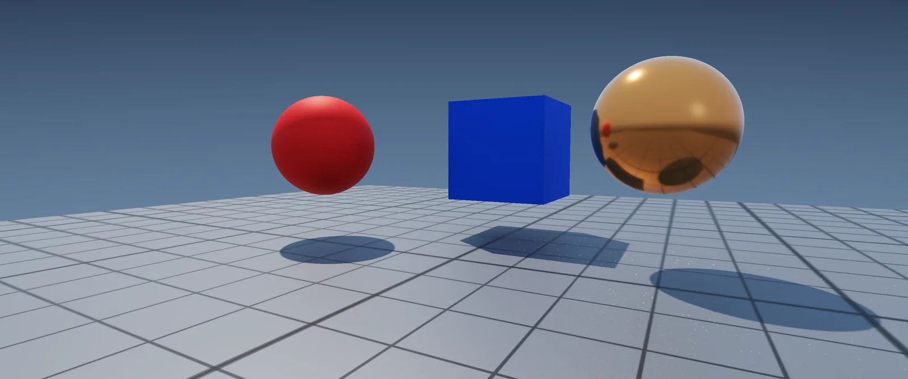
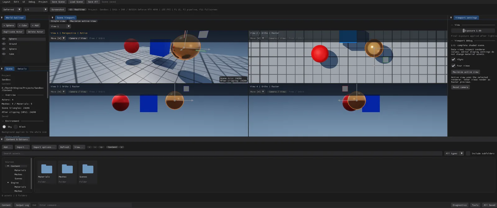
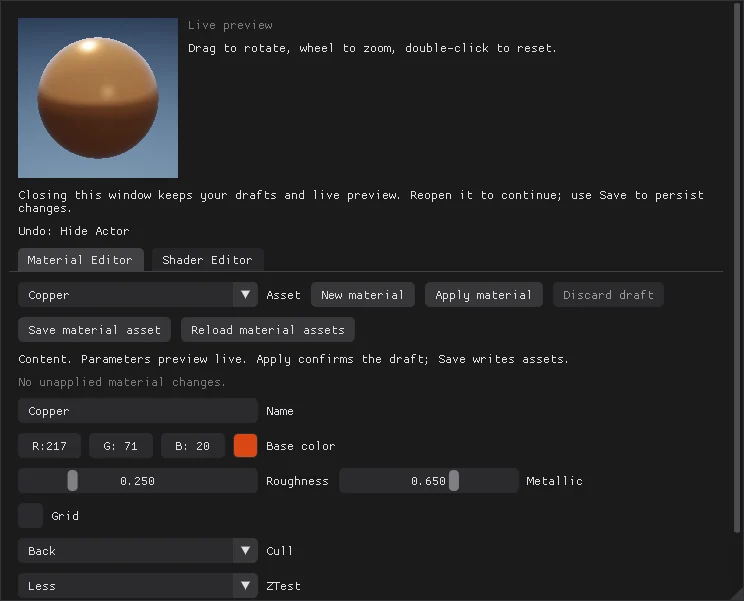
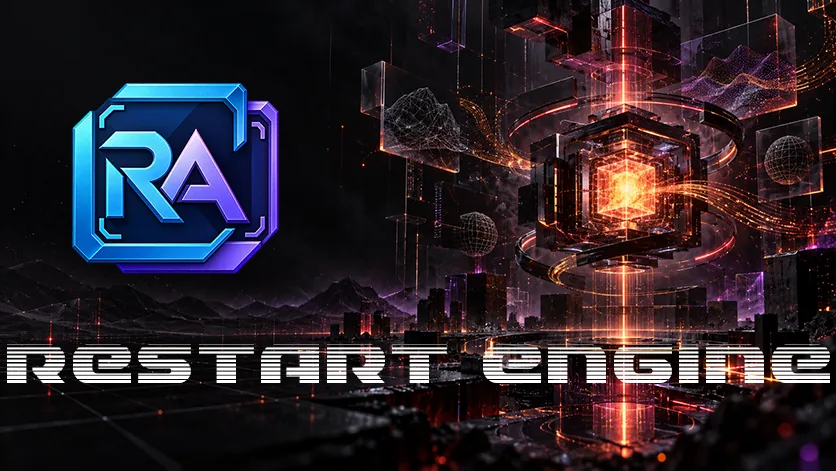

RestArtEngine 是我自己写的 Windows 场景引擎与编辑器：C++20 加 DirectX 11，编译出来只有一个 `RestArtEngine.exe`，却承担两份工作——不带参数启动时是 Project Manager，用 `--project` 启动时直接进场景编辑器。

写它不是为了再做一个通用引擎，而是想把技术美术日常要碰的东西放到同一套数据里：材质参数、Shader 草稿、光照、阴影方法、光追通道、诊断数据。其中一帧的 Pass 顺序和资源依赖由 `RenderPipeline` 统一声明，执行、诊断、测试读的是同一份声明。

## 一个可执行文件，两个身份

工程（`.raproject`）是纯数据：`Content/` 里放场景与材质，`Shaders/` 里放工程自己的 HLSL。它不含 C++ 代码，也不生成自己的 solution——编译引擎永远只打开仓库根目录的 `RestArtEngine.sln`。



这条边界是有意划的。工程搬家或换机器时，靠 `Engine.raeengine` 里的身份和本机注册表重新绑定，跨盘符不写绝对路径。工程本身不含 C++ 代码；引擎换版本要在 Project Manager 里显式确认兼容性。

编辑器的工作区是六个固定面板加一个独立的材质窗口，可以停靠、可以并标签、也可以拖出主窗口变成系统窗口。



## 三条光线路径，定位不同

三条光线路径常被当成画质档位，其实不是。它们用途不同、互不等价，选错也不会自动降级。

| 路径 | 后端 | 用途 |
| --- | --- | --- |
| 解析式 GPU 光追 | DX11 像素着色器 | 内置球 / 平面 / 立方体精确求交，其余网格走三角形缓冲，做一次弹射反射与解析阴影 |
| 硬件光追通道 | DX12 / DXR 1.1（同适配器） | 场景反射、所有投影灯阴影、路径追踪 GI 的求交底座 |
| 路径追踪 GI | 复用 DXR 通道的 compute | 渐进累积或实时间接光，供 Forward / Deferred 消费 |

解析光追跑在像素着色器里，只做一次弹射和解析阴影——它和 DXR 没有关系，名字像而已。内置球 / 平面 / 立方体走精确求交，上限 32 个图元；超出的网格改用 `StructuredBuffer<RayTriangle>` 逐个遍历。硬件光追用内联 `RayQuery` 遍历 TLAS；路径追踪 GI 复用这条通道做单向前向积分，矩形灯有 NEE 与 MIS，既能渐进累积整帧，也能只输出间接光给光栅用。

实时 GI 与硬件光追的开关对比：





路径追踪单独跑 Cornell Box 时是渐进累积：每帧 16 个样本、目标 65536 样本、12 次表面着色，矩形顶灯走面积采样加 BRDF MIS。



## 光栅：Forward 与 Deferred 共用一套参数

两条光栅路径共用同一套材质参数、光照与色调映射定义，所以切换路径通常只换常量，不动资产。但 Deferred 是从 G-buffer 反推表面，拿不到 UV 和像素导数——依赖这两者的材质换过去会明显不同。

前向 / 延迟一致性测试比的是固定场景的**平均像素差**，不是逐像素相等。差异集中在依赖 UV 和像素导数的材质上，这是两条路径的取法不同造成的。



阴影有九种接法，切换只改常量，不重建资源。光栅的五种共用一张 2048² × 2 切片深度数组；GTAO 和 Deferred Contact Shadow 只作用于延迟路径，Forward 下自动退回阴影贴图；解析光追完全不跑阴影 Pass。有个限制值得提前知道：光栅路径里只有第一盏开启投影的方向光能吃到阴影贴图，其余灯要么换解析光线，要么走硬件光追。

检查视图共 11 种，从 Lit / Unlit 一直排到 Albedo、法线、位置、Roughness、Metallic、Specular F0、线性深度和直接漫反射 / 直接高光分量。它们读的是 Shader 求值后的有效数据，包含尚未 Apply 的材质草稿，而不是 CPU 侧的资产字段。

## 相机与四分屏

相机的数据模型是 Pose + Lens，不依赖图形 API。自由视图支持右键或 Alt+左键环绕、中键平移、滚轮推拉、WASD 飞行和 F 聚焦。

四分屏不是把一张画面切四块。四格各自持有相机、镜头和曝光，激活格承载 DXR / GI 历史，其余格是光栅预览，可能慢一帧。



## 编辑器：材质草稿的三态

材质编辑器是一个独立系统窗口，160 px 球体实时预览。它把「预览 / 提交 / 落盘」拆成三步：

- 改参数 → 所有引用该材质的 Actor 实时预览，拖动中持续更新，磁盘不变；
- Apply → 提交为资产参数，画面保持一致，磁盘仍不变；
- Save → 才写 `Content/Materials/*.rasset`。

Shader 页编辑工程自己的 `Standard.hlsli`。Apply 时 2 个 VS + 7 个 PS 作为候选整体编译、反射校验、建 GPU 对象，全过才替换，失败保留上一版——不会出现一半新一半旧的管线。



撤销覆盖 Actor 增删复制、Gizmo、Details 数值、Mesh / 材质槽赋值、可见性、背景、相机和灯光参数，默认 64 步，历史不持久化。材质与 Shader 草稿、Actor 改名和打开视角不在撤销范围内；批量 Ctrl+D 目前每个 Actor 各记一条。

## 启动加载界面

打开工程或引擎启动期间，窗口显示 `assets/load/load.png`，完整图片铺满一个独立无边框窗口，加载完成后再切到按主屏 80% 居中的编辑器。

底部的文案、百分比与进度条全部按**图片的相对比例**定位：左右内边距是宽度 5.5%，文案与百分比在高度 87.2% 同一基线两端对齐，进度条在 92.1% 处、高 0.42%（最小 3px）。换一张加载图不用改一行代码。图片缺失或解码失败时回退纯色背景继续启动，不会卡住。



## 工程与分发

打包只需要四样东西：`RestArtEngine.exe`、引擎的 `Content/`、`Engine.raeengine`，以及 DXC 运行库（`dxcompiler.dll`、`dxil.dll`）。工程目录可以单独拷走。

规模基准是 `--render-scale-test`：一千万个非退化三角形、硬件光追和实时 GI 同时开、1920×1080，导出 JSON、BMP 和 CPU Trace。它分别记录首次准备、暖机、稳态同步帧时间，以及 DXGI 的 local / nonlocal 内存。同步帧时间包含 CPU 提交到 GPU 完成，不含 Present 和编辑器 UI——不要拿它当 GPU 执行时间。

实时 GI 是持续更新，不是「稳定 60 帧」。GI 在 DXR 通道下按视口吃 60 字节/像素，4K 约 475 MiB，加速结构和光栅目标还没算进去。渐进模式收敛多久取决于 GPU、分辨率和场景，能调的只有每帧样本、目标样本和反弹数。

## 验证方式

引擎里少数不允许「三处各写一遍」的东西之一，是一帧的 Pass 顺序和资源依赖：它由 `RenderPipeline` 声明，执行、诊断和测试读的是同一份数据。声明错了，校验器在帧开始时直接报错。

改动之后我按这套流程验：

```powershell
# CPU：渲染管线组合、资源边与特性三层判定
ctest --test-dir build/cmake-vs2022 -C Debug --output-on-failure

# GPU：编辑器全流程（真实鼠标/键盘注入）
.\build\cmake-vs2022\Debug\RestArtEngine.exe --editor-self-test --capture-dir artifacts\editor-validation
```

截图和文档与功能同一次提交更新。宁可写得少，也不要留下与代码不符的描述。

## 当前边界

这个引擎离「通用」还很远，下面这些是 README 里已经写明的硬限制：

- **双体系只做了一半**：PBR 着色基础在，NPR 体系以及两者的组合都还没实现；
- **目标格式**：场景颜色 RGBA8，没有 HDR 交换链、MSAA，也没有 Bloom / SSAO 这类通用后处理栈。GTAO 与 Contact Shadow 是延迟光照内部的着色项，景深是唯一的独立显示阶段 Pass；
- **几何与材质**：顶点只有位置和法线（24 字节）加最多四套 UV，还没有切线、顶点色和纹理采样；材质是参数式的，没有节点图或继承；也没有 MTL / DCC 材质图转换、骨骼动画与蒙皮导入；
- **资产类型只有 staticMesh 与 material**，容器写入不是原子的（导入走临时文件 + 排他发布，场景保存才是事务性的）；
- **场景模型**：只有 static mesh / light / camera 三类 Actor，没有父子层级、通用组件系统、标签 / 图层或 Prefab；
- **光照范围**：最多 32 盏可见直接灯，天光单独累加；矩形光是唯一可用的解析发光面，且光栅端是确定性的四点积分而不是 LTC，近距离能看出采样痕迹；没有发光材质、透明、折射或体积散射；光栅路径里只有第一盏投影方向光吃阴影贴图；解析光追只出一次弹射反射与解析阴影，不参与 GI；
- **硬件光追有门槛**：需要 DXR 1.1、SM 6.5、`dxcompiler.dll` / `dxil.dll` 和同适配器 DX12；不满足时保留光栅画面并报告原因。可见材质若用非 Less / LessEqual 的 `ZTest` 或 `ZWrite Off`，该帧硬件通道整体停用；
- **路径追踪 GI 只在 DXR 通道**，没有软件回退；预览与缩略图永远不显示 GI；没有降噪器、运动重投影或其他 GI 算法；
- **剔除**：视锥剔除有，遮挡剔除没有；DXR 场景不剔——屏幕外的物体仍可能贡献阴影、反射或间接光，几何或实例变换变化时会重建世界空间数据；
- **后端**：`RenderBackend` 里的 OpenGL / DX12 / Vulkan / Null 仍是生命周期骨架，没有 Render Graph、自动屏障或 RHI 资源抽象，管线按 DX11 即时上下文执行；
- **景深**：光栅端是屏幕空间 gather（最大 24 px 半径），恢复不了被前景挡住的背景；渐进路径追踪的遮挡正确，也会随样本收敛；
- **编辑器**：撤销不含材质 / Shader 草稿、Actor 改名和打开视角，历史不持久化；六个工作区面板可停靠浮动，但面板身份固定，没有动态插件面板、命名布局或逐显示器 DPI 适配；非活动四分屏可能滞后一帧，相机预览最长边 1024 px；场景缩略图只在保存场景时刷新；
- **平台**：目前只有 Windows 实际可用。

路线图按缺口排，不按愿望排。近期是 NPR 体系、资产侧的纹理与切线、局部光栅阴影、GI 的时间降噪与重投影；中期是完整的后端抽象（DX12 / Vulkan / OpenGL）。

---

引擎代码、文档与测试都在同一个仓库里：`README.md` 记录当前能做什么；每条路线图缺口在**对应文档的「边界」**一节里写明。
